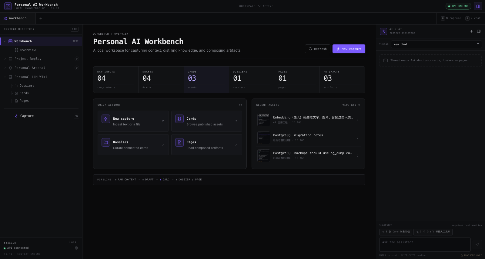
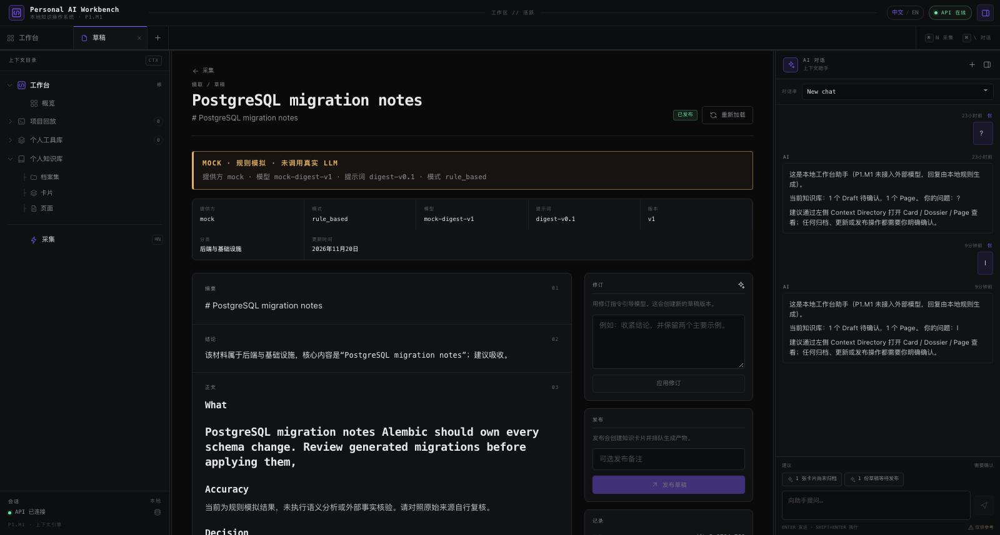
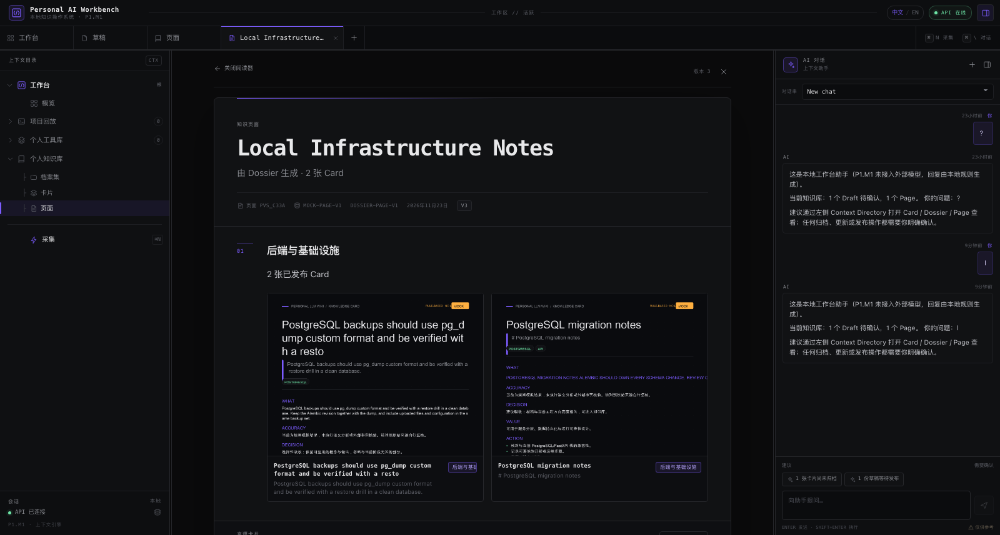
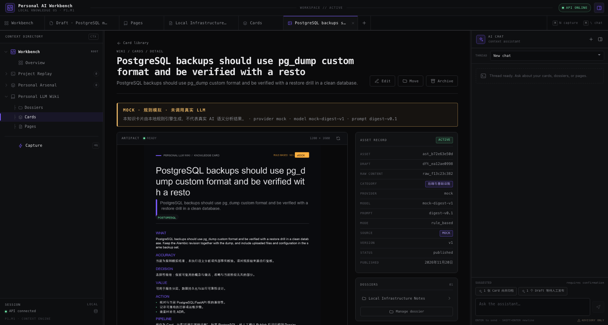

# Personal AI Workbench

Personal AI Workbench 是一个由多个独立产品组成的个人 AI 工作台，聚焦工程经验复现、可复用工程能力与技术知识资产。三个产品保持平级，拥有各自独立的业务边界。

## Product Preview

**Workbench overview** — 三栏 IDE 式工作台：Context Directory、Focused Artifact 与 AI Chat 面板，顶部保留工作标签。


**Capture → Draft → Publish** — Mock Digest 明确标注规则模拟；Draft 经人工审阅后显式 Publish。


**Dossier → Page** — 卡片组织为 Dossier，并生成带来源与版本的 Page Reader。


**Visual Artifact** — 已发布知识卡的视觉产物与来源信息；可查看 [完整 Artifact PNG](docs/assets/screenshots/visual-artifact.png)。


## 快速开始

```bash
# 1) 一次性环境准备（PostgreSQL 17 + Python 依赖 + Web 依赖）
brew install postgresql@17
cd services/api && python3.15 -m venv .venv && .venv/bin/pip install -e '.[dev]'

# 2) 启动全部服务
./scripts/workbench.sh start
#    Web: http://127.0.0.1:5173
#    API: http://127.0.0.1:8000/docs

# 3) 状态与停止
./scripts/workbench.sh status
./scripts/workbench.sh stop          # 停止 API/Web，保留 PostgreSQL
./scripts/workbench.sh stop --all
```

## 当前能力（P1.M1）

- **Capture**：文本、URL（仅保存不抓取）、UTF-8 文本文件上传；Raw Content 持久化。
- **Digest**：Mock Provider 生成六节 Card Draft（What / Accuracy / Decision / Value / Action / Pipeline）。
- **人工修订与发布**：只有用户显式 Publish 才生成正式 Card；旧版本保留。
- **知识资产**：分类、标签、Dossier 归档、Page 生成与版本化。
- **Visual Artifact**：跨业务共享服务，按知识内容渲染 PNG 知识卡片，带文件缓存、来源版本与校验。
- **Web Workbench**：三栏 IDE 式界面（Context Directory / Focused Artifact / AI Chat）、Artifact Tabs、Dossier Canvas、Card Masonry、Page Reader、沉浸式 Canvas。
- **AI Chat**：对话历史与上下文建议；当前回复由本地规则生成，不调用外部模型。
- **运维脚本**：统一启动/停止/状态；备份与恢复脚本。

## 技术基线

- PostgreSQL 17、SQLAlchemy 2.x、Alembic、psycopg 3
- FastAPI、Pydantic、Uvicorn
- React + TypeScript + Vite
- Pillow（Artifact 渲染）
- P1.M1 默认 Mock LLM Provider；真实外部调用默认关闭

## 目录结构

```text
apps/web/                 React + TypeScript 工作台
services/api/             FastAPI + PostgreSQL
  app/modules/            按业务职责划分（capture/knowledge/dossier/page/artifact/chat）
  migrations/             Alembic 迁移
  tests/                  pytest（真实 PostgreSQL 测试库）
docs/                     架构、治理与路线图
products/                 三产品定位
skills/                   知识分析 Skill 文档
scripts/                  workbench.sh / backup.sh / restore.sh
```

## 数据与备份

```bash
./scripts/backup.sh                       # 数据库 + 附件 + 配置副本 + 迁移版本
./scripts/restore.sh backups/<stamp>     # 恢复到 workbench_restore 并校验行数
```

## 文档

- [工程上下文](PROJECT_CONTEXT.md)
- [总体架构](docs/architecture/overview.md)
- [七模块职责](docs/architecture/module-responsibilities-and-dependencies.md)
- [Personal Knowledge 对象生命周期](docs/architecture/personal-knowledge-object-lifecycle.md)
- [Frozen Engineering Scope v1.0](docs/governance/frozen-engineering-scope-v1.0.md)
- [工程路线图](docs/roadmap/engineering-roadmap-v1.0.md)
- [P1.M1 实施准备](docs/roadmap/p1-m1-implementation-preparation.md)
- [本地启动与体验指南](docs/guides/local-workbench-preview-guide.md)
- [API README](services/api/README.md)

## 治理

Project Owner 拥有最终决策、授权与验收权；AI Agent 在明确授权范围内实施。
Commit / Push 需要单独授权。
