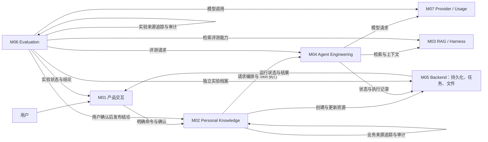

# 七大模块职责与依赖关系

本文件把 Project Owner 已确认的七模块职责落为协作边界。业务归属表示谁拥有语义与资产；运行时依赖表示能力调用关系，两者不等同。图示不是服务拆分承诺。

## 职责矩阵

| 模块 | 拥有的职责 / 资产 | 主要输入 | 主要输出 | 不负责 |
|---|---|---|---|---|
| **M01 Product Showcase** | Web 控制中心、Android、DingTalk、Workflow Monitor、Runtime Console、Human-in-the-loop 交互 | 用户操作、任务状态、业务结果 | 命令、确认、展示与通知 | 业务规则、Agent 编排、数据持久化 |
| **M02 Personal Knowledge** | Raw Content、Capture/Digest 语义、Card/Card Version、Card Library、Dossier、Page、Working Session、Spark、Change Set、Publish Record、Knowledge Administrator Agent | 用户来源与操作、RAG/Agent/Provider/Backend 能力 | Draft、已发布知识、Dossier/Page、修订与 Publish 记录 | 通用持久化设施、通用模型接入或执行框架 |
| **M03 RAG & Agent Harness** | 文档处理与 Chunking、Embedding、Vector DB、Retrieval、Top-K、Reranking、Context Engineering、Harness 基础支撑 | M02 的知识上下文、Agent 运行请求 | 检索结果、上下文、Harness 基础运行能力 | Card/Dossier/Page 等业务资产、完整业务工作流、Coding Agent |
| **M04 Agent Engineering** | Agent Loop/Workflow、Tool Calling、Human-in-the-loop 编排、Model Collaboration、Fallback 执行、公共 Skill 加载/版本解析/执行入口 | 业务任务、Skill、RAG、Provider、运行状态 | 编排步骤、工具执行结果、人工确认点 | 业务资产、RAG/Provider/Backend 基础能力 |
| **M05 Python Backend & Infrastructure** | FastAPI/Pydantic、API/Service 结构、通用持久化与数据访问、异步任务与状态、文件资源、配置、日志/异常/Observability、Backup/Restore | API 请求、服务间调用、任务与资源操作 | 通用运行、存储、任务、配置、观测与恢复能力 | 知识业务规则、Agent 行为、Evaluation 结论 |
| **M06 Evaluation & Quality Engineering** | Testset、Evaluation Run、实验配置与证据、Quality Score/Threshold、Failure Case、Human Review、Evaluation Conclusion、独立 Evaluation Cabinet/Dossier | Prompt、模型、RAG/Agent 被测能力及实验输入 | 可复现评测结果、质量结论；经用户确认可 Publish 为 M02 Card | 普通业务执行、普通知识 Dossier、模型路由决策 |
| **M07 LLM Provider Integration & Usage Tracking** | Provider Adapter、统一模型调用、Model Configuration、基础 Routing/Fallback 支持、Token/Cost/Latency 与调用记录 | M04/M06 的模型调用请求与配置 | 统一模型响应和使用记录 | Agent 流程决定、评测结论、复杂动态路由或完整 FinOps |

## 职责边界

- 业务模块拥有业务语义和业务资产；M02、M06 的资产分别归属个人知识和实验档案。
- M05 提供通用运行、持久化、文件、任务和备份能力；不代替业务模块决定数据含义。
- M04 编排工作流与执行；调用 M03 的检索/Harness、M07 的模型接口，不重复实现其基础能力。
- M03 提供检索和上下文能力；不拥有被检索的 Card、Dossier 或 Page。
- M07 管模型接入与调用记录；M04 决定 Agent 执行何时调用哪个模型，M06 评估效果。
- M01 提供用户交互与呈现；业务命令经明确 API/Service 契约进入业务模块。
- M06 的实验记录与普通知识资产隔离；有价值的结论须经用户确认后才进入 M02。
- M05 提供通用运行日志和 Observability；各业务模块自行保留来源追踪、业务 Audit Trail 和 Publish Record。
- Backup 覆盖业务数据、文件资源及必要 Skills、Prompts、配置、迁移信息和索引重建能力；最终需做真实 Restore Drill。

## 运行时依赖与协作

该运行图表达典型协作路径，不定义部署拓扑、微服务边界或唯一调用顺序。实际产品仍通过明确定义的接口协作。

## 依赖方向说明

| 调用方 | 依赖能力 | 约束 |
|---|---|---|
| M01 | M02 业务 API、M05 状态/通知支撑 | UI 不直接写业务数据或实现规则。 |
| M02 | M05 持久化与文件、M04 Skill/Workflow 执行、M03 检索上下文、M07 模型能力；按需关联 M01/M06 | M02 保持知识资产所有权；第一纵向切片可不等待高级 RAG。 |
| M03 | M05 资源/运行能力、M07 Embedding 或相关模型调用 | 不反向拥有业务数据；Embedding Provider 调用契约待设计。 |
| M04 | M03、M05、M07，以及 M02/M06 提供的业务 Skills | Skill 业务归属仍在业务模块；M04 只提供公共加载和执行入口。 |
| M05 | 各模块对通用服务的明确接口 | 不形成承载全部业务逻辑的总服务。 |
| M06 | M04 被测工作流、M03 RAG 能力、M07 模型调用、M05 实验档案 | 评测结论隔离，Publish 到 M02 需人工确认。 |
| M07 | 外部模型 Provider | 仅统一接入和追踪；不接管 M04 的执行决策。 |

## 观测性与可移植性

- 通用运行监控和日志由 M05 提供；业务来源、发布和实验审计由 M02/M06 分别保留。
- 可恢复工作状态的备份范围不仅是数据库，还包括原始附件、知识资产、必要配置、数据库迁移信息和索引重建能力。
- M0.2 仅确认这些边界与最终 Restore Drill 要求；不在此处选择数据库、ORM、队列、Vector DB 或部署架构。
