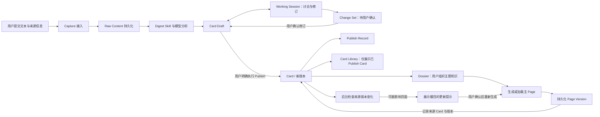
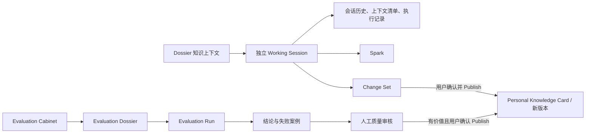

# Personal Knowledge 对象与生命周期

**状态说明：**M02 对象定义和 Page、Working Session 行为依据 Project Owner 在 M0.2 任务中确认的产品要求；这是对既有 M02 的产品定义细化，不新增模块，也不修改 Frozen Engineering Scope v1.0。本仓库尚无这些业务对象的实现。本文件描述业务关系和生命周期，不定义数据库表或复杂关系模型。

## 对象归属与持久性

| 对象 | 归属 | 类型与持久性 | 职责边界 |
|---|---|---|---|
| Raw Content | M02 Personal Knowledge | 持久化原始知识资产 | 保存标准化可读内容及来源信息；与生成的 Card 分开保存。 |
| Capture | M02，由 M04/M05 支撑 | 知识接入过程；具体记录粒度待定 | 接收输入并启动分析，不等同于 Raw Content 或正式 Card。 |
| Card Draft | M02 | 可修订的候选知识资产 | Digest 生成后供用户与 LLM 讨论、修正；未经用户明确 Publish 不进入正式知识库。 |
| Card / Card Version | M02 | 持久化知识资产及版本 | 保存正式知识及历史版本；Card Library 展示已 Publish 的 Card。 |
| Dossier | M02 | 用户定义的持久化主题集合 | 组织相关知识 Card，并作为 Page 生成的 Context Boundary。 |
| Page / Page Version | M02 | 持久化、版本化的完整图文混排知识百科页面，不只是 Markdown 或 Card 列表 | 基于 Dossier 中的知识 Card 生成；保留来源 Card 及版本、Renderer Skill/Prompt、模型和必要生成信息。1.0 一个 Dossier 对应一个主 Page。 |
| Working Session | M02 | 持久化的独立协作会话 | 与 Main Context 分离，保存会话历史、上下文清单、执行记录和必要 Sparks；不是 Agent Workflow。 |
| Spark | M02 | 知识演练或变更过程中的持久化候选记录 | 可记录 Working Session 中发现的想法；具体状态与生命周期待后续任务明确。 |
| Change Set | M02 | 持久化的变更提案 | 表达对 Card 或 Page 的修订建议，供用户审阅；不直接生效。 |
| Publish Record | M02 | 持久化业务记录 | 记录用户确认 Publish 的资产版本及必要来源关系；具体字段待定。 |
| Evaluation Cabinet | M06 Evaluation | 持久化实验档案入口 | 与普通 Personal Knowledge Dossier 分离。 |
| Evaluation Dossier | M06 Evaluation | 持久化实验场景档案 | 按实验场景组织 Evaluation 记录，不污染普通知识 Dossier。 |
| Evaluation Run | M06 Evaluation | 持久化实验执行与证据记录 | 保存实验配置、参数、执行证据、结果、指标和失败案例。 |

**待后续决策：**Capture 是否保留独立持久化记录、Spark 状态、Card/Dossier 关系约束、Page 组件表达和版本粒度、Publish Record 的字段都未在本任务中设计。

## Personal Knowledge 生命周期

Capture、Digest、讨论和修订均不能替代 Publish。修订形成新版本时，旧版本保留，不覆盖历史。Page 有更新提示时，必须等待用户确认才生成新版本；打开 Dossier 优先加载最近一次有效 Page。1.0 不提供独立可视化 Page 编辑器。

## Working Session 与 Evaluation 生命周期

Working Session 与 Main Context 分离，能够围绕 Dossier 知识复习、讨论、发现和提出修订，但它本身不等同于 Agent Workflow，也不直接 Publish。Evaluation 结论属于 M06 档案；仅经用户确认 Publish 后，才成为 M02 的 Personal Knowledge Card。

## 业务资产与执行过程

- **知识与业务资产：**Raw Content、Card 及其版本、Dossier、Page 及其版本、Publish Record；Spark、Change Set 是持久化候选/变更记录。
- **协作过程：**Working Session 及其历史、上下文清单、执行记录。过程数据应可恢复，但不因此成为已发布知识资产。
- **实验资产：**Evaluation Cabinet、Evaluation Dossier、Evaluation Run 与结果，独立归属 M06。
- **接入过程：**Capture 表示接入行为；是否单独持久化及保留期限尚未决定。

这里只定义业务归属和生命周期语义。具体持久化格式、数据表、外键、事务边界和任务状态模型留待对应技术决策与施工任务。
