# Personal AI Workbench — 本地启动与功能体验指南

> 适用范围：本机 macOS + 当前仓库工作区（P1.M1 第一阶段）。
> 全部命令与截图来自 **2026-11-20 实际运行**的项目，不是设计稿。
> 测试数据均为合成内容，不包含个人真实资料。

---

## 0. 一分钟结论

```bash
cd /Users/l719/Documents/projects/personal-ai-workbench
./scripts/workbench.sh start
# 浏览器打开 http://127.0.0.1:5173
```

- 统一脚本会启动 **PostgreSQL → 执行 Alembic 迁移 → FastAPI → Vite Web**。
- 从完全停止状态到可访问，本次实测约 **3 秒**（首次运行若需安装 Web 依赖、执行迁移会更久）。
- 停止：`./scripts/workbench.sh stop`（保留 PostgreSQL）或 `stop --all`（连 PostgreSQL 一起停）。

---

## 1. 首次启动前的环境准备

### 1.1 已在本机验证的版本

| 组件 | 本机版本 | 要求 |
|---|---|---|
| macOS | 当前开发机 | Homebrew 可用的 macOS |
| Python | **3.15.2** | `pyproject.toml` 要求 `>=3.15,<3.16` |
| PostgreSQL | **17.12（Homebrew）** | 17.x |
| Node.js | **v24.20.0** | 18+ 建议 |
| pnpm | **11.5.1** | 需要 pnpm |
| Homebrew | 已安装 | 用于安装 PostgreSQL |

### 1.2 安装 PostgreSQL

```bash
brew install postgresql@17
```

- Homebrew 会自动创建默认数据目录：`/opt/homebrew/var/postgresql@17`。
- **不需要手动执行 `initdb`**，也不需要手动 `createdb`：启动脚本会检查并创建 `workbench` 与 `workbench_test`，并执行迁移（见 `scripts/workbench.sh` 的 `ensure_db`）。
- 不需要手动启动 `brew services`；脚本会用 `pg_ctl` 启动本地实例。
- 如果机器上已有 Homebrew 的 PostgreSQL 服务在运行，脚本检测到端口可用后会直接复用。

### 1.3 安装 Python 依赖

```bash
cd services/api
python3.15 -m venv .venv
.venv/bin/pip install -e '.[dev]'
```

已安装的关键依赖：FastAPI、Pydantic、SQLAlchemy 2.1.9、Alembic 1.20.1、psycopg 3.3.9、Pillow 13、python-dotenv、python-multipart。

### 1.4 安装 Web 依赖

```bash
cd apps/web
pnpm install
```

如果 `apps/web/node_modules` 不存在，`workbench.sh start` 会自动执行 `pnpm install`。

### 1.5 `.env` 配置

- 模板：`services/api/.env.example`
- 本地文件：`services/api/.env`（已被 `.gitignore` 忽略，不会提交）
- **不配置也能启动**：默认值指向 `postgresql+psycopg://127.0.0.1:5432/workbench`，Provider 默认为 Mock。

常用变量：

| 变量 | 默认值 | 说明 |
|---|---|---|
| `DATABASE_URL` | `postgresql+psycopg://127.0.0.1:5432/workbench` | PostgreSQL 连接串 |
| `LLM_PROVIDER` | `mock` | 默认离线 Mock；`openai` 受保护且未启用 |
| `LLM_MODEL` | `mock-digest-v1` | 模型标识，不硬编码在业务代码 |
| `ALLOW_REAL_LLM` | `false` | 真实 Provider 双重开关之一 |
| `WORKBENCH_DATA_DIR` | `.data` | 上传文件与生成图片目录 |
| `MAX_UPLOAD_BYTES` | `2097152` | 上传上限 2 MB |
| `CORS_ORIGINS` | `http://127.0.0.1:5173,http://localhost:5173` | 浏览器跨域白名单 |

复制模板：

```bash
cp services/api/.env.example services/api/.env
```

---

## 2. 启动、状态、日志、停止

### 2.1 启动

```bash
cd /Users/l719/Documents/projects/personal-ai-workbench
./scripts/workbench.sh start
```

实际输出（2026-11-20）：

```text
postgres: already running        # 或 starting / ready
database: migrations up to date
api: starting on http://127.0.0.1:8000
api: ready
web: starting on http://127.0.0.1:5173
web: ready

Workbench is ready:
  Web: http://127.0.0.1:5173
  API: http://127.0.0.1:8000/docs
  Health: http://127.0.0.1:8000/health
```

### 2.2 浏览器访问地址

**http://127.0.0.1:5173**

- API 文档：http://127.0.0.1:8000/docs
- 健康检查：http://127.0.0.1:8000/health

### 2.3 查看状态

```bash
./scripts/workbench.sh status
```

输出示例：

```text
postgres : ready
api      : {"status":"ok","database":"ok"}
web      : ready (http://127.0.0.1:5173)
```

### 2.4 查看日志

```bash
./scripts/workbench.sh logs api
./scripts/workbench.sh logs web
./scripts/workbench.sh logs postgres    # 由脚本启动 PostgreSQL 时存在
```

日志文件位置：

| 服务 | 文件 |
|---|---|
| API | `.run/api.log` |
| Web | `.run/web.log` |
| PostgreSQL | `.run/postgres.log`（脚本启动时） |

### 2.5 停止

```bash
./scripts/workbench.sh stop        # 停止 API 与 Web，PostgreSQL 保留
./scripts/workbench.sh stop --all  # 三项全部停止
```

### 2.6 重新启动

```bash
./scripts/workbench.sh restart
# 或
./scripts/workbench.sh stop --all && ./scripts/workbench.sh start
```

### 2.7 端口被占用

当前服务端口固定为 **8000（API）** 与 **5173（Web）**。推荐先释放端口，而不是改端口：

```bash
lsof -nP -iTCP:8000 -sTCP:LISTEN
lsof -nP -iTCP:5173 -sTCP:LISTEN

# 确认是本项目旧进程后再结束：
lsof -ti:8000 | xargs kill
lsof -ti:5173 | xargs kill
```

说明：脚本虽然支持 `API_PORT` / `WEB_PORT` 环境变量，但 `apps/web/vite.config.ts` 的代理目标固定为 `http://127.0.0.1:8000` 且 dev 端口固定 5173，**改端口需要同时改前端配置**，因此不建议直接改。

---

## 3. 浏览器功能体验路线（按顺序）

> 每一步都注明：数据写入 / 文件生成 / Mock 或本地规则 / 是否需要人工确认。
> 建议从空数据库开始（见第 5 节重置方法）。

### 步骤 1：Workbench 首页与三栏布局

- **进入**：打开 http://127.0.0.1:5173
- **操作**：无需操作；观察左中右三栏与顶部标签栏。
- **预期**：左侧 Context Directory、中间总览/统计、右侧 AI Chat；顶部标签栏；可拖动列宽。
- **写入**：无。
- **规则**：统计来自 `GET /api/v1/knowledge/stats`（真实数据库）。
- **确认**：无。

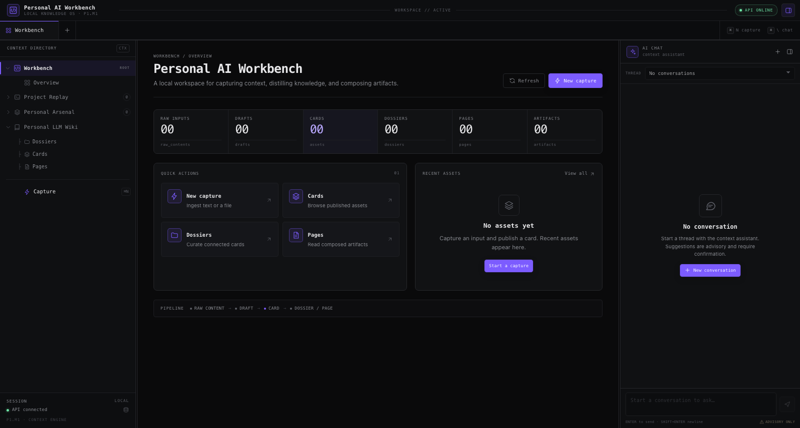

### 步骤 2：Context Directory 产品目录展开

- **进入**：左侧栏。
- **操作**：点击 `Project Replay`、`Personal Arsenal`、`Personal LLM Wiki` 前的箭头；展开 Wiki 下的 `Dossiers / Cards / Pages`。
- **预期**：Project Replay 与 Personal Arsenal 显示空占位（本期不做业务）；Personal LLM Wiki 可进入三个知识视图。
- **写入**：无。
- **规则**：本地前端状态。
- **确认**：无。

### 步骤 3：文本 Capture

- **进入**：左侧 `Capture`，或首页 `New capture`。
- **操作**：在 `RAW CONTENT` 文本框粘贴第 4 节的示例文本，点击右下角 `Capture`。
- **预期**：右侧出现 Capture Receipt（capture id、raw content id、status、source），提示 `Capture received successfully`。
- **写入**：**是**。写入 `captures` 与 `raw_contents`。
- **规则**：真实 API + PostgreSQL，无模型参与。
- **确认**：提交动作本身是人工。

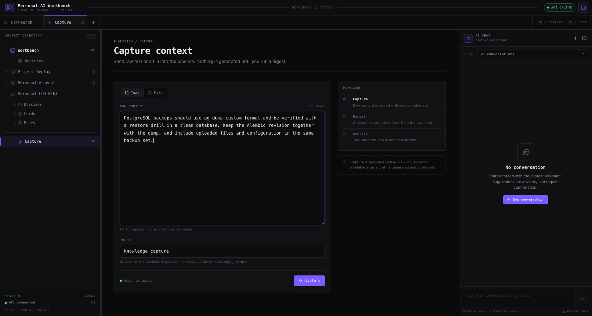
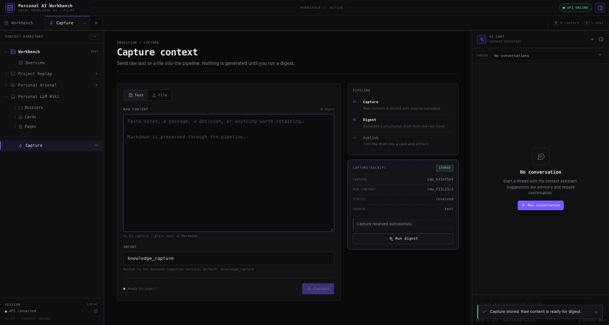

### 步骤 4：文件 Capture

- **进入**：`Capture` 页面，点击 `File` 标签。
- **操作**：选择第 4 节的 `.md` 文件，点击 `Capture`。
- **预期**：同上回执，`SOURCE` 显示 `file`。
- **写入**：**是**。原文件保存到 `services/api/.data/uploads/`，文本写入数据库。
- **规则**：真实 API；UTF-8 文本类文件（`.txt/.md/.markdown/.csv/.json/.log/.yaml/.yml`，≤2 MB）。
- **确认**：提交动作本身是人工。

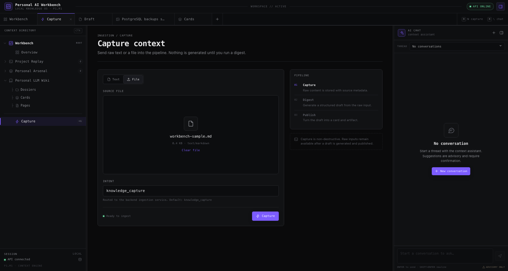

### 步骤 5：Digest 生成 Draft

- **进入**：Capture 回执面板。
- **操作**：点击 `Run digest`。
- **预期**：显示 `Draft generated`，可看到标题、分类、版本与 `Open draft`。
- **写入**：**是**。写入 `drafts`，Raw Content 状态变为 `digested`。
- **规则**：**Mock Provider**（`mock-digest-v1`），生成六节：What / Accuracy / Decision / Value / Action / Pipeline。**不调用真实外部 LLM**。
- **确认**：Digest 由用户点击触发；结果仍是草稿。

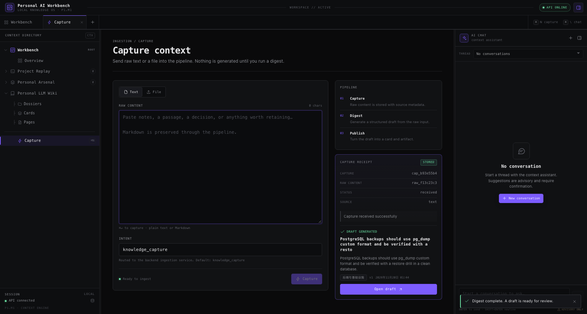

### 步骤 6：Draft 查看与修订

- **进入**：点击 `Open draft`。
- **操作**：查看六节正文；在 `REVISION` 输入框填写修改要求（如“请更简洁，并补充适用边界”），点击 `Apply revision`。
- **预期**：版本号 +1，正文出现 `## Revision` 段，状态仍为 `DRAFT`。
- **写入**：**是**。新增 `draft_revisions` 记录。
- **规则**：Mock Provider 的规则化修订。
- **确认**：修订不等于发布。

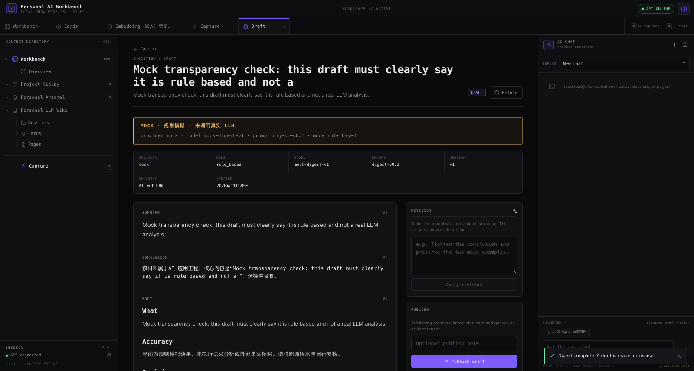

### 步骤 7：人工 Publish

- **进入**：Draft 视图右侧 `PUBLISH` 面板。
- **操作**：可选填写备注，点击 `Publish draft`。
- **预期**：出现 `PUBLISHED AS CARD`、`Open card`；Artifact 后台生成。
- **写入**：**是**。写入 `knowledge_assets`、`asset_versions`、`publish_records`、`artifacts`。
- **规则**：真实后端；Publish 只能由显式按钮/接口触发，无自动发布路径。
- **确认**：**必须人工确认**。

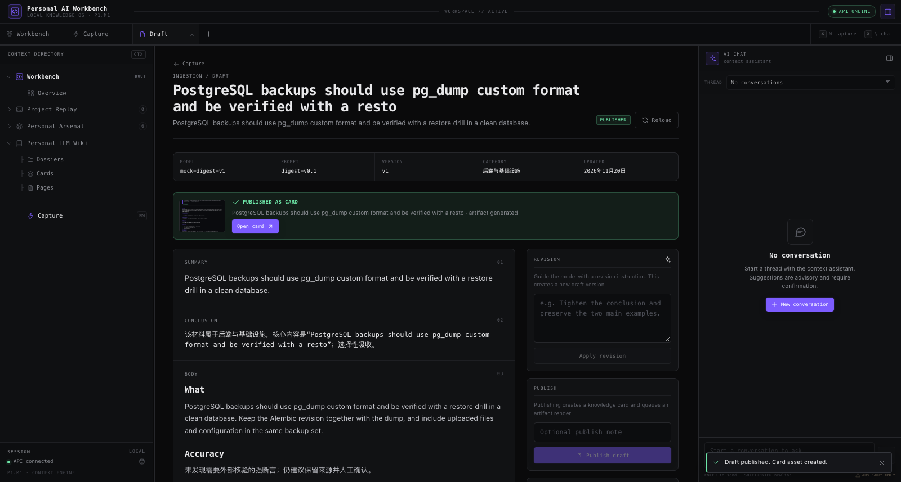

### 步骤 8：Card Wall 浏览

- **进入**：左侧 `Cards`，或首页 `Cards`。
- **操作**：查看 `ALL / UNARCHIVED / ARCHIVED` 过滤与瀑布流。
- **预期**：卡片按发布时间倒序；显示 Artifact 图、标题、分类、模型、标签。
- **写入**：无。
- **规则**：真实数据。
- **确认**：无。

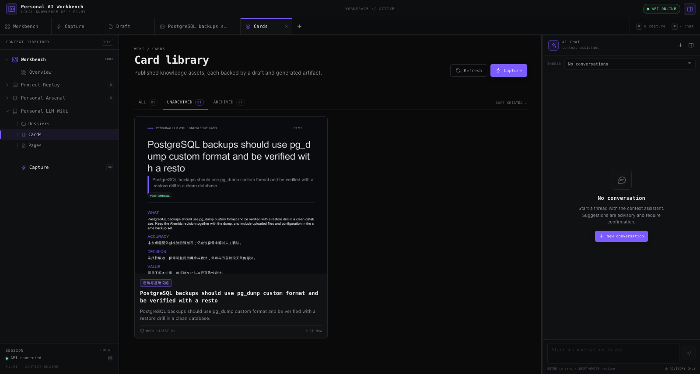

### 步骤 9：Card 详情

- **进入**：点击任意卡片。
- **操作**：查看顶部 Artifact 图、下方结构化正文、右侧资产记录与 Dossier 关联；可 `Edit metadata`、`Manage dossier`、`Archive`。
- **预期**：显示来源 Raw Content、Draft、模型、版本、发布时间；Artifact 状态 `READY`。
- **写入**：仅在你点击编辑/归档时写入。
- **规则**：真实数据；Artifact 是展示层，不是知识权威数据。
- **确认**：编辑/归档需人工点击。

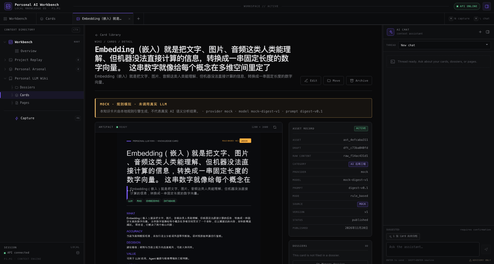

### 步骤 10：Dossier 创建与归档

- **进入**：左侧 `Dossiers` → `New dossier`。
- **操作**：填写名称（如 `Local Infrastructure Notes`）与描述，`Create dossier`；随后点击 `Add cards`，勾选已有 Card，`Add N cards`。
- **预期**：Dossier 内出现 Card 节点；数据库写入关联。
- **写入**：**是**。写入 `dossiers`、`dossier_assets`。
- **规则**：真实 API。
- **确认**：添加/移除均为人工操作。

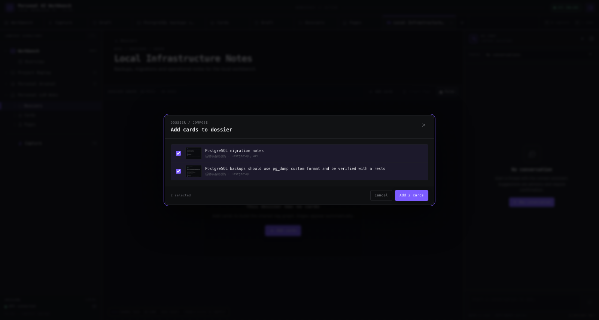

### 步骤 11：Dossier Canvas 与关系箭头

- **进入**：Dossier 详情。
- **操作**：观察点阵画布；拖动节点；查看虚线箭头；底部图例 `SHARED TAGS`。
- **预期**：节点可拖动；共享标签自动形成边（示例两张 PostgreSQL 卡片由标签建立 1 条边）。
- **写入**：拖动仅在前端，不写库；加/移 Card 才写库。
- **规则**：**本地规则**——后端按 Card 的 `tags` 交集生成 edges。
- **确认**：关系自动计算，无需确认；归档动作需人工。

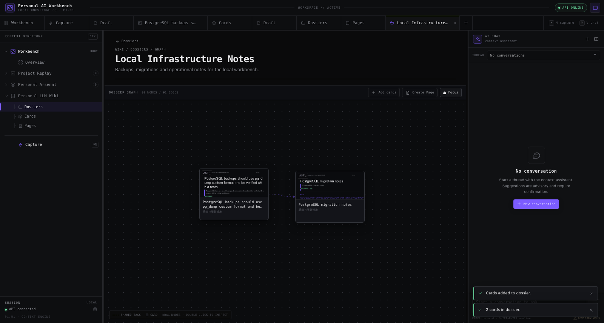

### 步骤 12：Focused Artifact 进入与退出

- **进入**：Dossier 详情工具栏 `Focus`（⏏ 风格）。
- **操作**：点击 `Focus`，进入全工作区画布；点击右上 `Exit focus` 返回。
- **预期**：左右栏隐藏、画布占满；退出后恢复原三栏与标签状态。
- **写入**：无。
- **规则**：前端工作模式切换，不是新页面层级。
- **确认**：无。

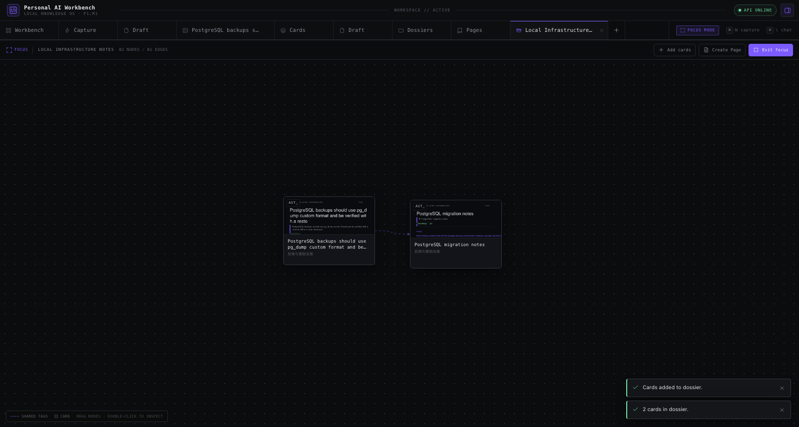

### 步骤 13：Page 创建、Grid 与 Reader

- **进入**：Dossier 详情 → `Create Page`。
- **预期**：后端创建版本化 Page；页面内容由 Dossier 当前 Card 组成。
- **写入**：**是**。写入 `pages` 与 `page_versions`。
- **规则**：**本地规则**组装（`mock-page-v1`），不调用 LLM。
- **确认**：由用户点击创建。
- **注意（当前缺陷）**：创建成功后前端会尝试打开一个标签页，但可能显示 `Page reference missing`。这是前端读取了错误字段导致的已知问题；**Page 已经真实创建**。关闭该标签，进入 `Pages`，点击 Page 卡片即可正常阅读。
- **Page Grid**：左侧 `Pages`，显示封面与版本。
- **Page Reader**：点击 Page 卡片；纵向图文混排；`Close reader` 返回 Grid。
- **自动更新**：**不会**。Dossier 后续增删 Card 不会自动改 Page；需要再次 `Create Page`（后端会生成新版本）或调用 `POST /api/v1/knowledge/pages/{id}/regenerate`。

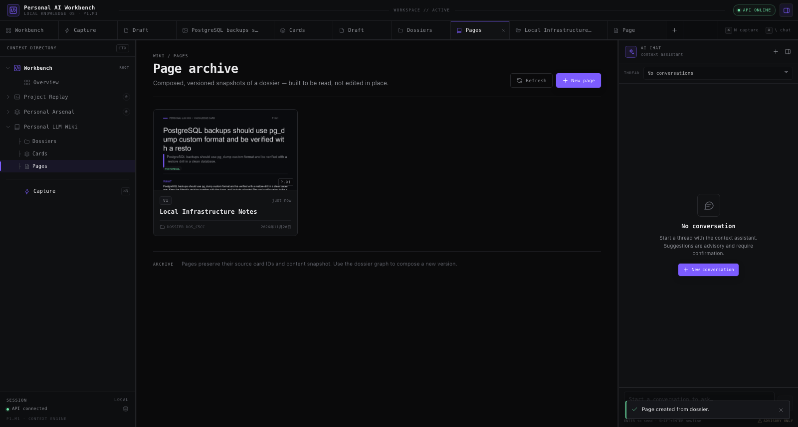
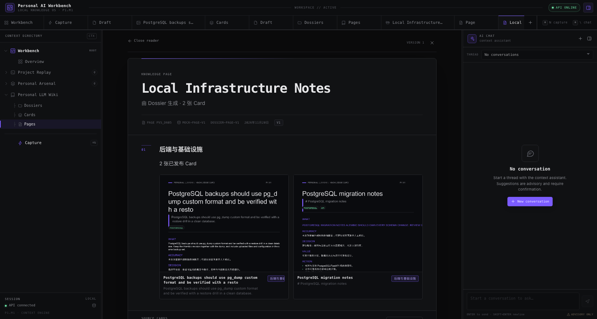

### 步骤 14：AI Chat 与上下文建议

- **进入**：右侧 AI Chat。
- **操作**：点击 `New conversation`，输入问题并发送；查看 `SUGGESTED` 建议。
- **预期**：返回本地规则生成的回复；建议条目标注 `requires confirmation`。
- **写入**：**是**。写入 `conversations`、`chat_messages`。
- **规则**：**本地规则**，不调用任何模型；建议只做导航提示，不自动执行归档/更新/发布。
- **确认**：建议必须用户点击并再次确认后才会打开相关视图。

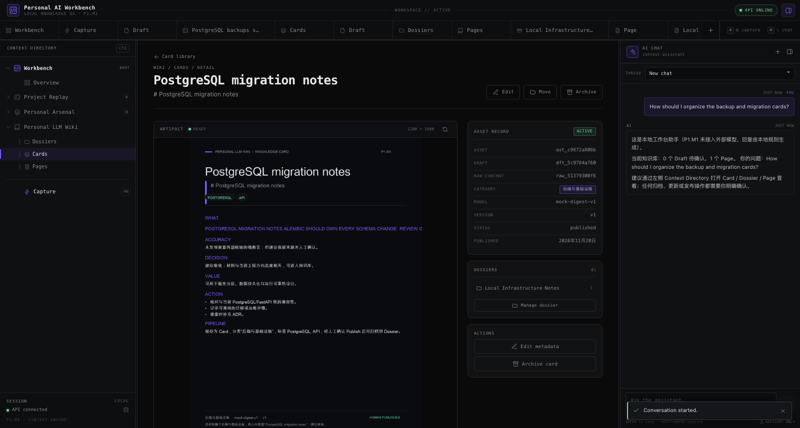

### 步骤 15：Artifact 图片查看与重新生成

- **进入**：Card 详情 → 顶部 Artifact 区域。
- **操作**：查看 PNG；点击右上重新生成图标（`Regenerate artifact`）。
- **预期**：Artifact 状态从 `READY` 保持 `READY`，文件重新渲染；如失败会显示 `FAILED`，但 Card 仍存在。
- **写入**：**是**。更新 `artifacts` 记录与 `.data/artifacts/*.png`。
- **规则**：Pillow 本地渲染，无外部图片服务。
- **确认**：重新生成为人工点击；Publish 时自动生成一次。

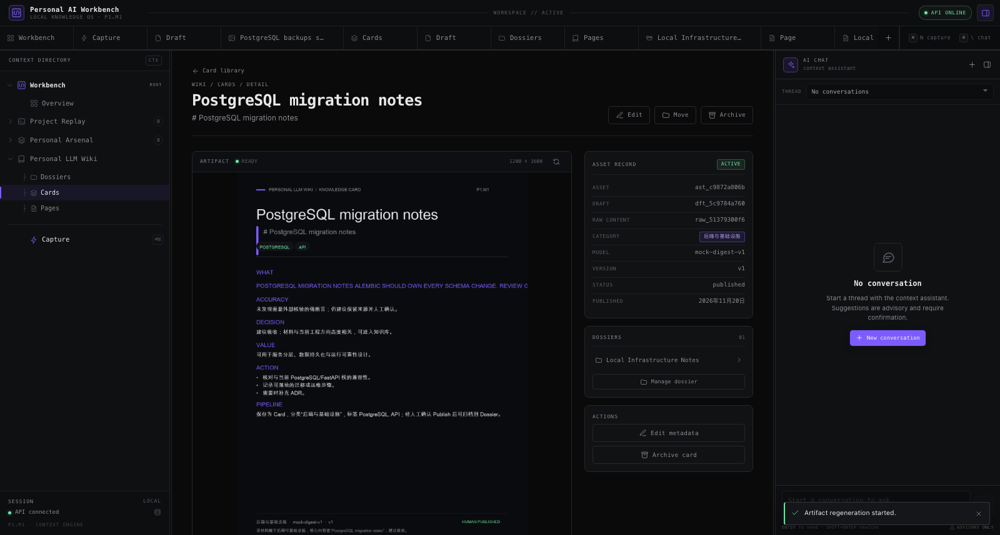

---

## 4. 测试数据

以下内容均为合成示例，不含个人真实资料。

### 4.1 文本 Capture 示例

```text
PostgreSQL backups should use pg_dump custom format and be verified with a restore drill in a clean database. Keep the Alembic revision together with the dump, and include uploaded files and configuration in the same backup set.
```

### 4.2 文件 Capture 示例

保存为 `/tmp/workbench-sample.md`：

```markdown
# PostgreSQL migration notes

Alembic should own every schema change. Review generated migrations before applying them,
and keep the revision id alongside database backups so a restore can be verified.

For local development, run `alembic upgrade head` before starting the API. If a restore
drill uses a different database, apply migrations to that database and compare row counts
with the source before declaring success.
```

### 4.3 同一 Dossier 的关联内容

建议再用文本 Capture 提交：

1. `RAG retrieval evaluation needs a small testset, recall@k and failure cases.`
2. `Agent workflows that change knowledge require explicit human confirmation before publish.`

然后创建 Dossier `AI Engineering Notes`，把上述卡片与第 4.1/4.2 的卡片加入。共享标签（如 `PostgreSQL`、`RAG`）会生成 Canvas 边。

### 4.4 清理 / 重置测试数据

保留 PostgreSQL、清空业务数据与生成文件：

```bash
./scripts/workbench.sh stop
dropdb -h 127.0.0.1 --if-exists workbench
rm -rf services/api/.data
./scripts/workbench.sh start     # 自动重建数据库并执行迁移
```

彻底停止：

```bash
./scripts/workbench.sh stop --all
```

> 注意：重置会删除全部 Raw Content、Card、Dossier、Page 与 Artifact，不可恢复；如需保留请先执行 `./scripts/backup.sh`。

---

## 5. 当前功能边界

### 5.1 可以真实操作

- 文本 / URL / UTF-8 文本文件 Capture，持久化到 PostgreSQL。
- 去重（相同内容返回已有 Raw Content，`duplicate=true`）。
- Mock Digest、人工修订、人工 Publish。
- Card 分类、标签、归档、Dossier 归档。
- Dossier 关系图、Page 生成与版本。
- Artifact 渲染、文件缓存、重新生成、校验。
- Web 三栏、标签、Focus、Page Reader、Chat 历史。

### 5.2 使用 Mock 的功能

- **Digest**：确定性 Mock Provider，生成六节内容；不调用真实 LLM。
- Draft 与 Card 页面顶部显示 `MOCK · 规则模拟 · 未调用真实 LLM` 横幅，并列出 provider / model / prompt / mode；Card 页面另有"本知识卡片由本地规则引擎生成"说明。
- Artifact 图片右上角带 `MOCK` 徽标，页脚标注 `MOCK · RULE_BASED`；历史来源未知的记录显示 `UNKNOWN / LEGACY`，不会伪装成真实 Provider。
- 真实 Provider 适配层存在但被双重开关保护且未启用；首次真实调用需 Owner 授权。

### 5.3 使用本地规则的功能

- **AI Chat 回复**：规则模板，不调用模型。
- **Dossier 关系边**：按 Card 的 `tags` 共享关系生成。
- **Page 内容组装**：按 Dossier 的 Card 分类分组，`mock-page-v1`。

### 5.4 尚未实现 / 不应期待

- URL 自动抓取：**不会**。URL 只保存原值，状态 `needs_fetch`，Digest 分析的是 URL 字符串。
- PDF / Word / 图片 / 视频：**不支持**；上传会返回 415（当前仅文本类文件）。
- 真实外部 LLM：**未启用**。
- RAG / Embedding / pgvector / Vector DB：**未实现**。
- Android / 钉钉：**未实现**。
- 自动 Publish：**不存在**；必须人工确认。
- Page 自动跟随 Dossier 更新：**不会**。
- 多模型选择 / 推荐 / 路由：**未实现**；接口不绑定具体模型。
- 用户登录 / RBAC：**无**，本地单用户。

---

## 6. 异常排查

### 6.1 PostgreSQL 启动失败

```bash
cat .run/postgres.log
pg_isready -h 127.0.0.1 -p 5432
ls -la /opt/homebrew/var/postgresql@17
```

- 若 5432 被占用：`lsof -nP -iTCP:5432 -sTCP:LISTEN`，确认后结束占用进程。
- 若数据目录损坏：不要删除，先备份；检查磁盘空间与目录权限。
- 可手动启动：`/opt/homebrew/opt/postgresql@17/bin/pg_ctl -D /opt/homebrew/var/postgresql@17 start`。

### 6.2 API 启动失败

```bash
./scripts/workbench.sh logs api
ls services/api/.venv/bin/uvicorn
curl -s http://127.0.0.1:8000/health
```

- `ModuleNotFoundError`：重新执行 `.venv/bin/pip install -e '.[dev]'`。
- 端口占用：`lsof -ti:8000 | xargs kill`。
- 数据库连接失败会出现在启动日志中。

### 6.3 Web 启动失败

```bash
./scripts/workbench.sh logs web
cd apps/web && pnpm install && pnpm build
```

- `EADDRINUSE`：结束占用 5173 的旧进程。
- Vite 代理报错：确认 API 在 8000 运行。

### 6.4 数据库连接失败

```bash
psql -h 127.0.0.1 -d workbench -c "select 1"
grep DATABASE_URL services/api/.env
```

- 检查 `.env` 用户名/端口；本机 Homebrew 默认使用当前系统用户与 trust 认证。
- 健康检查返回 `{"status":"ok","database":"error"}` 时，先确认 PostgreSQL 与库是否存在。

### 6.5 Alembic 迁移失败

```bash
cd services/api
.venv/bin/alembic current
.venv/bin/alembic upgrade head
```

- 若提示库不存在：先 `createdb -h 127.0.0.1 workbench`。
- 不要手工改表；复查 `migrations/versions/`。

### 6.6 端口冲突

```bash
lsof -nP -iTCP:8000 -sTCP:LISTEN
lsof -nP -iTCP:5173 -sTCP:LISTEN
lsof -ti:8000 | xargs kill
lsof -ti:5173 | xargs kill
```

### 6.7 文件上传失败

- 415：扩展名不在支持列表（`txt/md/markdown/csv/json/log/yaml/yml`）。
- 415 且提示“文件超过大小限制”：超过 2 MB（`MAX_UPLOAD_BYTES`）；当前后端统一以 415 返回不支持/超限文件。
- 编码错误：文件必须是 UTF-8 文本。

### 6.8 图片生成失败

- Card 详情 Artifact 显示 `FAILED` 或没有图；Card 本身仍有效。
- 检查 `services/api/.data/artifacts/` 与 API 日志；点击重新生成。
- 校验接口：`curl http://127.0.0.1:8000/api/v1/artifacts/<id>/validate`。

### 6.9 页面空白或 API 请求失败

- 顶部是否显示 `API OFFLINE`；点击 Retry。
- 打开浏览器控制台看 `/api` 请求；确认 `curl http://127.0.0.1:8000/health`。
- 硬刷新（Cmd+Shift+R）清掉旧的前端状态；标签状态存于 localStorage。
- 若 `Create Page` 后出现 `Page reference missing`，见步骤 13 的已知缺陷说明。

---

## 7. 已知问题（当前版本）

1. **Create Page 后的自动跳转缺陷**：前端使用 `page.id`（实际应为 `page.page.id`），导致新标签显示 `Page reference missing`；Page 已创建，从 `Pages` 进入即可。
2. **长标题截断**：Capture 标题取首行前 80 字符，无省略号，示例中显示为 `...resto`。
3. **知识卡缩略图信息密度高**：Dossier/Page 中直接展示 1200×1600 海报缩小图，文字较密；不影响功能。
4. **Web 仅以 Vite dev server 运行**：启动脚本使用 `pnpm dev`，未提供生产静态托管流程。
5. **端口固定**：改 `API_PORT`/`WEB_PORT` 需同时改前端代理与端口配置。
6. **无 CI**：测试需本地 PostgreSQL。

---

## 8. 本次验证记录

### 8.1 从完全停止状态启动

```text
STOPPED 2026-11-20 01:43:46
port checks: 5432=0, 8000=0, 5173=0

./scripts/workbench.sh start
database: migrations up to date
api: ready
web: ready
Workbench is ready:
  Web: http://127.0.0.1:5173
  API: http://127.0.0.1:8000/docs
  Health: http://127.0.0.1:8000/health
STARTED 2026-11-20 01:43:49

./scripts/workbench.sh status
postgres : ready
api      : {"status":"ok","database":"ok"}
web      : ready (http://127.0.0.1:5173)

curl -o /dev/null -w "%{http_code}" http://127.0.0.1:5173  -> 200
curl http://127.0.0.1:8000/health -> {"status":"ok","database":"ok"}
```

### 8.2 完整操作记录（本轮实际执行）

| 步骤 | 实际结果 |
|---|---|
| 文本 Capture | `cap_…` / `raw_…` 持久化，`stored` |
| Digest | Draft 生成，`mock-digest-v1`，v1 |
| Publish | Asset `ast_b72e…`，Artifact `ready` |
| Card Library | 显示 1 张卡；Artifact PNG 可加载 |
| 文件 Capture | `raw_5137…`，`source=file`，附件落盘 |
| 文件卡 Publish | Asset `ast_c9872…`，Artifact `ready` |
| Dossier | `Local Infrastructure Notes`，2 cards，1 edge |
| Focus | 进入/退出正常 |
| Page | 创建成功，`pag_9df7…` v1；从 Pages 打开 Reader 正常 |
| Chat | 新建会话并收到本地规则回复 |
| Artifact regenerate | 重新渲染成功，状态 `ready` |

### 8.3 自动化验证

```text
services/api: pytest -q  -> 21 passed
apps/web:     pnpm build -> ✓ built
```

### 8.4 截图索引（`docs/guides/assets/`）

| 文件 | 内容 |
|---|---|
| `01-home-empty.png` | 空库首页与三栏布局 |
| `02-capture-form.png` | 文本 Capture 表单 |
| `03-capture-receipt.png` | Capture 回执 |
| `04-digest-result.png` | Digest 生成 Draft |
| `05-draft-view.png` | Draft 详情 |
| `06-published.png` | Publish 成功 |
| `07-card-detail.png` | 首张 Card 详情 |
| `08-card-library.png` | Card Library（1 张） |
| `09-file-capture.png` | 文件 Capture |
| `10-file-published.png` | 文件卡发布 |
| `11-dossier-created.png` | 新建 Dossier |
| `12-add-cards.png` | 添加 Card 弹窗 |
| `13-dossier-canvas.png` | Dossier Canvas |
| `14-focus-mode.png` | Focus 模式 |
| `15-page-reader.png` | Page Reader |
| `16-pages-grid.png` | Page Grid |
| `17-card-library.png` | Card Library（2 张） |
| `18-card-detail.png` | Card 详情与 Artifact |
| `19-artifact-regenerated.png` | Artifact 重新生成 |
| `20-chat.png` | AI Chat 与会话 |

---

## 9. 建议的体验顺序总结

```text
首页 → Capture(文本) → Run digest → Open draft → Apply revision → Publish
     → Open card → Cards
     → Capture(File) → Digest → Publish
     → Dossiers → New dossier → Add cards → Canvas → Focus
     → Create Page → Pages → Page Reader
     → AI Chat
     → Card 详情 → Regenerate artifact
```
