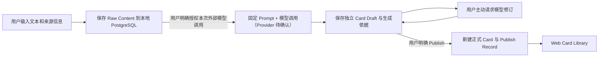

# P1.M1 实施准备：Knowledge Ingestion & Card Generation v0.1

**状态：PROPOSED（v0.3）— 待 Owner 决策与 GPT 技术审查；未获施工授权。**

**修订说明（2026-11-19，v0.3）：** Owner 决定采用 PostgreSQL 作为基础关系数据库，本文件据此替换 SQLite 方案，并补充本地部署、连接、迁移、备份恢复与 pgvector 演进路径；业务表不在本轮建立。v0.2 的其余收敛（移除单一固定模型假设、Provider 授权改为待核实）继续有效。本文件不修改 Frozen Engineering Scope、Human-Owned Engineering 或 Roadmap，不开始编码。技术事实以当前仓库为准；实现建议由实施 Agent 提出，尚未获得 Owner 批准（PostgreSQL 方向除外）。

## 0. Owner 阅读摘要

**准备做什么：** 让 Personal Knowledge 的第一步跑通——用户从网页提交一段文字，系统把原文存进本地 PostgreSQL，调用一次大模型生成"知识卡片草稿"，用户可和模型讨论修改，只有用户明确点击"发布"后才成为正式卡片并进入卡片库。本轮先建立数据库基础设施（本地服务、连接配置、迁移、备份），业务表随业务阶段逐步增加。

**为什么这么做：** 基础设施一次建立、业务能力按阶段叠加，避免后期返工；先打通"原文保存 → 生成草稿 → 人工确认 → 正式发布"的最小真实链路，验证数据分层与人工把关。原始文本与生成结果分开保存，保证可追溯。

**主要风险：**
1. 数据需发送到外部模型服务，涉及隐私、费用与第三方条款；目前**没有可核实的 Owner 授权记录**。
2. 本地 PostgreSQL 服务增加安装与运维依赖；当前开发机没有 Docker，也没有 psql/postgres，需要先安装。
3. Python 3.15 与 SQLAlchemy 2.x、PostgreSQL 驱动的兼容性尚未验证。
4. 现有 Capture 接口将从"只确认不保存"改为"真正保存"，并收窄为只收文本，需同步调整已有测试。
5. 备份与恢复方案需要实际演练，不能只写在文档里。
6. 多模型选择与路由后置，但调用接口不绑定具体模型。

**需要 Owner 决定（2 项）：** ①是否允许调用外部模型服务（当前建议 OpenAI）及相应数据处理与费用条款；②是否批准 P1.M1 任务范围（含接口收窄与测试调整）。

**不需要 Owner 决定：** PostgreSQL 方向已定；具体版本、部署方式（Homebrew 或容器）、表结构、字段命名、Repository 划分、Prompt 文案、前端组件拆分、测试文件组织，由实施方在获批范围内处理。

## 1. 当前技术基线

- **API：CONFIRMED** — `services/api/` 使用 FastAPI、Pydantic、Uvicorn；当前 Capture 路由 `POST /api/v1/ingestion/captures` 只校验并返回临时 ID，不持久化或调用模型。
- **持久化：CONFIRMED** — 没有数据库连接、ORM、迁移或数据访问实现。**数据库基线已由 Owner 于 2026-11-19 定为 PostgreSQL**（替代 SQLite 方向），但尚未接入；`PROJECT_CONTEXT.md` 已同步更新。
- **Provider：CONFIRMED** — 没有模型 SDK、Provider Adapter、模型配置读取或凭证读取实现。
- **环境配置：CONFIRMED** — `.gitignore` 已忽略 `.env` 并保留 `.env.example`；模板目前只有说明，应用没有读取环境变量的配置层。
- **Web：CONFIRMED** — `apps/web/` 为空，没有 `package.json`、构建配置或客户端代码。
- **Digest 材料：CONFIRMED** — `skills/knowledge-analysis/SKILL.md` 是 ContentParser 知识分析规范，不是可执行 Skill，也没有 Skill Runtime。它规定六项输出契约：What、Accuracy、Decision、Value、Action、Pipeline。

## 2. 技术安排（数据库方向已定，其余待批准）

### 2.1 数据库基线：PostgreSQL（Owner 已决定，实施待授权）

- **已决定（Owner，2026-11-19）：** 采用 PostgreSQL 作为基础关系数据库，不再以 SQLite 作为当前默认方案。这是基础设施方向调整，不属于临时试验。
- **已决定（方向）：** Python 数据访问采用 SQLAlchemy 2.x，迁移采用 Alembic；具体版本与 Python 3.15 兼容性由实施方核实后记录，不在本文写死版本号。
- **最小实现范围（本方案，不含业务表）：**
  1. **本地服务：** 当前开发机未安装 Docker、psql 或 postgres（2026-11-19 核对），仅有 Homebrew。最小路径是用 `brew` 安装 PostgreSQL 并由 `brew services` 托管，监听 `127.0.0.1:5432`；若后续引入 Docker/Colima，可切换为 Compose，连接契约不变。部署方式属实施方选择，须在任务报告记录。
  2. **连接配置：** 只从环境变量读取 `DATABASE_URL`（示例 `postgresql+psycopg://workbench@127.0.0.1:5432/workbench`）；`.env` 已被忽略，`.env.example` 提供占位；口令与密钥不进入仓库。
  3. **必要依赖（待安装，版本由实施方核实）：** `sqlalchemy`（2.x）、`alembic`、PostgreSQL 驱动（`psycopg` 3.x 或 `psycopg2-binary` 均可，按 Python 3.15 兼容性择一）。
  4. **数据访问：** SQLAlchemy 2.x 的 Engine/Session 基础与数据库健康检查；本轮不建立任何业务表。
  5. **迁移：** Alembic 初始化，`alembic upgrade head` 可在空库执行；首个 revision 只建立版本基线（Alembic 自身版本表）。
  6. **备份/恢复：** `pg_dump -Fc` 导出数据库 + 附件目录 + 必要配置副本 + 当前 Alembic 版本；恢复流程为建空库 → `pg_restore` → 回填附件 → `alembic upgrade head` → 健康检查。须做一次实际恢复演练（Frozen Scope 要求）。
  7. **启动脚本（后续统一）：** 用 `scripts/` 集中管理 PostgreSQL、FastAPI、Web 的启动、停止与健康检查；本轮只设计，不实现。
- **明确不做：** 业务表（Raw Content/Card/Draft/Publish Record 等待 P1.M1 范围获批后新增迁移）、Redis、独立向量数据库、pgvector 的完整实现、多环境/生产编排、多租户。
- **pgvector 演进路径：** 保留在同一 PostgreSQL 实例启用 `vector` 扩展的可能；Embedding 表、索引与检索在 P3 评估，不提前建表，不引入独立向量库。扩展与 PostgreSQL 主版本的兼容性届时核实。
- **测试策略：** 不使用 SQLite 作为测试替身（避免方言差异）；测试使用独立 PostgreSQL 测试库，由迁移建库并在用例间清表或回滚；本地无数据库时集成测试显式跳过并标注，不得伪造通过。
- **风险：** Python 3.15 与 SQLAlchemy/psycopg 的兼容性未验证；本地服务增加安装与备份责任；恢复演练尚未执行。若驱动不支持当前 Python，需回到 Python 基线决策（仍为 PENDING），不得自行降级或改选数据库。
- **实施授权：** 方向已定；具体实施（安装依赖、创建本地服务、修改 `.env.example` 与配置层）仍需 Owner 派发基础设施 Task，本轮不执行。

### 2.2 Provider、模型配置与凭证

- **已确认事实：**仓库没有模型 SDK、Provider 接入、配置读取或凭证读取实现；`.env` 已被 Git 忽略，`.env.example` 仅有两行说明。
- **历史讨论（建议，未批准）：**通过单个 OpenAI Python SDK 调用，使用 Responses API 并设置 `store=False`；用 `OPENAI_API_KEY`、`LLM_MODEL` 环境变量配置，增加 `python-dotenv` 读取本地 `.env`；每次调用由用户显式授权，只发送当前处理所需内容。
- **待核实事项：**
  1. **Owner 是否已授权使用 OpenAI API 处理用户内容**——当前仅有本文件旧版的自述，仓库中没有独立授权记录，**不得推定为已授权**。
  2. 具体模型是否可用、价格如何——旧版写的 `gpt-6.2-sol` 未经验证，本版不再把它作为默认模型写入设计。
- **模型选择边界（本版约束）：**本轮不实现多模型选择、模型推荐或路由，但**调用层不得锁定单一模型 ID**：模型标识必须来自配置，业务代码不出现硬编码模型名，调用接口保持 Provider 无关；Conversation 级模型选择、Model Registry、推荐与路由属于后续阶段，不在本 Milestone。
- **数据使用约束（获得授权后生效）：**每次 Digest 或修订均由用户主动触发并授权；只发送当前处理所需的 Prompt 与该条 Raw Content（修订时再带当前 Draft 和用户指令），不上传知识库其他内容。UI 需说明：API 输入默认不用于训练、日志可能短期留存、调用产生费用；具体条款以 Provider 官方最新说明为准，施工前复核。不得发送密码、API Key、访问令牌等凭证；企业保密或高度敏感内容默认不发送。
- **凭证/敏感内容最小保护：**密钥只从环境变量读取，不进入浏览器、Prompt、日志或请求数据。发出请求前对常见凭证格式做轻量阻断检查；检测到疑似凭证时阻断外发，提示用户清理后以新 Raw Content 重新提交，不覆盖原始记录。该规则是基础防护，不宣称能自动识别所有敏感内容；不建设分类系统或隐私中心。
- **现有代码影响：**增加 `openai`、`python-dotenv` 两项依赖（待授权）；在 `services/api/.env.example` 加入空白配置示例；新增配置读取与一个最小的模型调用封装。业务 Service 只依赖"输入文本、返回文本"的接口，不实现多 Provider 注册、动态路由或 LangGraph。
- **替换能力：**Provider 与业务 Service 之间保持最小接口；未来替换 Provider 或模型时只改适配层。替换前须独立核对新 Provider 的数据处理、留存与费用条款，不继承 OpenAI 的策略假设。
- **需要 Owner 决策：是（Provider 与数据外发）。**在 Owner 明确答复前，不调用任何真实外部模型，也不得把本方案写成已获授权或已解决。

外部资料（未在仓库内验证，仅供参考）： [OpenAI Python SDK 与 Responses API](https://developers.openai.com/api/reference/python)、[模型选择指南](https://developers.openai.com/api/docs/guides/model-selection)、[API 数据控制与保留说明](https://developers.openai.com/api/docs/guides/your-data)。数据留存与训练使用条款可能变化，施工交付时须复核并更新用户提示。

### 2.3 Web 技术基线

- **当前情况：**`apps/web/` 为空，无既有 Web 框架或用户界面。
- **建议：**使用 React + TypeScript + Vite 构建单页 Web App；本地以 Vite 开发服务器运行，通过开发代理访问 FastAPI。v0.1 只实现文本提交、Raw Content/Draft 查看与修订、显式授权和 Publish、Card Library。
- **理由：**Draft 修订和 Publish 是有状态交互；React 适合组织这些界面状态，TypeScript 与后端 JSON 契约配合。Vite React/TypeScript 模板足以提供构建能力，不需要 SSR、Next.js 或组件平台。
- **现有代码影响：**在 `apps/web/` 新建最小前端工程和 API Client；API 保持服务端业务规则与数据持久化权威。配置 CORS 或开发代理以支持本地联调。
- **替换能力：**UI 与 API 通过 HTTP/JSON 契约隔离；以后可调整前端组织或构建方式，不影响服务端知识资产。
- **需要 Owner 授权：待定。**这是低风险、可逆的实现建议，但按现行治理仍需 Owner 在 Task Brief 中一次性确认；确认前不作为已定方案。

官方资料： [React TypeScript 指南](https://react.dev/learn/typescript)、[Vite 指南及 React TypeScript 模板](https://vite.dev/guide/)。

### 2.4 `knowledge-analysis` 材料用于 Digest

- **当前情况：**`skills/knowledge-analysis/SKILL.md` 约定了入口识别、分类、六项强制输出和知识决策流程；其文件是 Agent 指令资料，不能由 FastAPI 直接当作可执行 Skill 调用。
- **建议：**不实现完整 Skill Runtime。基于该文档的六项输出契约，维护一个随代码版本控制的 Prompt 文件 `services/api/app/prompts/digest-v0.1.md`，用作固定的 Digest System Prompt；要求生成 What、Accuracy、Decision、Value、Action、Pipeline 六节的 Card Draft Markdown。代码用现有 Pydantic 校验基本响应结构。Capture 本身已表达明确 Digest 意图，不重复执行 Skill 的入口 Intent Router；当前不提供外部检索工具，因此对不能核实的事实要求模型标记不确定，不伪称已核验。
- **理由：**最大限度复用现有内容分析规则，又避免为单条静态 Prompt 引入通用 Skill Loader/执行框架。Prompt 单独版本化，便于 Review、回滚和记录生成依据。
- **现有代码影响：**新增固定 Prompt 文件和读取逻辑；Draft 记录 Prompt 版本、模型 ID、Raw Content 来源及生成时间。更新 Skill 时需显式审查 Digest Prompt 是否同步，不动态执行整个 Skill 文档。
- **替换能力：**未来将 Prompt 包装进 M04 Skill Runtime 时保留输入/输出契约；Prompt 文件作为 v0.1 可审计基线，不妨碍迁移。
- **需要 Owner 授权：待定。**六项输出契约来自仓库已有的 Skill 文档；以固定 Prompt 文件实现属实现建议，需 Owner 在 Task Brief 中确认。Card 的视觉/页面编辑能力不在本方案中。

## 3. P1.M1 实施范围

- **范围内：**文本输入、来源 metadata、Workbench 本地 PostgreSQL 持久化、基础 Digest、Card Draft、Draft 范围内人机讨论/修订、用户明确 Publish、已发布 Card Library。
- **明确行为：**Raw Content 先保存；用户不授权时不调用 Provider。原始文本和正式 Card 分别持久化。LLM 输出始终是 Draft/修订建议；只有用户 Publish 操作创建正式 Card 和 Publish Record。模型调用只发送当前必要上下文；具体 Provider 参数以获批方案为准。
- **不在范围：**完整 Skill Runtime、RAG/Embedding/Vector DB、LangGraph、完整 Working Session、多 Provider 注册、动态路由、模型推荐、Conversation 级模型选择、URL/PDF/Word/视频适配器、自动 Publish、隐私中心或复杂敏感数据分类、Dossier/Page、Android、DingTalk。接口需保持 Provider 无关，但不实现上述扩展。

## 4. 初步接口与数据流

沿用当前 FastAPI，不预先设计完整表结构。以下是施工 Task 的最小契约建议，具体字段以相关 Pydantic Schema 表达。这些接口承载 Personal Knowledge（M02）的业务语义，按 M05 的 API/Service 结构实现（见已批准的模块职责文档）：

| 操作 | 初步接口 | 行为 |
|---|---|---|
| 保存文本 | `POST /api/v1/ingestion/captures` | 校验文本与 metadata；持久化 Raw Content；不调用 Provider；返回稳定资源 ID。只允许 `input_type=text`。 |
| 请求 Digest | `POST /api/v1/knowledge/raw-contents/{id}/digest` | 请求包含本次外发授权；拒绝未授权或疑似凭证内容；基于单条 Raw Content 调用模型，保存 Draft 与来源/Prompt/模型/时间依据。 |
| 查看 Draft | `GET /api/v1/knowledge/drafts/{id}` | 返回 Draft、来源摘要和版本信息。 |
| 讨论/修订 | `POST /api/v1/knowledge/drafts/{id}/revisions` | 用户明确触发并授权外发；只发送当前 Raw Content、Draft 和本条修订指令；保存为新的 Draft Revision，不更新正式 Card。 |
| Publish | `POST /api/v1/knowledge/drafts/{id}/publish` | 仅由用户显式调用；创建正式 Card 和 Publish Record，Raw Content 保持不变。该接口不触发模型。 |
| Card Library | `GET /api/v1/knowledge/cards`、`GET /api/v1/knowledge/cards/{id}` | 只返回已发布 Card。 |

首版采用单请求同步处理：不引入队列或后台任务框架。先提交 Raw Content，再进行外部调用；模型失败时保留 Raw Content 并返回可重试的失败结果，不生成已发布 Card。若调用耗时成为实际问题，再基于实际运行证据引入持久化任务状态。

## 5. 测试与验收

- Repository/Service 单元测试：Raw Content 与 Draft/Card 隔离；Alembic 从空库迁移可应用；PostgreSQL 服务重启后数据可读；Publish 创建新 Card/记录且不改 Raw Content。
- PostgreSQL 基础设施测试：连接与健康检查；空库执行 `alembic upgrade head`；`pg_dump` / `pg_restore` 演练可恢复数据与迁移版本。
- Provider 测试：使用 mock，不调用真实 API；验证 Prompt 版本、请求只包含当前 Raw Content 所需内容、缺少授权或疑似凭证时不发送请求；如采用 OpenAI Responses API，验证 `store=False`。
- API 集成测试：文本 Capture 持久化；未授权不能 Digest；Digest/修订失败不自动 Publish；显式 Publish 才能进入 Library；URL 等非文本输入被拒绝。
- Web 测试：保存、授权提示、Draft 展示/修订、显式 Publish 和 Card Library；错误状态可见。
- 验收演示：Web 输入文本 → Raw Content 本地持久化 → 用户逐次授权外部模型 Digest/修订（Provider 待确认）→ Card Draft → 用户 Publish → Card Library；检查 API 请求不携带其他知识库数据或凭证。
- 只报告实际执行的测试结果；未实际请求 Provider 时，不声称真实模型端到端测试通过。

## 6. Owner 决策清单

| 事项 | 状态 | 说明 |
|---|---|---|
| PostgreSQL 作为基础关系数据库（含 SQLAlchemy 2.x + Alembic 方向） | **DECIDED（Owner，2026-11-19）** | 具体版本、部署方式（Homebrew/容器）与 Python 3.15 兼容性由实施方核实；本轮不实施。 |
| 是否允许调用外部模型服务（当前建议 OpenAI）处理用户授权的 Raw Content | **PENDING** | 涉及数据外发、费用与第三方条款；仓库内无可核实授权记录。 |
| 是否批准 P1.M1 任务范围（含 Capture 收窄为 text-only、同步处理、既有测试调整） | **PENDING** | 涉及对外契约与测试调整，须显式授权。 |
| Web 基线（React + TypeScript + Vite）与固定 Prompt 方案 | **建议，待授权** | 低风险可逆实现；可在 Task Brief 中一次性确认，不单独占用决策。 |

**不在本清单：**项目长期 Python 基线、Android、RAG/Vector DB、Redis、pgvector 完整实现、多模型路由与推荐——均不阻塞 P1.M1。

## 7. 可执行 Coding Task Brief

**目标：**完成 Knowledge Ingestion & Card Generation Pipeline v0.1，让用户从 Web 文本输入得到本地持久化 Raw Content 和 Card Draft，经明确授权调用外部模型（当前建议 OpenAI，待确认）辅助生成/修订，最后由用户显式 Publish 到 Card Library。

**任务拆分：**

1. **基础设施 Task（先行）：**接入 PostgreSQL 本地服务与 `DATABASE_URL` 配置；建立 SQLAlchemy 2.x Engine/Session、Alembic 初始化与版本基线、数据库健康检查、`pg_dump`/`pg_restore` 备份恢复脚本；设计统一启动脚本（PostgreSQL、FastAPI、Web 的启动与健康检查）。不建立业务表。
2. **业务表迁移（P1.M1 范围获批后）：**新增 Raw Content、Draft、Card、Publish Record 表及其 Alembic revision、最小数据访问层与测试。
3. 将现有 Capture API 从临时确认改为持久化文本 Raw Content；拒绝非文本输入，不触发自动 Digest。
4. 增加最小模型调用适配层（Provider 待确认）、配置读取、凭证防护、按内容授权和版本化 Digest Prompt；实现 Draft 生成与用户触发的 Draft 修订。若采用 OpenAI Responses API，设置 `store=False`。
5. 增加显式 Publish API 和只展示已发布 Card 的查询接口，确保模型调用路径没有 Publish 能力。
6. 在 `apps/web/` 用 React/TypeScript/Vite 实现提交、逐次外发授权提示、Draft 查看/修订、Publish 和 Card Library。

**现有相关文件：**

- `services/api/app/api/v1/client/ingestion/captures.py`
- `services/api/app/schemas/capture.py`
- `services/api/app/services/capture_service.py`
- `services/api/app/main.py`
- `services/api/tests/test_capture.py`
- `services/api/pyproject.toml`
- `services/api/.env.example`
- `.gitignore`
- `skills/knowledge-analysis/SKILL.md`
- `apps/web/`（当前为空）

**完成验收：**符合本文件第 3–5 节范围、接口和测试要求；PostgreSQL 迁移可从空库应用，备份与恢复演练通过；Raw Content 在外发前已落本地持久化；用户未授权时无 Provider 请求；获批后 Provider 请求只包含必要内容、不含知识库外内容或凭证；无任何 LLM 自动 Publish 路径；完成一次 Web 到 Card Library 的演示（Provider 未获授权时以 mock 验证，不声称真实模型端到端通过）。

**文档交付：**更新 API 运行/配置说明、Personal Knowledge 生命周期/来源说明、Web 运行说明和 `PROJECT_CONTEXT.md` 的实现状态；对获批的数据库/Provider/Web 选型按 ADR 记录（ADR 制度与模板待确认）。所有更新以实际实现为准。

**明确不做：**本文件第 3 节列出的排除项；不做完整 Skill Runtime、后台队列、RAG、Embedding、Vector DB、Redis、独立向量数据库、pgvector 完整实现、LangGraph、多 Provider 动态路由、其他输入适配器或完整 Working Session；不自动发布，不外发其他 Raw Content；不提前建立业务表。

本 Task Brief 为建议稿，尚未获得 Owner 批准（含 Provider 授权与 P1.M1 范围）。正式编码须按 Human-Owned Engineering 的 Task 授权与 Learning Gate 进行，并由 Owner 明确派发。PostgreSQL 方向已由 Owner 决定，但基础设施实施仍需单独 Task 授权。

---

**修订记录：**
- v0.3（2026-11-19）：按 Owner 决定将数据库基线由 SQLite 改为 PostgreSQL；补充本地部署、连接配置、Alembic 迁移、备份恢复、启动脚本设计与 pgvector 演进路径；明确本轮不建业务表、不引入 Redis/独立向量库。
- v0.2（2026-11-19）：按 Owner 决策状态盘点收敛——移除单一固定模型假设；Provider 授权改为"待核实"；四项建议明确标注未获批准；新增 §0 Owner 阅读摘要；Provider 相关表述改为 Provider 无关接口。
- v0.1：初版（日期未在仓库记录）。
