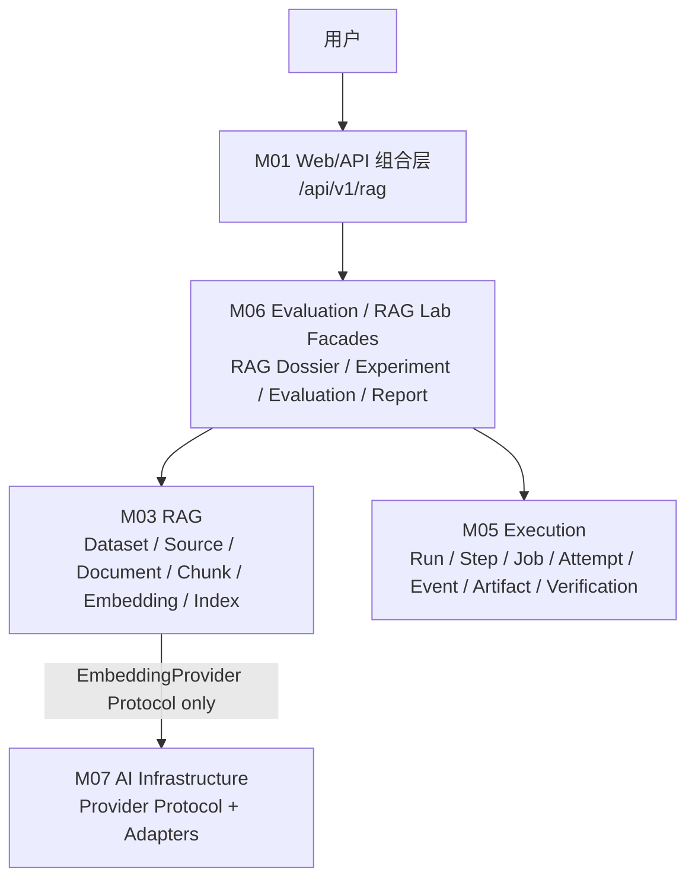
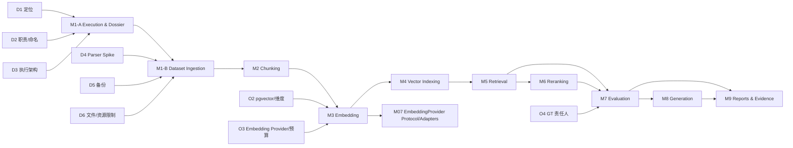

# RAG Lab — Phase 0 架构审计与实施计划（v0.3 修订稿）

**状态：PROPOSED — 等待架构审查。本文不是 APPROVED，也不构成 M1-A/M1-B 施工授权。**

- 文档版本：v0.3（最终定点修订，2026-11-25）
- 审计基线：`main` @ `7914b07`；工作区中仅存在此前的 `docs/guides/local-workbench-preview-guide.md` 未提交修改（非本次产生）。
- 修订性质：仅修改本架构与实施规划文档；**未修改运行时代码、数据库表、Alembic migration、依赖或业务逻辑，未 Commit/Push。**
- 决策状态：D1–D6 按本轮架构指令记录为“批准”或“有条件批准”；文档整体仍为 **PROPOSED**。O1–O9 是仍需确认的重大决策（§14.3）。
- 语言约定：工程说明使用简体中文；代码标识符、API 字段、数据库字段和通用技术术语保留英文；所有用户可见 UI 文案必须走现有 i18n 机制。

---

## 0. 修订记录

### 0.1 v0.3 定点修订（架构审查修复）

本版只修复 v0.2 的执行引擎、Schema、模块依赖和验收测试缺口，不重新设计 RAG Lab。

| 审查问题 | 修订位置 | 处理 |
|---|---|---|
| 1. M1-A Generated/Persisted/Verified 语义超前 | §6.3、§12.6–12.7、§10.4 | 拆分 DB Persistence 与 Artifact Persistence；M1-A 的 Artifact/Verification 明确为 Not Available；M1-B 才启用完整三态 |
| 2. Lease 失效、Attempt 终态与旧 Worker 写入 | §7.4–7.6、§9.2–9.6、§10.1 | 增加 `abandoned` Attempt、`WORKER_LOST`、`fencing_token` 所有权校验、条件更新与事务流程 |
| 3. Job Claim SQL 与 Schema 不一致 | §7.3、§9.2、§9.6 | 删除 `priority` 排序；统一 `execution_jobs` 字段、索引和 claim SQL |
| 4. Embedding Provider 模块依赖 | §5.1–5.3、§5.9、§9.4、§11.3 | M07 为共享基础设施；M03 只依赖 Provider Protocol，不耦合供应商 SDK；M06 不越过 M03 操作 Embedding 资产 |
| 5. Schema 关系与约束 | §9.2–9.6 | 增加组合 FK、`dataset_id` 一致性键、`supersedes_document_set_id`、Artifact/Verification FK 和删除策略 |
| 6. M06 Facade 职责边界 | §5.8 | 明确 Facade 只编排、不复制 M03/M05 逻辑；按用例拆分，禁止巨型 Service |
| 7. Worker 并发/过期写入测试 | §10.1、§10.2、§12.8、§13.6 | 新增 W1–W5：双 Worker Claim、Lease 接管、旧 Token 拒绝、并发幂等、Artifact 旧 Token 拒绝 |
| 未决事项收敛 | §14 | 将普通工程事项改为既定设计；只保留真正需要 Owner/架构审查的重大决策 |

### 0.1a v0.3 最终定点修订（本轮审查）

| 审查问题 | 修订位置 | 处理 |
|---|---|---|
| 1. Lease 过期后 Heartbeat 仍可续租 | §7.4、§10.1 W2、§12.5 | Heartbeat 条件增加 `lease_expires_at > now()`；过期但未 Recovery 时旧 Worker 续租 0 行；只有 Recovery 可回收 |
| 2. 文件与 DB 提交边界 | §7.4.1、§7.4.2、§9.7、§13.2、§13.6、§10.2 W6 | 明确正常/回滚/崩溃下的 tmp、final、DB 行、孤儿检测；Artifact 行只在当前 Lease 所有权校验通过后插入，COMMIT 后权威 |
| 3. Run/Step 聚合状态 | §7.9、§10.1 E11–E13、§12.4 | 所有 Job 终态后 Step 才终态；所有 Step 终态后 Run 才聚合；并发完成必须锁 Step/Run 后全量重算 |
| 4. 最终 M1-A Task Brief | §12 | 重写为可独立执行的 12.1–12.10 Task Brief，包含六表、依赖、状态机、Lease/Fencing、API、FE/i18n、E/W 测试、命令与证据清单 |
| 5. skipped 聚合语义 | §7.9、§10.1 E13、§12.4、§12.8 | 定义 succeeded+skipped、failed+skipped、all skipped 的 Step/Run 聚合；全部 skipped → Run skipped，不得算成功 |
| 6. Worker Shutdown 状态转换 | §7.2、§7.2.1、§10.1 E10a–E10c、§12.5、§12.8 | Graceful：Attempt `abandoned/WORKER_SHUTDOWN`、Job queued/failed、清 lease；SIGKILL：Recovery `WORKER_LOST`；旧 token 拒绝 |
| 7. Commit Outcome Unknown | §7.4.2、§10.2 W6、§13.2、§13.6 | COMMIT 确认丢失时保留 final；新 Session 回查；行存在+hash/size 一致→成功；行不存在→清理；DB 不可查→保留并记录待核查 |

### 0.2 v0.1 → v0.2 摘要

| 修订项 | v0.1 | v0.2 |
|---|---|---|
| 产品定位 | 已提出 M01/M03/M05/M06 组合，但依赖方向不够严格 | 明确 **M01 → M06 → M03 / M05**；M01 不拥有领域数据 |
| 模块职责 | M03/M05/M06 边界基本清楚，但跨模块 FK 与组合层不够明确 | M03 不 import/FK M05；M05 不 import RAG 业务；M06 作为 RAG Lab 应用门面组合 M03/M05 |
| 命名隔离 | 已提出 `rag_*`/`execution_*` | 增加逐对象命名表，明确 `Dossier`/`Artifact`/`Page`/`Run` 的禁用语义 |
| 执行架构 | 已提出 PostgreSQL 队列 + worker | 增加 Job 领取 SQL、Lease/Heartbeat、Attempt 历史、取消、部分成功、崩溃恢复、**workbench.sh** 启停与状态检查 |
| PDF Parser | 倾向于 `pypdf` | 改为 **Parser Spike 先行**；列出候选、真实语料、评分门槛、失败条件与中间表示 |
| 文件限制 | 仅提 200MB 建议 | 区分“上传上限”和“执行资源上限”；增加页数、时间、内存、类型/魔数校验、异常文件 |
| M1 范围 | 单个 M1 包含 14 张表 + 解析 + FE | 拆分为 **M1-A Execution & Dossier Foundation** 与 **M1-B Dataset Ingestion Foundation**，分别验收 |
| Schema | 27 张目标表，M1 一次建 14 张 | 逐表审查；M1-A 6 张、M1-B 8 张；后续表按里程碑增量建立；删除/推迟过度建模项 |
| 验收测试 | 以功能清单为主 | 增加执行引擎、Dataset、持久化/验证、Backup/Restore、FE、i18n 的完整测试矩阵 |
| 后续路线 | M1–M8 粗略 | 按 Chunking → Embedding → Vector Indexing → Retrieval → Reranking → Evaluation → Generation → Reports & Evidence 重排，附依赖与门禁 |
| i18n | 仅提及 | 增加 UI 文案、后端错误 code、`pnpm check:i18n`、全仓库扫描与验收要求 |

**仍然未解决的问题：** 仅保留影响技术路线/数据安全/长期成本的重大事项：Parser 最终选型、pgvector 与向量维度、Embedding Provider/预算/数据外发、30 条 GT 责任人、Rerank、Generation Provider、LLM Report、数据保留/删除政策、多用户/鉴权。普通工程实现细节已在正文定案。见 §14.3。

---

## 1. 审计方法与实际验证

### 1.1 已执行检查

| 检查项 | 命令/位置 | 2026-11-25 实际结果 |
|---|---|---|
| Git 基线 | `git log -1 --oneline` | `7914b07 docs: archive DingTalk integration and Personal Arsenal` |
| 后端测试 | `services/api/.venv/bin/pytest -q` | **38 passed in 2.46s**（真实 PostgreSQL `workbench_test`） |
| 前端构建 | `apps/web && pnpm build` | 通过（Vite 7.3.8，55 modules） |
| i18n 校验 | `apps/web && pnpm check:i18n` | 5 tests / 5 pass |
| 数据库 | `psql -h 127.0.0.1 -d workbench` | PostgreSQL 17.12；public schema 15 张表（14 业务表 + `alembic_version`） |
| 迁移头 | `alembic current` | `4c239bff00b0 (head)` |
| pgvector | `pg_available_extensions` | **无 `vector`**；有 `pg_trgm`、`pgcrypto`、`unaccent` |
| Homebrew pgvector | `brew info pgvector` | 0.8.7 bottled，**未安装** |
| Python | `.venv/bin/python -V` | 3.15.2 |
| 关键依赖 | `pip list` | 有 FastAPI/SQLAlchemy/Alembic/psycopg/Pillow/pytest；**无 pgvector、pypdf、numpy、jieba、rank-bm25、tiktoken** |
| 后台任务 | `grep -rnE -e "BackgroundTask" -e "asyncio" -e "threading" -e "Celery" -e "arq" -e "RQ" -e "Queue" -e "worker"` `services/api/app` | **无结果** |
| 事件/实时 | `grep -rnE -e "WebSocket" -e "EventSource" -e "text/event-stream" -e "StreamingResponse" -e "/events"` | **无结果** |
| FE Router | `grep -rnE -e "react-router" -e "useNavigate" -e "pathname"` `apps/web/src` | **无结果** |
| RAG Lab 痕迹 | `grep -rIl -e "RAG Lab" -e "rag-lab" -e "RagLab"` | **无结果**（全新工程） |

### 1.2 文档事实偏差（只记录，不修复）

| 文档位置 | 文档值 | 实际值 | 说明 |
|---|---|---|---|
| `PROJECT_CONTEXT.md:150` | 后端 28 passed | **38 passed** | DingTalk 测试等新增后未同步 |
| `PROJECT_CONTEXT.md:152,250` | i18n 每语言 462 键 | **470 键** | 词典已扩展 |
| `PROJECT_CONTEXT.md:89` | pgvector 为 PROPOSED | 仍准确 | 本机未安装，未启用 |
| `services/api/app/services/capture_service.py` | 存在于旧路径 | 路由已不使用 | 遗留临时代码，不应作为 RAG 入口 |

本次审计未修改上述文档/代码。

---

## 2. 仓库现状盘点

### 2.1 工程分层

```text
apps/web/                 React 19 + TypeScript + Vite 7（唯一可用客户端）
apps/android/             空
products/                 三个平级产品的 README
services/api/             FastAPI + SQLAlchemy 2 + Alembic + PostgreSQL
  app/api/v1/             按业务划分的 Router
  app/modules/            capture / knowledge / dossier / page / artifact / chat / dingtalk
  app/ai/                 LLM Provider 抽象与 Prompt
  app/core/               config / db / utils
  migrations/             3 个 Alembic revision
  tests/                  38 tests，真实 PostgreSQL
docs/                     architecture / governance / roadmap / guides
scripts/                  workbench.sh / backup.sh / restore.sh
```

**依据：** `PROJECT_CONTEXT.md:44-56`；`services/api/app/main.py:12-18`；`services/api/app/models_registry.py:3-13`。

### 2.2 前端架构

| 维度 | 现状 | 代码位置 |
|---|---|---|
| 路由 | **无 URL Router**；Workspace Tab + `openView(kind, params, title)`；Tab/布局持久化到 `localStorage` | `apps/web/src/App.tsx:33-35, 138-206`；`types.ts:214-240` |
| 页面注册 | `ViewKind` 联合类型 + `VIEW_KINDS`/`SINGLETON_VIEWS` + `renderTab()` switch | `types.ts:214-230`；`App.tsx:58-80, 598-675` |
| 导航 | `ContextTree` 硬编码：Workbench、Project Replay、Personal Arsenal、Personal Wiki、Capture | `ContextTree.tsx:18-210` |
| UI 规范 | 纯 CSS + 暗色 tokens；无组件库；primitives：`MicroLabel/Tag/Spinner/Skeleton/EmptyState/ErrorBanner/ViewHeader` | `styles.css:5-33`；`components/ui.tsx:1-190` |
| 数据获取 | 单一 `api` 对象 + `fetch`；`useAsyncData(load, key)` | `api.ts:74-127`；`hooks/useAsyncData.ts:16-60` |
| 实时 | 仅 Header 30s `/health` 轮询 | `App.tsx:240-247` |
| i18n | React Context + 集中词典；zh/en 各 470 键；`pnpm check:i18n` | `i18n/messages.ts:1`；`i18n/index.tsx:1-80` |

**结论：** RAG Lab 应作为同一 Workspace 的新 `ViewKind` 组接入；不引入 React Router、不新建第二个 SPA、不复制布局/i18n。

### 2.3 后端模块与 API

`app/main.py:31-51` 注册 7 个 Router；`/health`、`/health/ready` 直接检查数据库（`main.py:54-73`）。

| 模块 | 前缀 | 职责 |
|---|---|---|
| Capture | `/api/v1/ingestion` | 文本/URL/UTF-8 文本文件；RawContent；hash 去重 |
| Knowledge | `/api/v1/knowledge` | Mock Digest、Draft、Publish、Card/Asset 版本 |
| Dossier | `/api/v1/knowledge/dossiers` | M02 知识 Card 归集、tag edges |
| Page | `/api/v1/knowledge/pages` | Dossier → 版本化 JSON Page |
| Artifact | `/api/v1/artifacts` | PNG Visual Artifact、文件缓存、hash/version 校验 |
| Chat | `/api/v1/chat` | 本地规则对话；无外部模型 |
| DingTalk | `/api/v1/integrations/dingtalk` | 真实 Webhook 文本消息 |

**API 风格：** REST + JSON；Pydantic；同步路由 + SQLAlchemy Session；无统一错误 envelope、无分页标准、无 `Idempotency-Key`、无任务资源。`/docs` 可用。

### 2.4 数据库、Migration、ORM、pgvector

- PostgreSQL 17.12；SQLAlchemy 2.1.9；Alembic 1.20.1；14 张业务表。
- `Base`/`SessionLocal`/`get_session()` 在 `core/db.py:12-27`；模型注册在 `models_registry.py:3-13`。
- 状态字段多为 `String(24)` + 默认值；无 CHECK/Enum。
- JSON 多用 `JSON`（非 `JSONB`）；新表可使用 `JSONB` + GIN。
- **pgvector 未安装、未建表、未启用**；`PROJECT_CONTEXT.md:89` 仍为 PROPOSED。
- 测试库由 `tests/conftest.py:24-50` 在 session 启动时 drop schema + `alembic upgrade head`。

### 2.5 Worker / Job / Event

**现状：完全没有。**

- `main.py` lifespan 只 `ensure_data_dirs()`。
- Digest 同步调用 Provider；Publish 内同步渲染 PNG（`knowledge/service.py:179`）。
- Artifact 失败被捕获但不影响 Publish（`knowledge/service.py:180-183`），无重试/任务记录。
- `workbench.sh:150-177` 只启动 PostgreSQL、API、Web。
- `pyproject.toml:11-27` 无 Celery/RQ/arq/Redis/APScheduler。

### 2.6 文件上传、存储与读取

| 能力 | 现状 | 限制 |
|---|---|---|
| 文本/URL Capture | JSON `POST /ingestion/captures` | URL 只保存不抓取 |
| 文件上传 | `POST /ingestion/captures/files` | 仅 `.txt/.md/.markdown/.csv/.json/.log/.yaml/.yml`；UTF-8；默认 ≤2MB |
| 落盘 | `.data/uploads/{raw_id}{suffix}` | 全量 `await file.read()`；无流式/分片/病毒扫描 |
| 去重 | `sha256_text(text)` + `(content_hash, source_type)` | 按解码后文本 hash，不是原始字节 |
| Artifact | `.data/artifacts/{artifact_id}.png` | 同步 Pillow；无证据文件体系 |
| 目录 | `ensure_data_dirs()` 创建 `data/uploads`、`data/artifacts` | 无 `rag/` |

**依据：** `capture/parsing.py:11-58`；`capture/service.py:120-184`；`artifact/service.py:55-127`；`core/config.py:63-66`。

### 2.7 Provider、Embedding、配置、治理

- LLM：`LLMProvider` Protocol 仅 `digest/revise`（`ai/provider.py:34-42`）；Mock 确定性；OpenAI 骨架受 `ALLOW_REAL_LLM` 门禁，实际仍抛未授权（`ai/provider.py:249-281`）。
- Embedding：**不存在**。
- 配置：`Settings` frozen dataclass + `.env` + `lru_cache`（`core/config.py:20-66`）。
- Usage/Cost：**不存在**。
- 治理：`PROJECT_CONTEXT.md`、Frozen Scope v1.0、Human-Owned Engineering、七模块职责文档、Roadmap、P1.M1 准备文档；`docs/decisions/` 为空。

---

## 3. 现有能力复用矩阵

| 能力 | 已有证据 | RAG Lab 决策 | 说明 |
|---|---|---|---|
| FastAPI 应用/Router | `main.py:31-51` | **复用** | 新增 `/api/v1/rag`，不新建服务 |
| Pydantic/JSON 契约 | 各 Router | **复用并扩展** | 新增 RAG schemas；错误增加 `code` |
| SQLAlchemy Base/Session | `core/db.py` | **复用** | 新模型注册进 `models_registry.py` |
| Alembic | `migrations/` | **复用** | M1-A/M1-B 各自 migration |
| PostgreSQL | `workbench/workbench_test` | **复用** | 队列、事件、后续向量同实例 |
| 模块化 Service | `app/modules/*` | **复用模式** | 新模块按 `models.py` + `service/` + `router.py` |
| 配置管理 | `core/config.py` | **扩展** | 新增 RAG/Worker/Parser 配置；实验参数不进全局 env |
| 文件目录/下载 | `ensure_data_dirs`、`FileResponse` | **复用模式** | 新增 `.data/rag`；存相对 `storage_key` |
| 文本上传/hash | `capture/parsing.py` | **复用思路，不复用端点** | RAG 上传支持 PDF/大文件/流式 |
| Visual Artifact | `artifact/renderer.py` | **不复用语义** | RAG Evidence Artifact 是 JSON/CSV/MD 等证据文件 |
| LLM Provider 治理 | `ai/provider.py` | **复用模式** | EmbeddingProvider 同样需要授权门禁与 `is_mock` |
| Mock Provider | `MockProvider` | **仅 UI/流程演示** | 不得作为 RAG 证据；`is_mock=true` 不可 Verified |
| FE Workspace/Tab | `App.tsx` | **扩展** | 新增 `rag-*` ViewKind |
| FE 导航 | `ContextTree.tsx` | **扩展** | 新增 “RAG LAB” 分组 |
| FE UI primitives | `components/ui.tsx` | **复用** | 只用现有 tokens + 少量新组件 |
| FE i18n | `i18n/messages.ts` | **扩展** |  zh/en 同增；`check:i18n` |
| `useAsyncData` | `hooks/useAsyncData.ts` | **复用** | 另加 `useRunPolling` |
| 备份/恢复 | `backup.sh`/`restore.sh` | **必须扩展** | 当前只备份 uploads；需覆盖 `.data/rag`、`.data/artifacts` |
| 启动脚本 | `workbench.sh` | **必须扩展** | 增加 worker 启停/状态/日志 |
| 知识 Capture/RawContent | `capture/models.py` | **不复用为 RAG Source** | 语义/格式/大小不同 |
| 知识 Dossier | `dossier/models.py` | **不复用** | RAG Dossier 属 M06 实验档案 |
| 知识 Page | `page/models.py` | **不复用** | RAG Report 不是 PageVersion |
| Visual Artifact 表 | `artifact/models.py` | **不复用** | 新增 `execution_artifacts` |
| Chat | `chat/service.py` | **不复用** | Generation Playground 走 M07 |
| DingTalk | `dingtalk/service.py` | **可选后置** | 任务通知不进 M1 |

---

## 4. D1–D6 决策记录与批准条件

> 本节记录的是本轮架构指令对 D1–D6 的批准/有条件批准。**文档整体仍为 PROPOSED；D1–D6 不构成 M1-A/M1-B 施工授权。**

| 编号 | 决策 | 状态 | 批准条件 / 约束 | 未满足时的处理 |
|---|---|---|---|---|
| **D1** | RAG Lab 作为 M01 面向用户的实验产品入口（Product Surface），不是第八个后端业务模块 | **APPROVED（架构方向）** | M01 只做 API 组合、页面读模型、产品入口；M03 拥有 Dataset/Document/Chunk/Embedding/Index；M05 拥有 Run/Job/Step/Attempt/Event/Artifact/Verification；M06 拥有 RAG Dossier/Experiment/Evaluation/Ground Truth/Metrics/Report | 若需要新领域对象，先归入 M03/M05/M06 之一并评审，不新建模块 |
| **D2** | 模块职责与依赖方向 | **CONDITIONALLY APPROVED** | 依赖方向 **M01 → M06 → M03 / M05**；M03 不依赖 M06；M05 不依赖 RAG 语义；M06 可引用 M03 数据、使用 M05 执行；禁止反向/循环依赖 | 出现反向依赖时停止并提交架构评审 |
| **D2a** | 命名隔离 | **CONDITIONALLY APPROVED** | RAG 领域对象 `rag_*`；执行领域对象 `execution_*`；不得复用 `dossiers`、`artifacts`、`pages` 的业务语义；RAG Dossier 属 M06，不是 Dataset，也不拥有执行引擎 | 发现命名冲突时先改设计，不建别名表/兼容双写 |
| **D3** | PostgreSQL 持久化队列 + 独立 Worker；第一阶段不引入 Redis/Celery | **APPROVED** | 必须实现 Job 持久化/领取、Lease/Heartbeat、幂等、Retry/指数退避、崩溃恢复、取消、部分成功、事件持久化；第一阶段数据库轮询，不引入 WebSocket/SSE | 若吞吐不足，先用真实指标评估，不提前引入 broker |
| **D4** | PDF Parser 先做 Spike，再确定正式解析器 | **APPROVED（Spike-first）** | 必须用真实 PDF 验证文本、页码、Block、字符定位、复杂版面、无文本层识别、性能/内存/依赖；保留 Document/Section/Paragraph/CodeBlock/Table/Figure/Metadata 中间表示；无文本层明确失败；OCR/图像语义不在本阶段 | Spike 不通过则停止 M1-B 解析实现，提交 OCR/版面方案决策 |
| **D5** | 从 M1 开始纳入 RAG 数据资产的备份与恢复 | **CONDITIONALLY APPROVED** | 明确 `.data/rag` 职责、`.data/artifacts` 边界、DB↔文件引用、hash 校验、备份/恢复一致性、恢复后独立 Verification；不得只备份 DB | 备份/恢复验收不通过，M1-B 不算完成 |
| **D6** | 第一阶段支持 PDF/TXT/MD；默认 200MB，可配置 | **CONDITIONALLY APPROVED** | 上传上限 ≠ 执行资源上限；需配置 Worker 内存、PDF 页数、任务时限、类型/魔数/大小校验、异常文件处理、上传成功 vs 解析成功状态区分 | 资源限制缺失时不得进入批量解析 |

### 4.1 决策边界说明

- **D1 不改变 Frozen Scope 的模块数量**：不新增 M08；RAG Lab 是 M01 的页面/API 组合。
- **D2 是强约束**：M01 的 `/api/v1/rag` 路由调用 M06 的用例 Facade；M06 调用 M03/M05；M03/M05 不 import 对方；M07 是共享基础设施，M03 只依赖其 Provider Protocol。
- **D3 是执行事实**：Job/Run 状态由 handler 的 `StepResult` 决定，不由 LLM 输出、HTTP 200 或前端刷新决定。
- **D4 是质量门禁**：Parser 选型必须附真实语料对比结果；不得凭库介绍直接选型。
- **D5 是证据完整性**：RAG 原始文件、解析产物、证据 Artifact 必须可恢复；恢复后必须重新验证，而不是只看数据库行数。
- **D6 是资源安全**：上传成功只代表文件落盘；解析成功必须另有 `parse_status` 与 Document/Block 证据。

---

## 5. 总体架构、模块职责与依赖

### 5.1 定位

**RAG Lab = M01 产品入口 + M06 实验组织 + M03 RAG 数据资产 + M05 执行证据。**



**说明：**

- 业务依赖严格为 **M01 → M06 → M03 / M05**；M07 是共享基础设施，M03 只依赖其 Provider **Protocol**，不依赖任何供应商 SDK。
- `M03` 只记录不透明的 `created_by_run_id` / `parse_run_id` / `build_run_id`（String，无 FK），用于追溯；M03 不 import M05，也不设 FK。
- worker 启动时由**组合层**注册 M03/M06 handler；M05 核心不 import RAG/Evaluation。
- M05 的 Artifact 服务只接收调用方传入的 `storage_root`；RAG Lab 传入 `.data/rag/artifacts`，M05 不硬编码 RAG 路径。
- M01 不直接写 M03/M05 表；所有 RAG Lab 领域读写经 M06 的用例 Facade。
- **M07 不得 import M03/M05/M06 的领域模型；M03 不得 import 任何供应商 SDK。** 依赖倒置由组合层完成：组合层选择 Adapter，注入 M03 的 EmbeddingService。

### 5.2 模块职责

| 模块 | 归属 | RAG Lab 职责 | 明确不负责 |
|---|---|---|---|
| `apps/web/src/views/rag/` + `app/api/v1/rag/` | **M01** | 页面、API 组合、读模型、错误映射、分页、i18n 文案 | 领域规则、直接写表、执行引擎 |
| `app/modules/rag/` | **M03** | Dataset、Source、DocumentSet、Document、Block、ChunkSet、Chunk、EmbeddingSet、Embedding、Index、Parser/Chunking/Retrieval 实现 | RAG Dossier、Experiment、Evaluation、Report、Job 调度 |
| `app/modules/execution/` | **M05** | ExecutionRun、Step、Job、Attempt、RuntimeEvent、EvidenceArtifact、Verification；队列、lease、retry、worker 核心 | RAG 语义、Dataset/Chunk 表、评测指标 |
| `app/modules/evaluation/` | **M06** | RAG Dossier、DossierDataset 关联、Experiment、ExperimentConfig、EvalSet、Query、GroundTruth、Metrics、Report；**按用例拆分的 Facade** | 执行引擎、向量索引实现、M02 Card、直接写 M03/M05 表 |
| `app/ai/embedding/protocol.py` | **M07** | `EmbeddingProvider` Protocol、请求/响应 DTO、usage/latency/cost 归一化契约 | 检索策略、评测、RAG 资产持久化 |
| `app/ai/embedding/providers/` | **M07** | 具体供应商/本地模型 Adapter；实现 Protocol | 业务状态、EmbeddingSet/Embedding 表写入 |
| `app/workers/rag_worker.py` | **组合层** | 启动 worker，注册 M03/M06 handlers，加载配置 | 领域逻辑 |

### 5.3 依赖规则（强制）

```text
M01 → M06 → M03 / M05
M03 → M07 (EmbeddingProvider Protocol only)
M03 ↛ M06, M03 ↛ M05 (code/FK)
M05 ↛ M03, M05 ↛ M06 (code/FK)
M06 → M03, M06 → M05
M07 ↛ M03, M07 ↛ M05, M07 ↛ M06 (domain imports)
```

| 规则 | 说明 |
|---|---|
| M01 只调用 M06 | RAG Lab API 通过 `app/modules/evaluation/facades/` 组合；M01 不直接 import M03/M05 service |
| M06 可调用 M03/M05 | Dossier/Dataset 关联、Run 创建/状态、事件读模型由 M06 facade 编排 |
| M03 不依赖 M06/M05 | M03 的 `created_by_run_id` / `parse_run_id` / `build_run_id` 全部是 `String(64)` 逻辑引用，无 FK；不 import execution |
| M05 不依赖 RAG | `execution_runs.scope_type/scope_id` 为 opaque；handler 通过注册表注入 |
| 禁止循环 | 任何 `M03 → M06`、`M05 → M06`、`M03 ↔ M05` 的 import/FK 都必须评审并拒绝 |
| M03 → M07 仅 Protocol | M03 只 import `app/ai/embedding/protocol.py` 的接口/DTO；不得 import `providers/*`、OpenAI SDK 或模型运行时 |
| M07 不依赖领域 | `app/ai/embedding/` 不 import M03/M05/M06 的 models/service；Adapter 由组合层注入 |
| M06 不越过 M03 | M06 可以调用 M03 的 `EmbeddingService`，但不得直接 INSERT/UPDATE `rag_embeddings` / `rag_embedding_sets`，也不得直接调用供应商 SDK 写资产 |
| 禁止双写 | 不允许同一语义同时写 `dossiers` 与 `rag_dossiers`、`artifacts` 与 `execution_artifacts` |

### 5.4 命名隔离

| 概念 | 表/前缀 | 归属 | 禁止混淆 |
|---|---|---|---|
| RAG Dossier | `rag_dossiers` | M06 | 不是 M02 `dossiers`；不是 Dataset；不拥有执行引擎 |
| Dataset | `rag_datasets` | M03 | 不是 DocumentSet；不直接属于 Dossier（关联表在 M06） |
| Document Set | `rag_document_sets` | M03 | 一次解析的不可变输出，不是 Dataset 本身 |
| Source | `rag_sources` | M03 | 原始上传文件，不是 RawContent |
| Execution Run | `execution_runs` | M05 | 统一运行记录；不是 `rag_experiments` |
| Job/Step/Attempt | `execution_jobs` / `execution_steps` / `execution_job_attempts` | M05 | Step 是逻辑阶段；Job 是可调度单元；Attempt 是一次尝试 |
| Runtime Event | `execution_events` | M05 | 不是业务日志；append-only |
| Evidence Artifact | `execution_artifacts` | M05 | 不是 Visual Artifact `artifacts` |
| Verification | `execution_verifications` | M05 | 不是 Artifact 状态；是独立校验记录 |
| Report | `rag_reports` | M06 | 不是 M02 Page；不是 LLM 事实来源 |
| Visual Artifact | `artifacts` | 既有模块 | 保持 PNG/知识卡语义；不被 RAG 复用 |

### 5.5 建议目录

```text
services/api/app/
  modules/
    execution/
      models.py            # ExecutionRun, Step, Job, JobAttempt, RuntimeEvent, EvidenceArtifact, Verification
      queue.py             # claim / heartbeat / recover / retry
      service.py           # run/step 状态机、读模型
      worker.py            # worker loop、handler registry、graceful shutdown
      handlers.py          # 通用 handler 注册辅助（不 import RAG）
    rag/
      models.py
      service/
        datasets.py
        sources.py
        documents.py
        chunks.py
        embeddings.py
        indexes.py
      parsing/
        base.py            # Parser Protocol + IR
        pdf_parser.py
        text_parser.py
        normalize.py
      chunking/
        registry.py
        fixed.py
        recursive.py
        structure.py
        chapter.py
      retrieval/
        registry.py
        bm25.py
        dense.py
        hybrid.py
        rrf.py
        filters.py
        mmr.py
        hierarchical.py
    evaluation/
      models.py
      facades/             # M06 用例编排；M01 唯一入口
        dossiers.py
        dataset_ingest.py
        execution.py
        evaluation.py
        reports.py
      service/
        dossiers.py
        datasets_link.py   # Dossier↔Dataset 关联
        experiments.py
        eval_sets.py
        ground_truth.py
        metrics.py
        reports.py
      handlers/
        dataset_ingest.py
        evaluation_run.py
  ai/
    embedding/
      protocol.py          # M07 Protocol/DTO；M03 只依赖此文件
      providers/           # M07 供应商/本地 Adapter；由组合层注入
  api/v1/rag/
    router.py
    dossiers.py
    datasets.py
    sources.py
    runs.py
    artifacts.py
    stages.py
    strategies.py
  workers/
    rag_worker.py
```

**说明：** `evaluation/facades/` 是 M06 的用例编排层，不是新领域模块；它只编排 M03/M05，不拥有 Dataset/Job 数据。各 Facade 按用例拆分，禁止巨型 Service。

### 5.6 FE 页面与 API 映射

| IA 页面 | `ViewKind` | M01 组件 | M06/M03/M05 API | 阶段 |
|---|---|---|---|---|
| Dossier Library | `rag-dossiers` | `RagDossierList` | M06: `GET /rag/dossiers` | M1-A |
| Dossier Cover | `rag-dossier` | `RagDossierCover` + `StageGrid` + `EvidenceCapabilityChips`（M1-A 仅 DB Persistence；Artifact/Verified 显示 N/A） | M06: `GET /rag/dossiers/{id}` | M1-A |
| Run Timeline | `rag-run` 或 Cover 内嵌 | `RunTimeline` | M06 facade → M05: `GET /rag/runs/{id}`、`/events` | M1-A |
| Stage Dossier | `rag-stage` | `RagStageView`（统一模板） | M06: `GET /rag/dossiers/{id}/stages/{stage}` | M1-B 起 |
| Dataset Workspace | `rag-dataset` | `DatasetWorkspace` + `SourceTable` + `UploadPanel` | M06 facade → M03: dataset/source/document | M1-B |
| Experiment Workspace | `rag-experiment` | `ExperimentWorkspace` | M06: experiment/config/runs | M7 |
| Retrieval Inspector | `rag-inspector` | `RetrievalInspector` | M06 → M05/M03: run query/hits | M5 |
| Evaluation Center | `rag-evaluation` | `EvaluationCenter` | M06: eval set/metrics | M7 |
| Generation Playground | `rag-playground` | `GenerationPlayground` | M06 → M05/M07 | M8 |
| Reports & Evidence | `rag-reports` | `ReportViewer` + `ArtifactList` | M06: reports/artifacts | M9 |

**FE 接入点：** `types.ts` 扩展 `ViewKind/ViewParams`；`App.tsx` 更新 `VIEW_KINDS/SINGLETON_VIEWS/defaultTitle/renderTab`；`ContextTree.tsx` 新增 “RAG LAB” 分组；`api.ts` 新增 `rag` 方法；`messages.ts` 中英同步；`styles.css` 新增 RAG 节；新增 `hooks/useRunPolling.ts`。

**状态呈现：** 按 §6.3 的能力矩阵显示；M1-A 只显示 `GENERATED` 与 `DB PERSISTED`，`ARTIFACT PERSISTED` / `VERIFIED` 显示 `N/A`；M1-B 才显示完整证据链。禁止单一 `status=ready` 冒充完成，禁止把 N/A 显示成 pending/verified。

---

### 5.7 Stage Dossier 统一模板

- 后端统一读模型：`GET /api/v1/rag/dossiers/{id}/stages/{stage}`，返回 `stage_definition`、`evidence_capabilities`、当前资产、runs、verification、artifacts、next_actions。M1-A 的 `artifact_persisted/verified` capability 为 `not_available`。
- `stage_definition` 来自代码内 registry：`dataset / chunking / embedding / index / retrieval / reranking / evaluation / generation / report`；不建 per-stage 表。
- 前端只实现一个 `RagStageView`，由 `stage` + `stage_definition` 驱动；M1-B 首次用于 `dataset`，M2 复用于 `chunking`，后续阶段不得复制独立页面。
- 阶段状态由资产 + runs + execution_verifications 派生，不存 `dossier.stage_status` 冗余字段。
- Stage Dossier 的差异只允许来自 registry 配置和读模型字段，不允许复制布局/轮询/错误处理。

### 5.8 M06 Facade 职责边界

**定位：** Facade 是 M06 的**用例编排层**（application service），不是领域模型，也不是新的业务模块。它把 M03 的资产能力和 M05 的执行能力组合成 RAG Lab 的用例。

| 职责 | 允许 | 禁止 |
|---|---|---|
| 用例编排 | 创建 Dossier、注册 Dataset、发起 Run、读取 Run/Event/Artifact 读模型、触发 Verification | 实现 Parser/Chunking/Retrieval 算法、实现队列 claim/lease、复制 M03/M05 Service |
| 事务边界 | 在同一 SQLAlchemy Session 中组合 M03/M05 调用；按用例提交/回滚 | 跨模块直接写表、绕过 Service 做 SQL |
| 数据所有权 | 读写 M06 自己的 `rag_dossiers`、`rag_experiments`、`rag_eval_*`、`rag_reports` | 直接写 `rag_datasets`/`rag_sources`/`rag_documents`/`rag_chunks`/`rag_embeddings`；直接写 `execution_*` |
| Provider | 选择/注入 `EmbeddingProvider`（由组合层提供），调用 M03 EmbeddingService | 直接调用供应商 SDK、在 M06 持久化 Embedding 资产 |
| 幂等 | 按用例计算 payload hash、捕获唯一约束冲突、返回原 Run | 在 Facade 内重试 Provider/解析；那是 Job/Worker 的职责 |
| 读模型 | 组合 M03/M05 数据形成 Dossier Cover/Stage Dossier DTO | 把 UI 展示逻辑写进 Facade；复杂投影放 M01 读模型或专用 query service |

**拆分约束：**

- 不建单一 `RagLabService`。按用例拆为 `DossierFacade`、`DatasetIngestFacade`、`ExecutionFacade`、`EvaluationFacade`、`ReportFacade`。
- 每个 Facade 只依赖 M03/M05 的**公开 Service 接口**，不 import 其 ORM 查询构造器。
- Facade 代码中出现 `select(RagDocument)`、`select(ExecutionJob)` 等跨模块 ORM 查询，视为越界，Review 必须拒绝。
- Facade 的新增方法必须能归入一个用例；无法归类时先评审领域归属，不直接扩 Facade。
- M06 的评测/实验逻辑仍在 M06 Service；Facade 只编排，不承载指标算法。

**接口示意：**

```text
DossierFacade.create_dossier(payload) -> DossierRead
DossierFacade.get_cover(dossier_id) -> DossierCoverRead       # 组合 M03/M05 读模型
DatasetIngestFacade.register_dataset(dossier_id, payload) -> DatasetRead
DatasetIngestFacade.upload_source(dataset_id, file) -> SourceRead
DatasetIngestFacade.start_parse(dataset_id, payload) -> RunRead
ExecutionFacade.get_run(run_id) -> RunRead
ExecutionFacade.cancel(run_id) -> RunRead
EvaluationFacade.start_evaluation(experiment_id, config) -> RunRead   # M7
```

### 5.9 Embedding Provider 边界（M07）

**归属：** Embedding Provider 属于 **M07 共享 AI 基础设施**，不是独立业务模块，也不是 M03 的私有实现。

**接口（示意，M3 实现）：**

```python
class EmbeddingProvider(Protocol):
    name: str
    model: str
    dimension: int

    def embed(
        self,
        texts: list[str],
        *,
        request_key: str,
    ) -> EmbeddingBatch:
        """返回 vectors 与 usage；不得写 DB/业务状态。"""

@dataclass(frozen=True)
class EmbeddingBatch:
    vectors: list[list[float]]
    usage: ProviderUsage          # input_tokens? / total_tokens / latency_ms
    provider_request_id: str | None
    cost_actual_usd: Decimal | None
    cost_estimated_usd: Decimal | None
    cost_unmeasurable_reason: str | None
    pricing_version: str | None
```

**职责分工：**

| 层 | 职责 |
|---|---|
| M07 Protocol/Adapter | 供应商/本地模型调用、批处理、重试策略（仅 Provider 层可重试的错误）、usage/latency/cost 归一化；不知道 `rag_embedding_sets`/`rag_embeddings` 表 |
| M03 `EmbeddingService` | 校验 chunk set、创建 `rag_embedding_sets`、分批调用注入的 Provider、持久化 `rag_embeddings`、记录 config snapshot/usage/cost；不 import 供应商 SDK |
| M06 Facade | 选择用例、读取 Run/配置、调用 M03 EmbeddingService；**不直接写 Embedding 表，不直接调用 Provider SDK** |
| 组合层（worker/API composition） | 读取配置、构造 Adapter、注入 M03；执行数据外发/预算门禁 |

**DI 形态：**

```text
RAG_WORKER -> build_embedding_provider(config) -> OpenAIAdapter/LocalAdapter/MockAdapter
RAG_WORKER -> EmbeddingService(provider=adapter).embed_set(set_id, run_id)
```

- M03 构造函数接收 `EmbeddingProvider`，不接收 provider 名称或 SDK client；配置解析在组合层。
- 测试可注入 `FakeEmbeddingProvider`；生产 Adapter 不进入 M03。
- M07 Adapter 不得 import M03/M05/M06 领域模型；只实现 Protocol/DTO。

**记录字段：** `rag_embedding_sets` 保存 `provider`、`model`、`dimension`、`normalization`、`config_hash`、`usage`、`latency_ms`、`cost_actual/estimated/unmeasurable`、`pricing_version`；`rag_embeddings` 保存 `embedding`、`content_hash`。

**门禁：** 真实 Provider 调用前必须通过 `ALLOW_REAL_EMBEDDING`、数据外发授权、`max_cost_usd` 预算检查；未通过返回 `PROVIDER_AUTH` / `BUDGET_EXCEEDED`，不得静默使用 Mock 冒充真实结果。

## 6. 核心对象与生命周期

### 6.1 对象关系

```text
RAG Dossier (M06) 1─N DossierDataset N─1 Dataset (M03)
Dataset 1─N Source (M03)
Dataset 1─N DocumentSet (M03) 1─N Document (M03) 1─N Block (M03)

ExecutionRun (M05) 1─N ExecutionStep (M05) 1─N Job (M05) 1─N JobAttempt (M05)
ExecutionRun 1─N RuntimeEvent (M05)
ExecutionRun 1─N EvidenceArtifact (M05)
Verification (M05) N─1 EvidenceArtifact (optional)
ExecutionRun N─1 ExperimentConfig (M06, later)
RunQuery (M06, later) N─1 ExecutionRun
RetrievalHit (M06, later) N─1 RunQuery
```

### 6.2 生命周期

| 对象 | 生命周期 | 状态来源 |
|---|---|---|
| RAG Dossier | created → active → archived | M06 业务操作；阶段状态由 runs 派生 |
| Dataset | draft → ingesting → ready / partial / failed | M03 解析/校验聚合，不由 HTTP 200 直接置 ready |
| Source | `upload_status`: uploaded/stored/rejected；`parse_status`: not_parsed/queued/parsing/parsed/failed | 上传与解析分离；两者不可合并 |
| DocumentSet | building → ready / partial / failed | parse job 结果 + 校验 |
| ExecutionRun | queued → running → succeeded / partial / failed / cancelled / skipped | StepResult 聚合；`skipped` 是终态非失败 |
| ExecutionStep | pending → running → succeeded / partial / failed / skipped / cancelled | Job 结果 |
| Job | queued → running → succeeded / partial / failed / cancelled / skipped | handler 结果；`skipped` 是终态非失败，不产生 Attempt 成功 |
| JobAttempt | running → succeeded / failed / abandoned / cancelled | 单次尝试，append-only；`abandoned` 用于 `WORKER_LOST` |
| RuntimeEvent | append-only | 状态变更/进度/错误 |
| EvidenceArtifact | 原子写盘后存在；无独立状态 | 文件 + DB 行 + hash 读回 |
| Verification | created（passed/failed/partial） | 独立校验执行者 |
| Report | draft → verified | 人工确认后 verified；LLM 不能置 verified |

### 6.3 Generated / Persisted / Verified（按证据能力分级）

**核心原则：** 证据级别必须与当前阶段真实具备的能力一致；M1-A 不得展示或宣称 Artifact Persistence / Verified。

| 证据级别 | 严格定义 | 可核验证据 | M1-A | M1-B |
|---|---|---|---|---|
| **Generated** | Handler 已产生结果（内存/临时文件），但尚未提交 | `StepResult` + 执行日志；不构成完成 | ✅ 有（job 返回） | ✅ 有 |
| **DB Persisted** | 业务/执行记录事务提交，并在新 Session 中读回一致 | `execution_runs/result`、`execution_steps`、`execution_jobs`、`execution_job_attempts`、`execution_events` 行 + 读回值 | ✅ 有 | ✅ 有 |
| **Artifact Persisted** | 证据文件原子写盘 + DB 行 + 文件 sha256 读回一致 | `execution_artifacts` + 文件 hash + size | ❌ **Not Available** | ✅ 有 |
| **Verified** | 独立校验记录 `execution_verifications.result=passed`，且关联证据可核验 | Verification 行 + checks + artifact | ❌ **Not Implemented** | ✅ 有 |

**实现约定：** 证据级别由已有证据推导，不新增 `persisted` / `verified` 布尔列；避免状态冗余。

**FE 展示规则：**

```text
M1-A（仅执行基础）:
GENERATED            ●
DB PERSISTED         ●
ARTIFACT PERSISTED   — NOT AVAILABLE
VERIFIED             — NOT IMPLEMENTED

M1-B（文件导入后）:
GENERATED            ●
DB PERSISTED         ●
ARTIFACT PERSISTED   ● / ✕
VERIFIED             ● / ✕ / ○
```

- `NOT AVAILABLE` / `NOT IMPLEMENTED` 必须是明确状态，不能显示为 `pending` 或 `verified`。
- M1-A 的 Dossier Cover 只能承诺“执行记录已写入数据库”；不得声称“文件已持久化”或“已通过验证”。
- HTTP 200、Worker 返回 `succeeded`、UI 动画、轮询到数据都**不能**直接推出 DB Persisted / Artifact Persisted / Verified。
- `DB Persisted` 的读回必须在**新 Session**完成；同一 Session 的 `commit` 后对象缓存不算读回证据。
- 每个 stage/target 独立评估证据级别；Dossier 元数据可以只有 DB Persisted，文件类资产在 M1-B 才有 Artifact Persisted。
- M1-A 的 `GENERATED` 只作为 Run/Job 执行记录中的事实，不上升为 Dossier 级别的“已生成/已完成”宣传。


---

### 6.4 Dataset Pipeline 与 Experiment Pipeline 分离

**Dataset Pipeline（M03 数据资产生产，不依赖评测）：**

```text
Source Files → Ingestion & Parsing → Document Set → Chunking → Chunk Set
             → Embedding → Embedding Set → Vector / Lexical Index → Verification
```

**Experiment Pipeline（M06 实验与评测，不修改 Dataset 资产）：**

```text
Experiment Config + Dataset Assets（DocumentSet/ChunkSet/EmbeddingSet/Index）
  + Evaluation Set（Query + Ground Truth）
  → Retrieval → Optional Reranking → Evaluation → Results / Metrics
  → Engineering Conclusion / Report → Human Verification
```

**分离规则：**

| 规则 | 说明 |
|---|---|
| 资产只由 Dataset Pipeline 生产 | Experiment 只能引用不可变资产，不写 Source/Document/Chunk/Embedding/Index |
| Experiment 不依赖未验证资产 | 进入正式实验前，Dataset 资产必须 Persisted + Verified（至少 verifier 通过） |
| 两条 pipeline 共用 `execution_runs` | 用 `pipeline in ('dataset','experiment')`、`stage` 区分；不得混用状态或表 |
| M1 只做 Dataset Pipeline 的前半段 | M1-A 无文件；M1-B 到 Document/Block + Verification 为止；Chunking 从 M2 开始 |
| Experiment 对象从 M7 开始 | M7 前只做 Retrieval/Rerank 的工程验证，不建 Evaluation 结论 |

## 7. 异步执行架构（D3）

### 7.1 为什么是 PostgreSQL 队列

| 方案 | 判断 |
|---|---|
| FastAPI `BackgroundTasks` | 拒绝：进程内、无持久化、重启丢失、无法恢复 |
| Celery + Redis | 当前单用户、低并发；新增 broker/worker 运维；无真实吞吐证据 |
| PostgreSQL 队列 + 独立 worker | **批准**：与权威存储同事务、可查询、可恢复、可测试；`SKIP LOCKED` 足够 |

**第一阶段不做：** Redis、Celery、RQ、arq、Kafka、WebSocket、SSE、复杂优先级调度、多租户 worker 池。

### 7.2 进程模型与 `workbench.sh`

```text
scripts/workbench.sh
  ├─ postgres
  ├─ api       uvicorn app.main:app
  ├─ worker    .venv/bin/python -m app.workers.rag_worker
  └─ web       pnpm dev
```

**启动：**

1. `start_pg` → `ensure_db`（含 Alembic）→ `start_api` → `start_worker` → `start_web`。
2. `start_worker` 复用现有 `spawn_detached` 模式：
   - PID：`.run/worker.pid`
   - 日志：`.run/worker.log`
   - 命令：`cd services/api && .venv/bin/python -m app.workers.rag_worker`
3. 就绪检查：worker 每 5s 更新 `.run/worker.heartbeat`（mtime + JSON：`pid`、`started_at`、`last_seen`、`current_job_id`）；`workbench.sh status` 检查 PID 存活 + heartbeat 新鲜度。
4. **进程 heartbeat** 与 **Job lease heartbeat** 分离：前者是进程存活；后者写 `execution_jobs.last_heartbeat_at`，用于 stale job 恢复。

**停止：**

1. `stop_worker` 先发 `SIGTERM`；worker 按 §7.2.1 执行 Graceful Shutdown（正常完成，或 Attempt `abandoned`/`WORKER_SHUTDOWN` + Job 重排队/失败），不允许留下 `running` Job/Attempt；超过 `RAG_SHUTDOWN_GRACE_SECONDS` 再 `SIGKILL`，由 Recovery 接管。
2. 再停 API/Web；PostgreSQL 仍按现有 `stop --all` 语义。
3. `cmd_status` 输出 `postgres/api/worker/web` 四行；worker 显示 `ready (pid, heartbeat age)` 或 `down`。
4. `cmd_logs worker` 读取 `.run/worker.log`。

**验收：**

- `./scripts/workbench.sh start` 后四进程可用。
- `stop` 不留下 running lease；重启后 stale job 可恢复。
- `status` 能区分“进程死”和“进程活但 heartbeat 过期”。

### 7.2.1 Worker Shutdown 状态转换

**Graceful Shutdown（SIGTERM）：**

1. Worker 进入 `draining`：**停止 Claim 新 Job**；等待当前 Job 到安全点。
2. 若当前 Job 在 `RAG_SHUTDOWN_GRACE_SECONDS`（默认 25s）内正常完成：走正常结果提交，Attempt/Job 终态为 `succeeded/partial/failed`，不改写为 cancelled/abandoned。
3. 若无法在 grace 内完成且 handler 可安全中断，在同一事务中：
   - 条件：`id=:job_id AND status='running' AND lease_token=:token AND lease_expires_at > now()`。
   - Attempt：`status='abandoned'`、`finished_at=now()`、`error_code='WORKER_SHUTDOWN'`。
   - Job：若 `attempts >= max_attempts` → `failed`（`error_code='WORKER_SHUTDOWN'`）；否则 `queued`，清空 `locked_at/locked_by/lease_expires_at`，`available_at=now()`；保留 `lease_token`（下次 Claim 递增）。
   - 写 `job.attempt_abandoned` + `job.requeued` / `job.failed` 事件；提交后退出。
4. Graceful Shutdown 后不得存在 `running` Job 或 `running` Attempt；若 DB 事务失败，进程退出并由 Recovery 处理（该情况不算成功 Graceful）。
5. Graceful Shutdown 会消耗一次 Attempt；`attempts` 达到 `max_attempts` 时 Job 进入 `failed`，不无限重排队。

**SIGKILL / 非正常退出：**

1. Worker 不执行 Shutdown 事务；Job/Attempt 可能停留在 `running`。
2. Lease 到期后由 Recovery 接管：Attempt → `abandoned` + `WORKER_LOST`；Job → `queued` 或 `failed`（按 max_attempts）。
3. 旧 Worker 的 `lease_token` 不再有效；Heartbeat/结果写入均被拒绝。
4. 新 Worker Claim 时 `lease_token` 递增并创建新 Attempt。

**状态约定：**

| 场景 | Attempt | Job | Lease |
|---|---|---|---|
| Graceful，正常完成 | `succeeded/partial/failed` | 正常终态 | 正常清理 |
| Graceful，可安全中断 | `abandoned` / `WORKER_SHUTDOWN` | `queued` 或 `failed` | 清空 locked/lease，token 保留 |
| SIGKILL | Recovery：`abandoned` / `WORKER_LOST` | Recovery：`queued` 或 `failed` | 过期后 Recovery 清理 |
| 用户 Cancel | `cancelled` | `cancelled` | 清理 |

### 7.3 Job 持久化、字段与领取

**`execution_jobs` 核心字段（与 Schema 一节一致）：**

```text
id, run_id, step_id, job_key, kind, status, payload JSONB,
attempts, max_attempts,
available_at, locked_at, locked_by, last_heartbeat_at, lease_expires_at,
lease_token BIGINT NOT NULL DEFAULT 0,
cancel_requested_at, processed_count, failed_count,
error_code, error_detail, created_at, updated_at
```

**字段说明：**

- `job_key`：Run 内稳定的 job 标识（如 `dossier_rollup`、`parse_source`）；唯一约束 `(run_id, job_key)`，用于内部幂等和重试定位。
- `lease_token`：**fencing token**，每次成功领取时原子递增；写入结果时必须匹配。它不是客户端幂等 key。
- 一期**没有 `priority` 字段**，也不做优先级调度。领取顺序固定为 `created_at, id`；如果未来需要优先级，必须单独评审 Schema 变更。
- ORM `ExecutionJob`、Alembic DDL、Claim SQL 与 Index 必须使用同一组字段；不得出现 SQL/ORM 单边字段（如 `priority`、客户端 `idempotency_key`）。`lease_token` 使用 `BigInteger`，默认 0。
- 客户端幂等 key 只作用于 **Run 创建**，不直接写 Job；见 §7.5。

**领取 SQL（示意，必须在一个事务中执行）：**

```sql
WITH candidate AS (
    SELECT id
    FROM execution_jobs
    WHERE status = 'queued'
      AND available_at <= now()
    ORDER BY created_at, id
    FOR UPDATE SKIP LOCKED
    LIMIT 1
)
UPDATE execution_jobs AS j
SET status = 'running',
    locked_at = now(),
    locked_by = :worker_id,
    lease_token = j.lease_token + 1,
    last_heartbeat_at = now(),
    lease_expires_at = now() + make_interval(secs => :lease_seconds),
    attempts = j.attempts + 1,
    error_code = NULL,
    error_detail = NULL,
    updated_at = now()
FROM candidate AS c
WHERE j.id = c.id
RETURNING j.id, j.run_id, j.step_id, j.lease_token, j.attempts;
```

同一事务内插入 Attempt：

```sql
INSERT INTO execution_job_attempts
    (id, job_id, attempt_no, status, worker_id, fencing_token, started_at)
VALUES
    (:attempt_id, :job_id, :attempts, 'running', :worker_id, :lease_token, now());
```

- Claim 与 Attempt 创建必须同事务；Attempt 插入失败则整个 claim 回滚。
- 需要的索引：`execution_jobs(status, available_at, created_at)`、`execution_jobs(run_id, job_key)`；后者为唯一约束。
- `execution_jobs` 不存客户端 `idempotency_key`；客户端幂等由 `execution_runs` 负责。
- Job 内部幂等语义由 `(run_id, job_key)` 唯一约束保证，避免同一 Run 重复建同一 Job。

### 7.4 Lease、Heartbeat、Attempt 终态与崩溃恢复

**正常心跳：**

```sql
UPDATE execution_jobs
SET last_heartbeat_at = now(),
    lease_expires_at = now() + make_interval(secs => :lease_seconds),
    updated_at = now()
WHERE id = :job_id
  AND status = 'running'
  AND lease_token = :lease_token
  AND lease_expires_at > now();
```

- 心跳必须带 `lease_token` 与 `lease_expires_at > now()`；旧 Worker 的心跳不会延长新 Worker 的 Lease。
- **Lease 已过期但尚未被 Recovery 接管**：旧 Worker 的 Heartbeat 仍然 0 行；**不得**通过 Heartbeat 恢复所有权。只有 Recovery 流程可以回收过期 Job。
- 心跳影响 0 行 → 当前 Worker 已失去所有权，必须停止执行并放弃写入；不得重试 Heartbeat 或自行延长 Lease。
- 新 Worker 接管时 `lease_token` 必须递增；旧 Worker 的 Heartbeat 与结果写入都因 token/lease 条件失败。

**恢复扫描（Worker 启动时 + 每 30s，一个事务）：**

```sql
-- 1) 锁定过期 Job
WITH expired AS (
    SELECT id, lease_token, attempts, max_attempts
    FROM execution_jobs
    WHERE status = 'running'
      AND lease_expires_at < now()
    FOR UPDATE SKIP LOCKED
)
-- 2) 原 Attempt 进入明确终态
, abandoned AS (
    UPDATE execution_job_attempts AS a
    SET status = 'abandoned',
        finished_at = now(),
        error_code = 'WORKER_LOST',
        error_detail = 'worker heartbeat expired; lease reclaimed'
    FROM expired AS e
    WHERE a.job_id = e.id
      AND a.status = 'running'
      AND a.fencing_token = e.lease_token
    RETURNING a.id, a.job_id
)
-- 3) Job 重排队或最终失败
UPDATE execution_jobs AS j
SET status = CASE
        WHEN j.attempts >= j.max_attempts THEN 'failed'
        ELSE 'queued'
    END,
    locked_at = NULL,
    locked_by = NULL,
    available_at = now(),
    lease_expires_at = NULL,
    error_code = CASE
        WHEN j.attempts >= j.max_attempts THEN 'WORKER_LOST'
        ELSE 'LEASE_EXPIRED'
    END,
    error_detail = 'lease expired; attempt abandoned',
    updated_at = now()
FROM expired AS e
WHERE j.id = e.id;
```

- 原 Attempt：`status='abandoned'`、`finished_at=now()`、`error_code='WORKER_LOST'`；**不得**继续保留 `running`。
- 若 `attempts >= max_attempts`：Job `failed`，Run/Step 按聚合规则终止；否则 Job 回 `queued`，新 Worker 领取时 `lease_token` 继续递增，创建新的 Attempt。
- 恢复扫描与 Claim 都必须使用 `FOR UPDATE SKIP LOCKED`，避免两个恢复器同时处理同一 Job。
- 恢复事务提交后写 `job.attempt_abandoned` + `job.requeued` / `job.failed` 事件。

### 7.4.1 Fencing：防止旧 Worker 写入

**问题：** Worker A 的 Lease 过期后，Worker B 接管；A 可能恢复并尝试提交结果。仅靠 `status='running'` 不够，因为 A 可能仍认为自己是 running。

**机制：**

1. 每次成功 claim：`lease_token = lease_token + 1`；Worker 拿到该值。
2. Attempt 记录 `fencing_token`。
3. **所有**会改变 Job/Attempt/Run/Step/Artifact 的写入都必须带条件：
   ```sql
   WHERE id = :job_id
     AND status = 'running'
     AND lease_token = :lease_token
     AND lease_expires_at > now()
   ```
4. 旧 Worker 的 `lease_token` 小于新值，且 Lease 已过期 → 条件不匹配 → 写入 0 行；应用层返回 `STALE_LEASE`，删除临时文件，不提交结果。
5. 新 Worker 使用新 token 提交；Attempt 的条件更新带 `(job_id, attempt_no, fencing_token)`，确保只有当前 Attempt 能进入终态。
6. `lease_token` 是 **per-job 单调递增**，不依赖全局时钟；它只解决同一 Job 的所有权竞争，不需要全局 fencing 服务。

**结果提交事务（示意）：**

```sql
-- 前置：文件已在事务外生成到 tmp，fsync + sha256；尚未 rename 为 final
BEGIN;

SELECT id, run_id, step_id, lease_token, status
FROM execution_jobs
WHERE id = :job_id
  AND status = 'running'
  AND lease_token = :lease_token
  AND lease_expires_at > now()
FOR UPDATE;
-- 0 行：ROLLBACK；删除 tmp；记录 STALE_LEASE；不得更新 Attempt/Run/Step

-- 文件 rename 是快速的元数据操作；不在持锁期间做解析/编码/远程 IO
-- 将 tmp rename 为 final storage_key（同文件系统）
INSERT INTO execution_artifacts (...);  -- 仅在上述所有权校验通过后

UPDATE execution_job_attempts
SET status = :attempt_status,
    finished_at = now(),
    error_code = :error_code
WHERE job_id = :job_id
  AND attempt_no = :attempt_no
  AND fencing_token = :lease_token
  AND status = 'running';
-- 0 行：ROLLBACK；删除 final；视为所有权丢失

UPDATE execution_jobs
SET status = :job_status,
    processed_count = :processed,
    failed_count = :failed,
    updated_at = now()
WHERE id = :job_id
  AND lease_token = :lease_token
  AND status = 'running';
-- 0 行：ROLLBACK；删除 final

-- 聚合更新（见 §7.9）
UPDATE execution_steps ... WHERE id = :step_id AND run_id = :run_id;
UPDATE execution_runs ... WHERE id = :run_id;

INSERT INTO execution_events (...);
COMMIT;  -- 只有 COMMIT 成功，Artifact 行才是权威
```

**竞争处理：**

- Claim 用行锁 + `SKIP LOCKED`；同一 Job 只能被一个 Worker 成功 claim。
- 结果提交先 `SELECT ... FOR UPDATE` 锁 Job 行，再校验 token/lease；新 Worker 的 claim 会等待该行锁，避免交错。
- 聚合更新 Step/Run 前必须 `SELECT ... FOR UPDATE` 锁对应行（或使用版本号条件更新）；后续 1 Step → N Job 时，多个 Job 的聚合必须串行化。
- 旧 Worker 提交在 token 校验处失败，不能更新 Attempt/Job/Run/Step，也不能插入 Artifact 行。
- 外部 Provider 调用可能已经发生且不可撤销；旧 Worker 的调用成本/usage 记录在 Attempt metrics，但**结果不作为权威**；新 Worker 重新调用。Provider 侧应使用幂等请求 key（如支持）。
- **文件处理不得在持有 Job 行锁时执行**：解析、编码、远程下载等全部在事务外完成；事务内只做所有权校验、快速 rename、DB 写入与提交。

### 7.4.2 Artifact 文件与 DB 提交边界

**目标：** 不引入分布式事务/对象存储，明确“文件 + DB 行”的权威边界。

| 阶段 | 临时文件 | 最终文件 | Artifact DB 行 | 处理 |
|---|---|---|---|---|
| 正常提交 | 事务外生成 tmp；fsync + hash | 事务内快速 rename 为 final | 所有权校验通过后插入；COMMIT 后权威 | 事务内不执行长时间文件处理 |
| 事务回滚 / 所有权失败 | 删除 tmp | 若已 rename，删除 final | 不插入/回滚 | 旧 Worker 返回 `STALE_LEASE`；不得留下行 |
| Worker 崩溃（commit 前） | 可能残留 tmp | 可能残留 final | 无行（未提交） | 启动清理 tmp；孤儿 final 扫描清理 |
| Worker 崩溃（commit 后） | 无 | final 存在 | 行已提交 | 正常；后续 Verification 可校验 hash |
| **COMMIT 结果未知**（连接在确认前断开） | 无（已 rename） | **保留 final** | 未知 | 新 Session 回查；行存在+hash/size 一致→成功；行不存在→确认未提交后清理；DB 不可查→保留并记录待核查 |
| 文件丢失/Hash 不一致 | — | 缺失/不一致 | 行保留（历史事实） | 新 Verification 记录 `ARTIFACT_MISSING` / `ARTIFACT_HASH_MISMATCH` |

**规则：**

- **权威 Artifact = 已提交的 `execution_artifacts` 行 + 其 `storage_key` 文件 + hash 读回一致**。仅有文件、无 DB 行，不是 Artifact；仅有 DB 行、无文件，是待验证/失败，不是有效 Artifact。
- `execution_artifacts.storage_key` 唯一；API 只服务 DB 行对应的 final 文件，绝不服务 `.tmp`。
- 临时目录 `$WORKBENCH_DATA_DIR/rag/tmp/{attempt_id}/` 与 final 目录 `$WORKBENCH_DATA_DIR/rag/artifacts/{run_id}/` 必须在同一文件系统，保证 rename 原子且快速。
- **孤儿文件检测：**
  - Worker 启动清理超过 `RAG_TMP_GRACE_SECONDS`（默认 3600）的 tmp。
  - 定期/Backup/Verification 扫描 final 目录：存在于文件系统、但无 `execution_artifacts.storage_key` 引用且 mtime 超过 `RAG_ORPHAN_GRACE_SECONDS`（默认 86400）的文件 → 记录 `artifact.orphan_detected`，移入 quarantine 或删除（配置）；不新增表。
  - DB 行引用但文件缺失 → 不删除行，由 Verification 记录失败；`ARTIFACT_MISSING`。
  - 备份前先做一次 orphan 扫描；备份 manifest 记录 missing/orphan，不静默忽略。
- **崩溃窗口：** rename 与 COMMIT 之间崩溃会留下孤儿 final；commit 之前崩溃不会留下 DB 行。孤儿清理与 Verification 是补偿机制，不假装原子。
- **回滚清理失败：** 删除 final 失败时记录 warning + 事件；孤儿扫描兜底；不得把该文件当有效 Artifact。
- **COMMIT 结果未知（Commit Outcome Unknown）：**
  1. Worker 已发送 COMMIT，但连接在收到确认前断开；应用**不得立即删除 final**。
  2. 使用**新的 Session/新连接**、在 primary 上按 `execution_artifacts.storage_key`（或 artifact id）回查；不查只读副本。
  3. DB 行存在，且 `sha256` / `size_bytes` 与文件一致 → 视为提交成功；保留 final，按成功处理。
  4. DB 行不存在 → 确认事务未提交（同一事务的 Artifact/Job/Attempt 更新均未生效）；此时才允许清理 final。
  5. DB 暂时不可查询（连接失败/超时）→ **保留 final**，记录 `artifact.commit_outcome_unknown` 日志/事件；不得删除、不得重复插入、不得宣称成功；交由后续 orphan/Verification 扫描。
  6. 预期状态：未知时 tmp 无、final 存在、DB 行未知；确认提交后 final + 行；确认未提交后 final 删除、无行；不可查询时 final 保留、记录待核查。
- **M1-A 不产生 Artifact**；该边界从 M1-B 开始生效。M1-A 的 `execution_runs.result` 仅 DB JSONB，无文件删除问题；若 DB 提交确认丢失，按 Run/Job 状态回查处理，不涉及 final 文件。
- **门禁归属：** Commit Outcome Unknown 是 **M1-B 后续施工门禁**，不得因此阻塞或扩大 M1-A。

### 7.5 幂等

| 场景 | 作用域 | 机制 |
|---|---|---|
| 客户端重复创建 Run | `(scope_type, scope_id, idempotency_key)` | `execution_runs` partial unique；`idempotency_payload_hash` 比较 |
| 同 key 同 payload | 同上 | 返回原 Run，`reused=true`；不重复建 Job |
| 同 key 不同 payload | 同上 | `409 IDEMPOTENCY_CONFLICT`；原 Run 不变 |
| 并发同 key 同 payload | 同上 | 唯一约束 + 捕获 `IntegrityError`，重新查询原 Run 并比较 hash |
| Job 内部幂等 | `(run_id, job_key)` | `execution_jobs` 唯一约束；同一 Run 不重复建同一 Job |
| 重复 Source | `(dataset_id, sha256)` | 返回已有 Source，`duplicate=true` |
| 重复 DocumentSet | `dataset_id + source_set_hash + parser_config_hash` | 默认复用；显式 `force=true` 才新建（旧 DocumentSet 保留） |
| Job 重试 | `(job_id, attempt_no)` | 独立 Attempt；handler 用内容 hash/唯一约束避免重复写 |
| 事件 | `run_id + type + step/job` | 应用层去重；事件插入不依赖幂等 key |

**Payload Hash 规则：**

- 对 Run 创建请求的**规范化 JSON**做 SHA-256：`sort_keys=True`、`ensure_ascii=False`、紧凑分隔符；字段包含 `scope_type`、`scope_id`、`pipeline`、`stage`、`kind`、以及业务参数。
- 排除：`Idempotency-Key` 本身、客户端时间戳、注释性 `note`、服务端生成的 `run_id`。
- `idempotency_payload_hash` 与 `idempotency_key` 一起存储；比较 hash，不比较原始 JSON 文本。
- 作用域为 `(scope_type, scope_id)`：同一 Dossier 内同 key 冲突；不同 Dossier 可以使用相同 key。

### 7.6 Retry 与指数退避

- 默认 `max_attempts=3`。
- 退避：`delay = min(base * 2^(attempt-1), max_delay) + jitter`；例如 base=5s、max=300s、jitter 0–20%。
- 可重试：临时网络错误、DB 连接中断、Provider 5xx/限流、文件锁冲突。
- 不可重试：`PDF_NO_TEXT_LAYER`、`PDF_ENCRYPTED`、`UNSUPPORTED_FILE_TYPE`、`FILE_TOO_LARGE`、`INVALID_CONFIG`、`PROVIDER_AUTH`、`IDEMPOTENCY_CONFLICT`。
- `WORKER_LOST`：Attempt 以 `abandoned` 结束；Job 按 `attempts/max_attempts` 重排队或失败；不是普通 handler 异常。
- 失败分类写入 `error_code`；`error_detail` 只放安全信息，不放凭证/全文。
- 每次尝试记录 `started_at/finished_at/error/metrics`；总耗时/成本按 Attempt 汇总，不合并成单次。
- Attempt 终态：`succeeded | failed | abandoned | cancelled`；终态写入后不可再改。

### 7.7 取消与部分成功

**取消：**

- `POST /rag/runs/{id}/cancel` 设置 `execution_runs.cancel_requested_at` 与关联 execution_jobs 的 `cancel_requested_at`。
- Job 在 batch 边界检查；已完成批次保留；状态 `cancelled`；不删除资产。
- 已 `succeeded/failed` 的 Run 不可取消；返回 `409`。

**部分成功：**

- Handler 返回 `StepResult(status='partial', processed_count, failed_count, failures=[...])`。
- `failed_count>0 && processed_count>0` → `partial`；两者都为 0 → `failed`。
- 失败明细写入 `execution_artifacts`（如 `failures.csv`，M1-B 起）或 `result JSONB`（M1-A 小结果）。
- `partial` 不是 `succeeded`；FE 必须显示失败数与重试入口。

### 7.8 事件持久化

**表：** `execution_events(id BIGSERIAL, run_id, step_id NULL, job_id NULL, type, level, message, payload JSONB, created_at)`。

- 索引 `(run_id, id)`；FE 用 `after_id` 增量拉取。
- 事件与状态变更尽量同事务；外部调用后的进度事件按 batch 提交。
- 事件类型：`run.created`、`run.status_changed`、`step.started`、`step.progress`、`step.completed`、`step.failed`、`asset.persisted`、`verification.*`、`artifact.created`、`warning`。
- `payload` 禁止文件全文、凭证、完整 Prompt、Provider key。
- 第一阶段只用 DB 轮询；不引入 WebSocket/SSE。

### 7.9 Run / Step / Attempt 关联与职责

| 对象 | 回答的问题 | 关键关系 | 不承担 |
|---|---|---|---|
| Run | 这次实验/管线的整体目标、配置、最终状态 | 1:N Step/Event/Artifact | 单次调度、单次失败重试 |
| Step | 管线中的哪个阶段、进度、阶段结果 | N:1 Run；1:N Job | 具体 worker 领取 |
| Job | 哪一次可调度执行、锁、重试次数 | N:1 Step；1:N Attempt/Event | 业务阶段语义（由 kind 表达） |
| Attempt | 这一次尝试发生了什么 | N:1 Job；unique `(job_id, attempt_no)`；`fencing_token` 标识当前所有权 | 业务状态聚合 |
| Event | 用户可读的执行时间线 | N:1 Run/Step/Job | 业务事实来源（以 DB 资产为准） |

**M1-A 约定：** 1 Step = 1 Job；后续批量任务允许 1 Step → N Job（fan-out），不改表结构。

**终态聚合规则：**

- 只有持有当前 `lease_token` 的写入才能更新 Attempt/Job/Step/Run；旧 Worker 的写入 0 行，不参与聚合。
- Attempt 终态：`succeeded | failed | abandoned | cancelled`；`abandoned` 不直接等于 Run 失败，要看 Job 是否还有重试机会。
- Job 终态：`succeeded | partial | failed | cancelled | skipped`。`partial` 表示部分 item 成功；`failed` 表示无可恢复结果；`skipped` 表示有意不执行，是**非失败终态**。
- **Step 的终态前提：** 只有该 Step 关联的**所有 Job 都进入终态**（`succeeded | partial | failed | cancelled | skipped`）后，Step 才能进入终态。
- **Step 的非终态规则：** 任一 Job 仍是 `queued` 或 `running`，Step 必须保持 `running`（若所有 Job 尚未开始则为 `pending`）；不得提前写终态。
- **Job `partial` 的语义：** `processed_count > 0` 且 `failed_count > 0`，代表“有成功项 + 有失败项”；它本身是终态，但不等同于 Step/Run 成功。
- **`skipped` 的语义：** 非失败终态；不能单独推导整体成功；不得与 `failed` 混为一谈；Job/Step/Run 均可为 `skipped`。

**聚合函数（Step 对 Job、Run 对 Step 使用同一纯函数）：**

```text
aggregate(statuses):
  1. 若存在 failed:
       - 若同时存在 succeeded 或 partial -> partial
       - 否则 -> failed
  2. 否则若存在 partial -> partial
  3. 否则若存在 cancelled:
       - 若同时存在 succeeded -> partial
       - 否则 -> cancelled
  4. 否则若存在 succeeded -> succeeded
  5. 否则若全部为 skipped（或空集合） -> skipped
```

**Step 终态聚合矩阵（所有 Job 终态后）：**

| Job 组合 | Step | 说明 |
|---|---|---|
| 全部 `succeeded` | `succeeded` | 正常成功 |
| `succeeded` + `skipped` | `succeeded` | `skipped` 不拖累已有成功 |
| `failed` + `skipped` | `failed` | 失败优先于 skipped |
| 全部 `skipped` | `skipped` | 非失败，但不能算成功 |
| `partial` + `skipped` | `partial` | 部分成功保持 |
| `cancelled` + `skipped` | `cancelled` | 取消优先于 skipped |
| `succeeded` + `failed` + `skipped` | `partial` | 有成功有失败 |
| `failed` + `cancelled` + `skipped` | `failed` | 无成功，失败优先 |
| `succeeded` + `cancelled` | `partial` | 有成功也有取消 |
| 全部 `cancelled` | `cancelled` | 无成功、无失败 |

**Run 终态聚合矩阵（所有 Step 终态后）：**

| Step 组合 | Run | 说明 |
|---|---|---|
| 全部 `succeeded` | `succeeded` | 所有阶段成功 |
| `succeeded` + `skipped` | `succeeded` | 有实际成功，skipped 不拖累 |
| `failed` + `skipped` | `failed` | 失败优先 |
| 全部 `skipped` | **`skipped`** | 不能因全部 skipped 就宣布 Run 成功 |
| `partial` + `skipped` | `partial` | 部分成功 |
| `cancelled` + `skipped` | `cancelled` | 取消优先 |
| `succeeded` + `failed` + `skipped` | `partial` | 有成功有失败 |
| `failed` + `cancelled` + `skipped` | `failed` | 无成功，失败优先 |
| `succeeded` + `cancelled` | `partial` | 有成功也有取消 |

- **Step 与 Run 的关系：** Step 聚合 Job，Run 聚合 Step；两级使用同一聚合函数和同一状态集合。Run 的 `succeeded` 必须至少有一个实际 `succeeded`，且没有 `failed/cancelled/partial`；全部 skipped 只能是 `skipped`。
- **Run 的终态前提：** 只有所有 Step 都进入终态后，Run 才能聚合；任一 Step 仍为 `pending/running`，Run 必须保持 `running`。
- **并发完成不丢结果：** 多 Job 并发完成时，不得使用“读到当前 Job 后直接覆盖 Step/Run 状态”的增量写法。必须：
  1. `SELECT ... FOR UPDATE` 锁 Step（再锁 Run）；
  2. 在同一事务内重新查询该 Step/Run 下所有 Job/Step 的状态；
  3. 若仍有非终态，保持 `running`；否则按聚合函数重算后写入；
  4. 提交。
  这样后到的 Job 会基于完整集合重算，不会丢失先完成 Job 的结果。
- **幂等重算：** 聚合函数是纯函数 `aggregate(statuses) -> status`；重复调用结果相同；不使用 Event 计算状态。
- Event 只记录事实，不参与状态计算。

### 7.10 错误契约

统一结构化：

```json
{"code": "PDF_NO_TEXT_LAYER", "message": "...", "run_id": "...", "recoverable": false}
```

- 4xx：请求/配置；409：幂等/状态冲突；422：校验；503：Provider/Worker 不可用；500：未预期。
- 执行所有权/生命周期错误：`WORKER_LOST`（Attempt 被放弃）、`WORKER_SHUTDOWN`（Graceful Shutdown 安全中断）、`LEASE_EXPIRED`（Lease 过期，Job 重排队）、`STALE_LEASE`（旧 Worker 提交被拒）。
- `STALE_LEASE` 必须记录在旧 Worker 的日志/事件中，但不得写入权威 Run/Job/Artifact 状态。
- 禁止 200 + `status=failed` 伪装失败。
- FE 用 `code` 映射 i18n；无映射时显示后端 `message`。

---

## 8. 文件、Parser Spike 与备份（D4/D5/D6）

### 8.1 文件类型、大小与资源限制（D6）

**第一阶段支持：** PDF、TXT、MD。

**上传上限与执行上限分离：**

| 配置项 | 默认 | 作用域 | 说明 |
|---|---|---|---|
| `RAG_MAX_UPLOAD_BYTES` | 200 MB | 上传 | 流式写入；超过即 `413/422 RAG_FILE_TOO_LARGE` |
| `RAG_ALLOWED_EXTENSIONS` | `pdf,txt,md` | 上传 | 扩展名 + MIME/魔数校验（PDF `%PDF-`） |
| `RAG_MAX_PDF_PAGES` | 2000 | 解析 | 页数预检；超过 `PDF_PAGE_LIMIT_EXCEEDED` |
| `RAG_MAX_PARSE_SECONDS` | 600 | 执行 | Job deadline；超时 `JOB_TIMEOUT`，保留部分结果 |
| `RAG_MAX_SOURCE_CHARS` | 20,000,000 | 解析 | 防止异常大文本 |
| `RAG_MAX_BLOCKS` | 200,000 | 解析 | 防止异常块数 |
| `RAG_MAX_WORKER_RSS_MB` | 2048 | 执行 | 解析前后检查 RSS；超限失败并记录；不做复杂调度 |
| `RAG_WORKER_CONCURRENCY` | 1 | 执行 | 第一阶段单并发；后续再评估 |
| `RAG_JOB_LEASE_SECONDS` | 60 | 执行 | lease 时长 |
| `RAG_JOB_HEARTBEAT_SECONDS` | 10 | 执行 | heartbeat 间隔 |
| `RAG_SHUTDOWN_GRACE_SECONDS` | 25 | 进程 | SIGTERM 后等待当前 Job 正常完成/安全中断的时长 |
| `RAG_TMP_GRACE_SECONDS` | 3600 | 清理 | 启动时清理超过该时长的 tmp 文件 |
| `RAG_ORPHAN_GRACE_SECONDS` | 86400 | 清理 | 无 DB 引用的 final 文件超过该时长才视为孤儿 |

**原则：**

- 上传成功 ≠ 解析成功；`rag_sources.upload_status` 与 `parse_status` 分开。
- 200MB 上传成功不代表允许解析；页数/内存/时间超限必须明确失败。
- 异常文件：空文件、损坏、加密 PDF、非 UTF-8 TXT/MD、扩展名与魔数不符、超过上限 → 明确错误 code + Source 保留/拒绝策略。
- 不做病毒扫描、OCR、图像语义理解、复杂资源调度；这些不在第一阶段。

### 8.2 Parser Spike（D4）

**候选：**

| 候选 | 优点 | 风险 |
|---|---|---|
| `pypdf` | 纯 Python、许可证宽松、简单 | 版面/表格/字符定位弱 |
| `pdfplumber` | 基于 pdfminer.six，词/坐标/表格能力较好 | 依赖较重、性能/内存需验证 |
| `PyMuPDF` | 快、版面/图像能力强 | AGPL/商业许可；需 Owner 评估 |

**Spike 语料：**

1. 真实《三国演义》PDF（目标语料）。
2. 至少 2 份技术类 PDF（含代码、表格、架构图/多栏）。
3. 1 份扫描件/无文本层 PDF。
4. 1 份加密 PDF。
5. 1 份损坏/截断 PDF。

**评分维度：**

| 维度 | 验收问题 |
|---|---|
| 文本层 | 非空页比例；字符数/页；中文正确性 |
| 页码 | 每个 Block 是否可追溯页码 |
| Block 类型 | 是否能区分 heading/paragraph/code/table/figure/list |
| 字符定位 | 是否提供 page + char/word offset；能否回放原文 |
| 复杂版面 | 多栏、表格、代码、图注是否可读 |
| 无文本层 | 是否明确识别并返回 `PDF_NO_TEXT_LAYER` |
| 性能/内存 | 解析耗时、峰值内存、依赖体积 |
| 许可/兼容 | License、Python 3.15 兼容、维护活跃度 |

**决策门槛：**

- 至少一个候选在真实语料上通过“文本层 + 页码 + 基本 Block + 字符定位”最低门槛；否则 M1-B 暂停，提交 OCR/版面方案决策。
- 选型结果写入 M1-B 的 Parser Spike 报告，并在 `rag_document_sets` 记录 `parser_id/version`。
- 不凭技术介绍直接选型；不在 Spike 前安装正式依赖。

**中间表示（IR）：**

```text
ParsedDocument
  metadata: {title, page_count, source_sha256, parser, version}
  sections: [Section]
    Section: {heading, level, page_start, page_end, blocks}
      Block:
        Paragraph {text, page_no, char_start, char_end}
        CodeBlock {text, language?, page_no, char_start, char_end}
        Table {rows|cells|text, page_no, char_start, char_end}
        Figure {caption, alt_text?, page_no, bbox?}
        List {items, page_no, char_start, char_end}
```

**DB 映射：** `rag_documents` 保存规范化全文 + 元数据；`rag_document_blocks` 保存 `block_type`、`text`、`page_no`、`char_start/end`、`heading_level/heading_path`、`metadata JSONB`（表格单元格/图注/bbox）。Section 不单独建表，由 heading block + `heading_path` 表达；Figure 只保存 caption/位置/元数据，不做图像语义理解。**不允许只把 PDF 拼成一段纯文本。**

**无文本层：** 解析结果为空/仅空白 → `PDF_NO_TEXT_LAYER`；Source `parse_status=failed`；不得创建 `ready` DocumentSet；事件与 Artifact 记录原因。OCR 不在本阶段。

### 8.3 文件存储与备份（D5）

**目录职责：**

| 路径 | 职责 | 归属 |
|---|---|---|
| `.data/uploads/` | 既有 Capture 原始文本文件 | 既有 M02 |
| `.data/artifacts/` | 既有 Visual Artifact PNG | 既有 Artifact 模块 |
| `.data/rag/sources/{dataset_id}/{source_id}/{sha256}.{ext}` | RAG 原始文件 | M03 |
| `.data/rag/artifacts/{run_id}/{artifact_id}.{ext}` | RAG 证据文件（parse report、chunk stats、metrics、CSV 等） | M05 |
| `.data/rag/tmp/` | 原子写临时文件 | M05/M03 |

**边界：**

- `.data/artifacts` **不是** RAG 证据目录；RAG 证据只进 `.data/rag/artifacts`。
- 现有 Visual Artifact 与 RAG Evidence Artifact 不共享表、不共享语义；备份可以一起打包。
- 新 RAG 文件路径在 DB 中存 **相对 `WORKBENCH_DATA_DIR` 的 `storage_key`**，避免迁移/异机恢复绝对路径失效；现有 `artifact.file_path` 保持现状，不在本次改造。

**备份内容：**

1. `pg_dump -Fc` 全库。
2. `.data/rag/` 全量（sources + artifacts，排除 tmp）。
3. `.data/artifacts/` 全量（现有 Visual Artifact，当前 `backup.sh` 遗漏）。
4. `.data/uploads/`（现有）。
5. `.env.example` / 必要配置（`.env` 可选择加密/排除，按现有脚本策略）。
6. `alembic_version.txt`、`app_git_sha`、`manifest.txt`（每个文件 sha256 + size）。

**恢复流程：**

1. 停止 API/Worker，避免写入。
2. 建空库 → `pg_restore` → `alembic upgrade head`。
3. 解包 `.data/rag`、`.data/artifacts`、`.data/uploads` 到目标 `WORKBENCH_DATA_DIR`。
4. 执行 **DB↔文件一致性校验**：
   - `rag_sources` 每个 `storage_key` 存在，`sha256`/`size_bytes` 匹配。
   - `execution_artifacts` 每个 `storage_key` 存在，hash 匹配。
   - 报告 missing/orphan；missing 视为恢复失败。
5. 执行 **恢复后独立 Verification**（只读）：抽样 Document/Block 回放、Source hash、Artifact hash；写入 `execution_verifications`（如果 API 可用）或输出独立报告。
6. FE 打开恢复后的 Dossier/Dataset，确认数据可用。

**验收：** 必须做一次真实 Backup → Restore → Verification；不能只验证脚本存在。恢复后不得出现“DB 有记录、文件缺失”或“文件存在、DB 无引用”的静默状态。

---

## 9. 数据库 Schema 逐表审查

### 9.1 审查结论摘要

| 结论 | 说明 |
|---|---|
| M1 不再一次建 14 张表 | M1-A 6 张、M1-B 8 张；后续按里程碑增量 |
| 执行表统一 `execution_*` | Run/Step/Job/Attempt/Event/Artifact/Verification 全部归 M05 |
| 取消 M03 → M05 FK | M03 只存逻辑 `*_run_id`（String，无 FK），避免反向依赖 |
| `rag_dossiers` 不拥有执行/数据集 | Dossier 属 M06；Dataset 属 M03；关联表在 M06 |
| `rag_dossier_datasets` 归 M06 | 解决 M03 不能依赖 M06 的归属问题 |
| DocumentSet 与 Dataset 分离 | Dataset 是容器；DocumentSet 是一次解析的不可变输出 |
| Job/Step/Attempt 不混同 | Step 逻辑阶段；Job 可调度；Attempt 单次尝试；新增 `abandoned` 终态 |
| Artifact 与 Verification 分离 | Artifact 是证据文件；Verification 是校验判断 |
| 删除独立 `rag_eval_query_results` | 指标并入 `rag_run_queries.metrics JSONB` |
| `rag_generation_results` 暂不建 | M8 先用 `execution_artifacts` 保存 `answer.json` |
| 单表 `rag_indexes` | 同时承载 bm25/dense 索引，不建两套索引表 |
| 增加 `fencing_token` | 防止旧 Worker 在 Lease 失效后写入 |
| 增加组合 FK | 保证 Job→Step→Run、Event→Step/Job→Run、Document→DocumentSet/Source→Dataset 的一致性 |
| 删除 `priority` | 一期无优先级调度，Claim 按 `created_at, id` |

### 9.2 M1-A 表（6 张，必须实现）

| # | 表 | 模块 | 核心职责 | 主要字段 | 关系 | 生命周期 | M1-A | 判定 |
|---|---|---|---|---|---|---|---|---|
| 1 | `rag_dossiers` | M06 | RAG 实验档案组织 | `id`、`title`、`description`、`status(active/archived)`、时间戳 | 1:N `rag_dossier_datasets`（M1-B）、1:N experiments（M7） | created → active → archived | ✅ | 保留；不存 stage/run 状态，派生 |
| 2 | `execution_runs` | M05 | 统一执行记录 | `id`、`scope_type`、`scope_id`、`pipeline`、`stage`、`status`、`config_snapshot JSONB`、`config_hash`、`fingerprint`、`idempotency_key`、`idempotency_payload_hash`、`parent_run_id`、`result JSONB`、`error_code/detail`、`cancel_requested_at`、时间戳、`app_git_sha` | 1:N steps/jobs/events/artifacts；自关联 parent | queued → running → succeeded/partial/failed/cancelled | ✅ | 保留；不 FK 到 `rag_*` |
| 3 | `execution_steps` | M05 | 阶段进度与结果 | `id`、`run_id`、`step_key`、`ordinal`、`status`、`progress`、`processed_count`、`failed_count`、`error_*`、时间戳 | N:1 run；1:N execution_jobs；unique `(id, run_id)` 供组合 FK | pending → running → succeeded/partial/failed/skipped/cancelled | ✅ | 保留；M1 1 Step=1 Job，但结构支持 fan-out |
| 4 | `execution_jobs` | M05 | 可调度执行单元 | `id`、`run_id NOT NULL`、`step_id NOT NULL`、`job_key`、`kind`、`status`、`payload JSONB`、`attempts`、`max_attempts`、`lease_token`、`available_at`、`locked_at`、`locked_by`、`last_heartbeat_at`、`lease_expires_at`、`cancel_requested_at`、计数、`error_*` | N:1 step（组合 FK `(step_id, run_id)`）；1:N attempts/events | queued → running → succeeded/partial/failed/cancelled | ✅ | 保留；无 `priority` |
| 5 | `execution_job_attempts` | M05 | 单次尝试历史 | `id`、`job_id`、`attempt_no`、`status`、`worker_id`、`fencing_token`、`started_at`、`finished_at`、`error_code/detail`、`metrics JSONB` | N:1 job；unique `(job_id, attempt_no)` | running → succeeded/failed/abandoned/cancelled | ✅ | 保留；`abandoned` 用于 `WORKER_LOST` |
| 6 | `execution_events` | M05 | 用户可读时间线 | `id BIGSERIAL`、`run_id NOT NULL`、`step_id NULL`、`job_id NULL`、`type`、`level`、`message`、`payload JSONB`、`created_at` | N:1 run；组合 FK `(step_id, run_id)` / `(job_id, run_id)` | append-only | ✅ | 保留；日志另走 logging |

### 9.3 M1-B 表（8 张，必须实现）

| # | 表 | 模块 | 核心职责 | 主要字段 | 关系 | 生命周期 | M1-B | 判定 |
|---|---|---|---|---|---|---|---|---|
| 7 | `execution_artifacts` | M05 | 证据文件登记 | `id`、`run_id`、`kind`、`filename`、`storage_key`、`media_type`、`sha256`、`size_bytes`、`schema_version`、`metadata JSONB`、`created_at` | N:1 run；Verification 可引用 | 原子写盘 + 行提交后存在；无独立 status | ✅ | 保留；存在即 Artifact Persisted |
| 8 | `execution_verifications` | M05 | 独立校验记录 | `id`、`target_type`、`target_id`、`checks JSONB`、`result`、`artifact_id`、`artifact_sha256`、`verifier`、`notes`、`created_at` | N:1 artifact（可选）；target opaque | created（passed/failed/partial）；不可变 | ✅ | 保留；不与 Artifact 合并 |
| 9 | `rag_datasets` | M03 | 语料容器 | `id`、`name`、`description`、`status`、时间戳 | 1:N sources/document_sets；M06 关联表引用 | draft → ingesting → ready/partial/failed | ✅ | 保留；无 `dossier_id` |
| 10 | `rag_dossier_datasets` | M06 | Dossier↔Dataset 关联 | `dossier_id`、`dataset_id`、`added_at`；PK 两者 | N:1 dossier（CASCADE）；N:1 dataset（RESTRICT） | 加入/移除；删 Dossier 不删 Dataset | ✅ | 保留；放 M06 |
| 11 | `rag_sources` | M03 | 原始上传文件 | `id`、`dataset_id`、`original_filename`、`storage_key`、`media_type`、`size_bytes`、`sha256`、`upload_status`、`parse_status`、`page_count`、`parser_id/version`、`error_*`、`metadata JSONB`、时间戳 | N:1 dataset；1:N documents；unique `(id, dataset_id)`、`(dataset_id, sha256)` | uploaded → stored/rejected；parse 独立 | ✅ | 保留；两状态分离 |
| 12 | `rag_document_sets` | M03 | 一次解析的不可变输出 | `id`、`dataset_id`、`supersedes_document_set_id`、`parse_run_id`、`parser_id/version`、`parser_config JSONB`、`config_hash`、`source_set_hash`、`status`、计数、`created_at` | N:1 dataset；1:N documents；自关联 supersedes | building → ready/partial/failed；新 set 保留，旧 set 不覆盖 | ✅ | 保留；显式 re-parse 生成新 set |
| 13 | `rag_documents` | M03 | 单文档规范化全文 | `id`、`document_set_id`、`dataset_id`、`source_id`、`ordinal`、`title`、`text`、`char_count`、`page_count`、`metadata JSONB`、`created_at` | 组合 FK 到 DocumentSet/Source 的 `(id, dataset_id)`；1:N blocks | 随 DocumentSet 创建；不可变 | ✅ | 保留；`dataset_id` 是一致性键 |
| 14 | `rag_document_blocks` | M03 | 结构/定位最小单元 | `id`、`document_id`、`ordinal`、`block_type`、`text`、`page_no`、`char_start/end`、`heading_level`、`heading_path JSONB`、`metadata JSONB`、`created_at` | N:1 document；index(document_id,page_no) | 随 Document 创建；不可变 | ✅ | 保留；unique(document_id, ordinal) |

**字段语义约定：**

- `rag_document_blocks.char_start/char_end` 与 `rag_ground_truths.char_start/char_end` 都是相对 `rag_documents.text` 的半开区间 `[start, end)`；Block 必须落在 Document 文本范围内。
- `rag_document_sets.source_set_hash = sha256(sorted(source_id + ":" + source_sha256))`；`config_hash = sha256(parser_id + parser_version + parser_config + normalization_version)`。
- `rag_documents.dataset_id` 是**跨字段一致性键**：它与 `document_set_id`、`source_id` 一起参与组合 FK，保证 Document 的 Source 与 DocumentSet 属于同一 Dataset。
- `rag_documents.text` 是规范化全文；Block 结构是权威结构，`text` 只是可检索/可回放的派生视图，不允许只存拼接文本。
- M03 的 `parse_run_id` / `created_by_run_id` / `build_run_id` 都是逻辑引用（`String(64)`，无 FK），用于追溯，不构成 M03→M05 的代码依赖。

### 9.4 后续阶段表（按里程碑增量，不在 M1 建）

| # | 表 | 模块 | 职责 | 关键字段/关系 | 阶段 | 判定 |
|---|---|---|---|---|---|---|
| 15 | `rag_chunk_sets` | M03 | 一次 chunking 输出 | document_set_id、strategy/version、params、config_hash、status、counts/stats、created_by_run_id | M2 | 保留 |
| 16 | `rag_chunks` | M03 | chunk 文本与定位 | chunk_set_id、document_id、document_set_id、ordinal、text、content_hash、char/page range、token_count、heading_path、block_ids；组合 FK `(document_id, document_set_id)` | M2 | 保留；保证 chunk 与 document set 一致 |
| 17 | `rag_embedding_sets` | M03 | embedding 版本/成本 | chunk_set_id、provider、model、dimension、normalization、config_hash、usage、latency、cost_actual/estimated/unmeasurable、pricing_version、created_by_run_id | M3 | 保留；成本三列 |
| 18 | `rag_embeddings` | M03 | 向量 | embedding_set_id、chunk_id、embedding vector(n)、content_hash；unique(set,chunk)；`n` 在 M3 固定 | M3 | 保留；需 pgvector；换模型/维度需新 set + 迁移/重建 |
| 19 | `rag_indexes` | M03 | bm25/dense 索引登记 | chunk_set_id、embedding_set_id nullable、kind、params、config_hash、status、entry_count、artifact_id、build_run_id、verified_at | M4 | 保留；单表多 kind |
| 20 | `rag_experiments` | M06 | 实验逻辑对象 | `dossier_id`、`dataset_id`、name、hypothesis、status | M7 | 保留；`dataset_id` 为 M06→M03 单向引用 |
| 21 | `rag_experiment_configs` | M06 | 不可变配置版本 | experiment_id、version、config JSONB、config_hash | M7 | 保留；与 Run snapshot 分离 |
| 22 | `rag_eval_sets` | M06 | 评测集 | dossier_id、name、query_count、status | M7 | 保留 |
| 23 | `rag_eval_queries` | M06 | 查询 | eval_set_id、ordinal、query、query_type、difficulty、expected_answer、notes | M7 | 保留 |
| 24 | `rag_ground_truths` | M06 | 稳定证据定位 | query_id、relevance、source_id、document_id、page/char、quote、quote_hash、locator_version、status | M7 | 保留；**不存 chunk_id 为权威** |
| 25 | `rag_run_queries` | M06 | 每 query 结果/指标 | run_id、query_id、status、metrics JSONB、failure_reason、latency_ms | M7 | 保留；合并原 `rag_eval_query_results` |
| 26 | `rag_retrieval_hits` | M06 | 排序结果/证据 | run_query_id、rank、chunk_id nullable、score、source/document/page/char、is_relevant | M7 | 保留 |
| 27 | `rag_reports` | M06 | 工程报告 | dossier_id、title、kind、status、content_md/json、source_run_ids、artifact_ids、generated_by、authoritative、verified_at | M9 | 保留；不自动 Publish 到 M02 |
| — | `rag_generation_results` | M06 | 生成答案历史 | run_id、query、answer、citations、usage/cost | M8 候选 | **暂不建**；先用 `execution_artifacts` 的 `answer.json` |

**后续表生命周期（补充审查）：**

| 表 | 生命周期 |
|---|---|
| `rag_chunk_sets` | building → ready / partial / failed；不可变，新配置产生新 set |
| `rag_chunks` | 随 ChunkSet 创建；不可变 |
| `rag_embedding_sets` | building → ready / partial / failed；不可变；成本/usage 固定 |
| `rag_embeddings` | 随 EmbeddingSet 创建；不可变 |
| `rag_indexes` | building → ready / failed；重建产生新记录或显式 replace |
| `rag_experiments` | draft → active → archived |
| `rag_experiment_configs` | 创建即不可变；version 递增 |
| `rag_eval_sets` | draft → active → archived |
| `rag_eval_queries` | 随 EvalSet 创建；可修订但需版本/审计（M7 细化） |
| `rag_ground_truths` | valid / broken；创建后可人工复核；不可静默覆盖 |
| `rag_run_queries` | 随 Run 创建；结果不可变 |
| `rag_retrieval_hits` | 随 RunQuery 创建；不可变 |
| `rag_reports` | draft → verified；LLM 叙述不改变状态 |

### 9.5 跨字段一致性与约束方案

| 问题 | 约束/方案 | 层级 |
|---|---|---|
| Job 的 Step 必须属于同一 Run | `execution_steps` unique `(id, run_id)`；`execution_jobs` 组合 FK `(step_id, run_id) → execution_steps(id, run_id)`；Job 的 `run_id` 同时 FK `execution_runs(id)` | DB |
| Event 的 Step/Job 必须属于同一 Run | Event `run_id NOT NULL`；组合 FK `(step_id, run_id)` 与 `(job_id, run_id)`；nullable 时 MATCH SIMPLE 跳过 | DB |
| Event.step_id 与 Job.step_id 一致 | 同一事务写入时由应用层校验；当前不增加冗余组合 FK | App |
| Attempt 属于 Job | `execution_job_attempts.job_id → execution_jobs(id)`；unique `(job_id, attempt_no)` | DB |
| Job 内部幂等 | unique `(run_id, job_key)` | DB |
| Run 客户端幂等 | partial unique `(scope_type, scope_id, idempotency_key)`；`idempotency_payload_hash` 比较 | DB + App |
| 状态合法性 | `CHECK status IN (...)`；终态 Attempt 必须有 `finished_at` | DB |
| 旧 Worker 写入 | 所有写 SQL 条件 `status='running' AND lease_token=:token AND lease_expires_at>now()`；Attempt 条件含 `fencing_token` | App/SQL（DB 无法单独表达“当前所有者”） |
| Document 的 Source 与 DocumentSet 同 Dataset | `rag_sources` unique `(id, dataset_id)`；`rag_document_sets` unique `(id, dataset_id)`；`rag_documents` 组合 FK `(source_id, dataset_id)`、`(document_set_id, dataset_id)` | DB |
| Chunk 的 Document 属于同一 DocumentSet | `rag_documents` unique `(id, document_set_id)`；`rag_chunks` 组合 FK `(document_id, document_set_id)` | DB |
| Re-parse 历史 | `rag_document_sets.supersedes_document_set_id` 自 FK + 同 Dataset 组合 FK；旧 set 不覆盖 | DB + App |
| Dossier 删除不误删 Dataset | `rag_dossier_datasets.dossier_id` FK `ON DELETE CASCADE`；`dataset_id` FK `ON DELETE RESTRICT` | DB |
| Verification 引用 Artifact | `execution_verifications.artifact_id → execution_artifacts(id) ON DELETE RESTRICT`；`artifact_sha256` 快照 | DB |
| Artifact 文件缺失/Hash 不一致 | Verification 检查 `file_exists`、`sha256_matches`；失败写入 `checks/result/error_code`，不篡改 Artifact 行 | App/Verification |

**DB 能强制 vs 应用层保证：**

| 层级 | 能保证 | 不能保证 |
|---|---|---|
| DB | FK/组合 FK、unique、CHECK、行锁、`SKIP LOCKED`、事务原子性 | 状态转换是否合法、fencing 所有权、payload 语义、文件内容、跨文件系统原子性 |
| App/SQL | 状态机、lease_token 条件更新、payload hash、Attempt 终态、Run/Step 聚合、Artifact hash、缺失文件检测 | 外部 Provider 调用不可撤销、文件系统崩溃窗口 |

### 9.6 必须的约束/索引

| 表 | 约束/索引 |
|---|---|
| `execution_runs` | partial unique `(scope_type, scope_id, idempotency_key)` where key not null；`CHECK (idempotency_key IS NULL OR idempotency_payload_hash IS NOT NULL)`；index `(scope_type, scope_id, created_at)`；index `fingerprint` |
| `execution_steps` | unique `(id, run_id)`；unique `(run_id, ordinal)`；unique `(run_id, step_key)`；index `(run_id, status)` |
| `execution_jobs` | unique `(id, run_id)`；unique `(run_id, job_key)`；index `(status, available_at, created_at)`；index `(run_id)`；index `(step_id, status)`；组合 FK `(step_id, run_id)`；`CHECK lease_token >= 0`；`CHECK (status <> 'running' OR lease_expires_at IS NOT NULL)` |
| `execution_job_attempts` | unique `(job_id, attempt_no)`；index `(job_id, status)`；`CHECK status IN (...)`；`CHECK (status = 'running' OR finished_at IS NOT NULL)`；`CHECK fencing_token > 0` |
| `execution_events` | index `(run_id, id)`；组合 FK `(step_id, run_id)`、`(job_id, run_id)` |
| `execution_artifacts` | unique `storage_key`；unique `(run_id, kind, filename)`；index `(run_id)` |
| `execution_verifications` | index `(target_type, target_id, created_at)`；FK `artifact_id` RESTRICT |
| `rag_dossiers` | index `(status, updated_at)` |
| `rag_dossier_datasets` | PK `(dossier_id, dataset_id)`；index `(dataset_id)` |
| `rag_datasets` | PK `id`；index `(status)`；被 `rag_sources` / `rag_document_sets` / `rag_dossier_datasets` 引用 |
| `rag_sources` | unique `(id, dataset_id)`；unique `(dataset_id, sha256)`；index `(dataset_id, parse_status)` |
| `rag_document_sets` | unique `(id, dataset_id)`；index `(dataset_id, created_at)`；自 FK `supersedes_document_set_id` |
| `rag_documents` | unique `(document_set_id, source_id, ordinal)`；unique `(id, dataset_id)`；unique `(id, document_set_id)`；index `(document_set_id)` |
| `rag_document_blocks` | unique `(document_id, ordinal)`；index `(document_id, page_no)` |
| `rag_chunks` | unique `(chunk_set_id, document_id, ordinal)`；组合 FK `(document_id, document_set_id)` |
| `rag_embeddings` | unique `(embedding_set_id, chunk_id)` |
| `rag_indexes` | unique `(chunk_set_id, embedding_set_id, kind, config_hash)`（NULL 用 partial unique） |
| `rag_ground_truths` | index `(query_id)`；`quote_hash` 非空 |
| `rag_retrieval_hits` | unique `(run_query_id, rank)` |

**状态约束：** 新表状态字段 `String(32)` + Pydantic `Literal` + Alembic `CHECK`；现有旧表不改。Run/Job 允许 `queued|running|succeeded|partial|failed|cancelled|skipped`；Step 允许 `pending|running|succeeded|partial|failed|skipped|cancelled`；Attempt 允许 `running|succeeded|failed|abandoned|cancelled`。

**时间/ID：** 沿用 `new_id(prefix)` 与 `DateTime(timezone=True)`；`execution_events.id` 用 `BigInteger` identity；新增字段用 `JSONB`。

### 9.7 删除、保留与失败处理

| 场景 | 设计 |
|---|---|
| Dossier 删除 | 只删除 `rag_dossier_datasets` 关联（CASCADE）；Dataset/Source/DocumentSet 保留；若 Dataset 仍被其他 Dossier 引用，不得删除 Dataset（RESTRICT） |
| Dataset 删除 | M1 不提供删除 API；未来删除前必须检查 `rag_dossier_datasets` 引用；有引用则 RESTRICT |
| Source 删除 | M1 不提供删除；Source 保留用于证据追溯；未来采用软删除/保留期 |
| DocumentSet 删除 | M1 不提供删除；每次 re-parse 新建 DocumentSet，`supersedes_document_set_id` 指向旧版本；旧版本保留 |
| Artifact 删除 | M1 不提供删除；若 Verification 引用则 RESTRICT；文件缺失/Hash 不一致由 Verification 记录 `failed`，不修改历史 Artifact 行 |
| Verification | 不可变；新 Verification 追加，不覆盖旧记录；`created_at` 决定最新 |
| Job/Attempt/Event | 不自动删除；失败/放弃记录保留为执行证据 |

**Artifact / Verification 生命周期补充：**

- Artifact 生命周期：事务外写 `.tmp` → fsync → sha256；事务内校验 Lease/token → 快速 rename → 插入 `execution_artifacts` → COMMIT。只有 COMMIT 后“行 + final 文件 + hash 读回”才是 Artifact Persisted；这是一次性事实，不随之后文件变化而自动改写。正常/回滚/崩溃/孤儿清理见 §7.4.2。
- Verification 生命周期：独立执行 → 写 `execution_verifications`（passed/failed/partial）→ 不可变。最新验证按 `created_at` 读取；旧验证保留。
- 文件被删除/丢失：Artifact 行仍保留（历史事实）；新 Verification 检查 `file_exists=false`，`result=failed`，`checks` 写 `ARTIFACT_MISSING`。
- COMMIT 结果未知：保留 final，新 Session 回查 DB；行存在+hash/size 一致→成功；行不存在→确认未提交后清理；DB 不可查→保留+记录待核查；详见 §7.4.2。
- Hash 不一致：新 Verification 检查 `sha256_matches=false`，`result=failed`，`checks` 写 `ARTIFACT_HASH_MISMATCH`；不得修改 Artifact 的原始 `sha256`。
- Source 文件缺失/不一致：同样以 `SOURCE_MISSING` / `SOURCE_HASH_MISMATCH` 记录 Verification failed。
- 没有 Verification 时，Artifact 只能是 Artifact Persisted，不能显示 Verified。

## 10. 验收测试矩阵

> 所有测试使用真实 PostgreSQL；worker 测试使用真实子进程/真实队列；不得 skip 或伪造通过。FE 测试必须连真实 API/数据库，不得用静态 mock。

### 10.1 执行引擎（M1-A）

| ID | 场景 | 操作 | 期望 | 证据 |
|---|---|---|---|---|
| E1 | Job 正常执行 | 创建 Dossier，触发 `dossier_rollup` run | Run/Step/Job/Attempt 状态正确；`result` 含真实计数；事件完整 | DB 行、`execution_events`、API 响应 |
| E2 | 幂等重复提交 | 同 `Idempotency-Key` + 同 payload 两次 | 只创建一个 Run/Job；第二次 `reused=true`；无重复资产 | DB count、响应 |
| E3 | 幂等冲突 | 同 key + 不同 payload | `409 IDEMPOTENCY_CONFLICT`；原 Run 不变 | 响应、DB |
| E4 | Worker 异常退出 | 测试 handler 执行中 `kill -9` worker | 原 Attempt `abandoned` + `WORKER_LOST`；Job 回 `queued`；新 Attempt 成功；无重复写 | `execution_job_attempts`、事件、DB |
| E5 | Lease 过期恢复 | 插入 `running` 且 `lease_expires_at` 过期的 job | Attempt `abandoned`；Job 按 max_attempts 重排队/失败；`lease_token` 递增 | DB、事件 |
| E6 | Retry/最终失败 | 测试 handler 连续 retryable 失败 | 按指数退避重试；达到 max_attempts 后 `failed` | `execution_job_attempts`、`available_at` |
| E7 | 取消 | 长任务中调用 cancel | 状态 `cancelled`；不再 claim；已完成批次保留 | 事件、DB |
| E8 | 部分成功 | 批量 handler 部分 item 失败 | 状态 `partial`；`processed/failed` 正确；失败明细可查 | `result`/artifact、事件 |
| E9 | 事件完整性 | 完成一次 run | 事件按 id 有序；start/progress/terminal 齐全；无敏感 payload | `execution_events` |
| E10a | Graceful Shutdown（未完成 Job） | 触发可中断长任务；`stop_worker` 发 SIGTERM；等待 `RAG_SHUTDOWN_GRACE_SECONDS` | 停止 Claim；无 running Job/Attempt；Attempt `abandoned` + `WORKER_SHUTDOWN`；Job `queued`（或 attempts 达上限时 `failed`）；lease 字段清空；`workbench.sh status` 显示 worker down | Job/Attempt 行、事件、命令输出 |
| E10b | Graceful Shutdown（已完成 Job） | 任务在 grace 内完成后 SIGTERM | Job 正常 `succeeded/partial/failed`；不改成 abandoned/cancelled；无 running 遗留 | DB、事件 |
| E10c | SIGKILL / Recovery | `kill -9` worker；Lease 过期；Recovery/新 Worker 接管 | Attempt `abandoned` + `WORKER_LOST`；Job 重排队/失败；新 Attempt token 递增；旧 token 写入被拒（W3） | Attempt 历史、Job/Run、事件 |
| E11 | Step 聚合等待全部 Job | 测试专用 fixture：一个 Step 绑定 2 个 Job（一个成功、一个 queued/running） | 任一 Job 非终态时 Step 保持 `running`；全部 Job 终态后才聚合为 `partial`/`succeeded`/`failed`；不得提前终态 | `execution_steps`、`execution_jobs`、事件 |
| E12 | Run 聚合等待全部 Step | 测试专用 fixture：一个 Run 绑定 2 个 Step（一个已完成、一个待执行） | 任一 Step 非终态时 Run 保持 `running`；全部 Step 终态后才聚合；失败/部分成功不能被最后一个成功 Step 掩盖 | `execution_runs`、`execution_steps`、事件 |
| E13 | skipped 聚合矩阵 | 表驱动纯函数测试 + Step/Run 集成 fixture：`[succeeded,skipped]`、`[failed,skipped]`、`[all skipped]`、`[partial,skipped]`、`[cancelled,skipped]`、`[succeeded,failed,skipped]`、`[failed,cancelled,skipped]`、`[succeeded,cancelled]`、`[all cancelled]` | 每个输入组合断言唯一输出：`succeeded+skipped→succeeded`、`failed+skipped→failed`、`all skipped→skipped`；Step/Run 使用同一函数；全部 skipped 不得变 succeeded | 单元测试断言表、`execution_steps`/`execution_runs` |
| W1 | 双 Worker 并发 Claim | 两个真实 Worker **测试进程**同时启动（一期默认单 Worker，不代表日常部署），队列中只有一个 Job | 只有一个 Worker 成功 claim；另一个 `SKIP LOCKED` 空转；DB 只有 1 个 Attempt、1 个 running Job；无重复结果 | `execution_jobs`、`execution_job_attempts`、`execution_events` |
| W2 | Lease 失效、过期续租拒绝与接管 | A claim 后停止 heartbeat；等 `lease_expires_at` 过期；**在 Recovery 前** A 调用 Heartbeat（应为 0 行）；随后 Recovery/B 接管 | 过期 Heartbeat 0 行，A 不能恢复所有权；原 Attempt `abandoned` + `WORKER_LOST`；B 创建 `attempt_no+1`，`lease_token` 更大；Job 按 max_attempts 重排队/失败；Step/Run 聚合正确 | Attempt 历史、Job/Run 行、事件 |
| W3 | 旧 Worker 写入被拒 | B 接管后，A 使用旧 `lease_token` 提交结果 | A 的更新 0 行并返回 `STALE_LEASE`；不写 Artifact/结果/终态；B 的提交是唯一权威；DB 最终只有 B 的结果 | DB 最终状态、Attempt 历史、事件、文件 |
| W4 | 并发幂等 | 并发提交同 Key + 同 Payload；再并发同 Key + 不同 Payload | 同 Key/同 Payload 只创建 1 个 Run，全部返回同一 Run/`reused=true`；不同 Payload 只有一个成功，其余 `409`；无重复 Job | `execution_runs`、`execution_jobs`、响应、事件 |

> W1–W4 必须验证数据库最终状态、Attempt 历史、Runtime Event 和结果记录，不能只断言 HTTP 响应。W2/W3 必须使用真实 Worker 子进程与真实 Lease，不得 mock 数据库锁。

> E4/E6/E7 可使用**仅测试进程注册**的慢速/失败/可取消 handler；E11–E13 可使用测试专用多 Job/Step fixture；生产 worker registry 不包含这些 handler，页面也不使用它们的数据。M1-A 生产只创建 1 Step = 1 Job；聚合代码仍需支持 N Job/Step。生产页面的数据必须来自真实业务 handler（如 `dossier_rollup`）。

### 10.2 Dataset Ingestion（M1-B）

| ID | 场景 | 操作 | 期望 | 证据 |
|---|---|---|---|---|
| DS1 | PDF 上传/解析 | 真实《三国演义》PDF | Source 落盘 + SHA256；DocumentSet/Document/Block 生成；页码/字符定位可回放 | DB、`parse_report.json` |
| DS2 | TXT 上传/解析 | 真实 UTF-8 TXT | Document/Block 生成；char offset 正确 | DB、artifact |
| DS3 | MD 上传/解析 | 真实 MD | 标题/段落 Block 正确 | DB、artifact |
| DS4 | 文件 Hash | 上传后读回 | `sha256` 与原始文件一致；size 一致 | DB、文件、manifest |
| DS5 | 页码/字符定位 | 抽样 Block | `document.text[start:end]` 规范化后匹配 Block；页码在范围 | 校验脚本/Verification |
| DS6 | 无文本层 PDF | 扫描件 | `PDF_NO_TEXT_LAYER`；无 ready DocumentSet；Source 保留 | 事件、`execution_verifications` |
| DS7 | 重复文件 | 同文件二次上传 | 返回已有 Source，`duplicate=true`；不重复建 Source | DB count |
| DS8 | 超大文件 | 超过 `RAG_MAX_UPLOAD_BYTES` | 明确 413/422；无半写记录 | 响应、DB |
| DS9 | 不支持类型 | `.docx`/`.png` | `RAG_UNSUPPORTED_FILE_TYPE` | 响应 |
| DS10 | 加密/损坏 PDF | 加密/截断 PDF | `PDF_ENCRYPTED`/`RAG_FILE_CORRUPT`；不伪装成功 | 响应、事件 |
| DS11 | 上传 vs 解析 | 上传成功但解析失败 | `upload_status=stored`、`parse_status=failed` 同时存在 | DB、FE |
| DS12 | Parser Spike | 候选解析真实语料 | 评分表 + 选型结论；未达标则 M1-B 暂停 | Spike 报告 |
| W5 | Artifact 旧 Token 写入被拒 | M1-B：A 失去 Lease 后仍尝试写 parse_report/结果；B 已接管 | A 的 Artifact 行/最终文件不落库；临时文件清理；B 的 Artifact 为唯一权威；Verification 只针对 B | Artifact 行、文件 hash、Attempt/Event |
| W6 | Artifact 文件/DB 提交边界 | M1-B：正常提交、事务回滚、Worker 在 rename 与 COMMIT 之间崩溃、**COMMIT 结果未知**；启动清理 tmp；孤儿扫描 | 正常：行+final+hash；回滚：无行、无 final；崩溃：无行，final 孤儿清理；COMMIT 未知：**不得立即删 final**，新 Session 回查；行存在+hash/size→成功；行不存在→清理；DB 不可查→保留+事件；tmp 不通过 API 服务 | `execution_artifacts`、文件系统、事件、Verification |

### 10.3 持久化、验证、Backup/Restore

| ID | 场景 | 操作 | 期望 | 证据 |
|---|---|---|---|---|
| P1 | DB 独立回查 | 重启 API | Dossier/Dataset/Source/DocumentSet/Document/Block 可读 | API 响应、DB |
| P2 | 文件独立回读 | 直接读文件 | hash/size 与 DB 一致 | 文件、DB |
| P3 | Verification 记录 | 触发 verify | `execution_verifications.result=passed`；关联 artifact；checks 明细 | DB、artifact |
| P4 | Backup | 执行 backup | 包含 DB + `.data/rag` + `.data/artifacts` + manifest | 归档、manifest |
| P5 | Restore | 恢复到新库/新数据目录 | 表计数一致；文件 hash 一致；无 missing | restore 日志 |
| P6 | 恢复后验证 | 运行只读 verify | 抽样 Document/Block 回放、Source/Artifact hash 通过 | verification 报告 |
| P7 | 缺失文件检测 | 人为删除一个 source 文件 | 恢复校验失败并列出 missing；不静默通过 | 校验输出 |

### 10.4 FE 与 i18n

| ID | 场景 | 操作 | 期望 |
|---|---|---|---|
| F1 | 真实 API | 创建 Dossier/触发 run | 页面数据来自真实 API，无静态 mock |
| F2 | Job 状态 | 轮询 run/events | 状态与 DB 一致；terminal 后停止轮询 |
| F3 | 失败信息 | 触发失败 job | 显示 `code` + 可读消息；不显示“成功” |
| F4a | M1-A 证据能力 | 查看 Dossier Cover | 只显示 `GENERATED` / `DB PERSISTED`；`ARTIFACT PERSISTED` / `VERIFIED` 显示 `N/A`；不显示已验证 |
| F4b | M1-B 完整证据链 | 查看 Dataset/Stage Dossier | `ARTIFACT PERSISTED` 有真实 hash；`VERIFIED` 只在 Verification 通过后显示；失败显示 `failed` |
| F5 | 失败恢复 | worker 恢复后刷新 | 页面反映恢复后状态；不缓存旧成功 |
| F6 | i18n 切换 | zh/en 切换 | 所有新增文案正确切换；无硬编码中文 |
| F7 | i18n 校验 | `pnpm check:i18n` | 通过；zh/en 键一致 |
| F8 | 全仓库扫描 | `rg` CJK + 人工 review | 新增 UI 文件无未走 i18n 的中文；例外需记录 |

**i18n 扫描建议命令（验收时执行，不在本次新增工具）：**

```bash
cd apps/web && pnpm check:i18n
rg -n '\p{Han}' src --glob '*.tsx' --glob '*.ts'
```

- 注释/测试数据中的中文需人工判断；JSX 用户可见文本必须来自 `t()`。
- 后端错误返回 `code`；FE 用 `t('rag.error.<code>')`，无映射时回退 `detail`。
- 默认 zh-CN，en-US 为第二语言；沿用 `messages.ts`，不新建 i18n 机制。

---

### 10.5 语言与 i18n 规范

- 工程指令、架构说明、实施计划默认使用简体中文；代码标识符、API 字段、数据库字段、通用技术术语保留英文。
- 所有用户可见 UI 文案必须使用现有 `apps/web/src/i18n/messages.ts` 与 `useI18n()`；不得在 JSX 中硬编码中文，不得另建第二套 i18n 机制。
- 中文（`zh-CN`）为主要语言，英文（`en-US`）为第二语言；每个新增 `rag.*` 键必须同时补齐 zh/en。
- 每个施工阶段验收必须运行 `cd apps/web && pnpm check:i18n`；最终验收必须执行全仓库 i18n 扫描：
  ```bash
  rg -n '\p{Han}' apps/web/src --glob '*.tsx' --glob '*.ts'
  ```
  对扫描结果逐条判断：用户可见文本必须走 `t()`；注释/测试数据中的中文可保留，但需在验收记录中说明。
- 后端错误以 `code` 为主，`message` 为安全兜底；FE 优先使用 `t('rag.error.<code>')`，无映射时显示后端 `message`。
- 本次文档修订不新增 i18n 键/工具；只在实施阶段按上述规则执行。

## 11. 修订后的阶段路线图

### 11.1 总览

| 阶段 | 目标 | 新表 | 依赖 | 明确不包含 |
|---|---|---|---|---|
| **M0** | 本审计/架构/计划 | — | — | 代码 |
| **M1-A** | Execution & Dossier Foundation | 6 | D1–D3 | 文件、PDF、Dataset |
| **M1-B** | Dataset Ingestion Foundation | 8 | M1-A、D4–D6 | Chunking/Embedding |
| **M2** | Chunking Foundation | 2 | M1-B | Embedding/Retrieval |
| **M3** | Embedding Foundation | 2 | M2、O2（pgvector）、O3（Provider） | Vector Index |
| **M4** | Vector Indexing | 1（`rag_indexes`） | M3 | Retrieval |
| **M5** | Retrieval | 0 新表（复用 `rag_indexes`） | M4 | Rerank |
| **M6** | Reranking | 0 新表 | M5 | Evaluation |
| **M7** | Evaluation | 7 | M5/M6、O4（GT） | Generation |
| **M8** | Generation | 0–1（候选） | M7 | Reports |
| **M9** | Reports & Evidence | 1 | M7/M8 | 多智能体/Agent Runtime |

**M1-A 与 M1-B 必须分别验收，不得合并为一个 M1 验收，也不得用 M1-A 的测试结果替代 M1-B 的真实文件验收。**

### 11.2 依赖图



**关于 pgvector 时机的说明：** M3 的 `rag_embeddings` 直接使用 `vector` 存储，因此 pgvector 安装/验证放在 M3 开始前，比“进入 Vector Indexing 前”更早；这样可以避免先用 JSON/BYTEA 存向量、再在 M4 迁移。若架构审查希望 M3 完全不依赖 pgvector，可把 M3 拆为“Provider 验证（临时 artifact）”与“向量落库（安装 pgvector 后）”，但默认建议一次装好、一次落库。

### 11.3 各阶段验收标准

| 阶段 | 验收标准 |
|---|---|
| **M1-A** | 真实创建/执行/持久化 Job；worker 崩溃恢复；幂等；Run/Step/Attempt/Event 可追溯；Dossier Library/Cover 使用真实 DB；仅声明 DB Persistence（Artifact/Verified 为 N/A）；E1–E10 + E11–E13 + W1–W4 通过 |
| **M1-B** | 真实 PDF/TXT/MD 上传/解析/持久化；页码/字符定位；无文本层失败；hash 读回；Verification；Backup/Restore 真实演练；Dataset Workspace 真实数据；DS1–DS12 + W5–W6/P1–P7/F1–F8 通过 |
| **M2** | 4 种 chunking 策略（fixed/recursive/structure/chapter）产生 ChunkSet；chunk 文本可按 char range 回放；结构/章回边界统计；Stage 模板复用；不接 Embedding |
| **M3** | M07 Provider Protocol/Adapter 边界落地；M03 通过 DI 注入 Provider；pgvector 安装/验证；EmbeddingSet 数量/维度正确；provider/model/dimension/usage/latency 记录，cost actual/estimated/unmeasurable 三列；失败 Provider 明确失败；不建 ANN 索引 |
| **M4** | Vector Index 构建；exact vs HNSW/IVFFlat 的 recall/延迟对比；索引验证用真实 query；维度/失败场景可解释 |
| **M5** | BM25、Dense、Metadata Filter、Hierarchical、MMR 至少按计划实现；Retrieval Inspector 展示 score/locator；同配置可复现 |
| **M6** | Rerank 前后排名对比；rerank 可关闭；失败不影响基础检索；成本/延迟记录 |
| **M7** | 30 条 query + GT locator 全部校验；Hit@K/Recall@K/MRR/NDCG 可从 per-query 结果重算；unresolved/broken GT 显式报告；失败案例 |
| **M8** | 答案带稳定 locator 引用；无依据断言被标记；LLM 不决定 Job 状态；成本/usage 记录 |
| **M9** | Report 每个数字可追溯 run/artifact；策略画像四态；cost actual/estimated/unmeasurable 分开；备份/恢复含证据；人工 Verification |

### 11.4 阶段门禁

- **M1-A 门禁：** 执行引擎测试 E1–E10 + E11–E13 + W1–W4 通过 + D1/D2/D3 记录；才允许 M1-B。
- **M1-B 门禁：** Parser Spike 选型 + 真实文件验收 + W5–W6 + Backup/Restore；才允许 M2。
- **M2 门禁：** chunk 定位回放 100% 抽样通过；才允许 M3。
- **M3 门禁：** pgvector + Provider 决策 + 维度固定；才允许 M4。
- **M4 门禁：** 索引验证/recall 报告；才允许 M5。
- **M7 门禁：** 30 条 GT 人工确认；才允许正式评测结论。
- **M9 门禁：** 全量备份恢复演练 + 人工 Verification；才允许对外展示“可复现证据链”。

---

### 11.5 策略 Registry 的四态（M2/M5）

- **Registry Coverage**：策略是否登记，是否说明用途、参数、适用/不适用；未采用的常见策略也必须出现在 profile 中。
- **Implementation Status**：是否有可执行实现；`implemented | registered_only | deprecated`。
- **Execution Status**：是否被真实 run 执行过；由 `execution_runs` 聚合，不由页面存在推断。
- **Verification Status**：是否通过独立 Verification/人工验收；由 `execution_verifications` 读取，不由 HTTP 200 推断。
- M2 建立 Chunking Registry（fixed/recursive/structure/chapter 实现；semantic/parent_child/table_aware/code_aware 等登记但未实现，附未采用原因）。
- M5 建立 Retrieval Registry（bm25/dense/hybrid_rrf/metadata_filter/hierarchical/mmr；multi_query/query_decomposition/rerank 等按阶段登记）。
- Strategy Profile API 只读聚合上述四态；不建策略状态冗余表。

## 12. M1-A Task Brief（最终版，可独立执行）

**状态：PROPOSED — 等待 Owner 审查与明确派发；本 Brief 不构成施工授权。**
**范围：只做 Execution & Dossier Foundation；不得进入 M1-B 的文件/PDF/Dataset 能力。**

### 12.1 施工目标与非目标

**目标：** 建立一个真实可执行的 RAG Lab 实验入口：Dossier 可创建；Run/Step/Job/Attempt/Event 可持久化、调度、恢复、追溯；FE 的 Dossier Library/Cover 展示真实数据库与执行记录，不展示未具备的 Artifact/Verification 能力。

**必须交付：**

- 6 张表 + 1 个 Alembic revision。
- PostgreSQL 持久化队列 + 独立 Worker 进程。
- Lease、Heartbeat、Recovery、Fencing、Retry、Cancel、Partial Success。
- M06 用例 Facade + M01 `/api/v1/rag` API。
- 真实业务 Job `dossier_rollup`（读取数据库统计并写 `execution_runs.result`）。
- FE：RAG LAB 导航、Dossier Library、Dossier Cover、RunTimeline、EvidenceCapabilityChips。
- 测试 E1–E10 + E11–E13（聚合/skipped）+ W1–W4；i18n F1–F8（M1-A 子集）。
- 真实 PostgreSQL 验证与验收证据。

**非目标（严格不做）：**

- 文件上传、PDF/TXT/MD 解析、Dataset/Source/Document/Block。
- `execution_artifacts`、`execution_verifications`、文件 hash、Artifact 下载。
- Chunking、Embedding、Index、Retrieval、Evaluation、Generation、Report。
- M1-B 的 Parser Spike、Backup/Restore 文件部分。
- Redis、Celery、Kafka、WebSocket、SSE、对象存储、分布式事务、多租户/鉴权。
- 任何 Mock 数据冒充真实执行结果；任何 HTTP 200/Worker 返回/UI 动画代替 DB 读回。

### 12.2 六张表与职责

| # | 表 | 模块 | 职责 | 关键字段/约束 |
|---|---|---|---|---|
| 1 | `rag_dossiers` | M06 | RAG 实验档案 | `id`、`title`、`description`、`status(active/archived)`、`created_at`、`updated_at`；不存 stage/run 状态 |
| 2 | `execution_runs` | M05 | Run 记录/配置快照 | `id`、`scope_type`、`scope_id`、`pipeline`、`stage`、`status`、`config_snapshot JSONB`、`config_hash`、`fingerprint`、`idempotency_key`、`idempotency_payload_hash`、`parent_run_id`、`result JSONB`、`error_code/error_detail`、`cancel_requested_at`、`app_git_sha`、时间戳 |
| 3 | `execution_steps` | M05 | Step 阶段/聚合 | `id`、`run_id`、`step_key`、`ordinal`、`status`、`progress`、`processed_count`、`failed_count`、`error_*`、时间戳；`unique(run_id, ordinal)`、`unique(run_id, step_key)`、`unique(id, run_id)` 供组合 FK |
| 4 | `execution_jobs` | M05 | 可调度 Job | `id`、`run_id`、`step_id`、`job_key`、`kind`、`status`、`payload JSONB`、`attempts`、`max_attempts`、`lease_token`、`available_at`、`locked_at`、`locked_by`、`last_heartbeat_at`、`lease_expires_at`、`cancel_requested_at`、计数、`error_*`、时间戳；**无 `priority`** |
| 5 | `execution_job_attempts` | M05 | 单次尝试历史 | `id`、`job_id`、`attempt_no`、`status`、`worker_id`、`fencing_token`、`started_at`、`finished_at`、`error_code/error_detail`、`metrics JSONB`；`unique(job_id, attempt_no)` |
| 6 | `execution_events` | M05 | 用户可读时间线 | `id BIGSERIAL`、`run_id NOT NULL`、`step_id NULL`、`job_id NULL`、`type`、`level`、`message`、`payload JSONB`、`created_at`；索引 `(run_id, id)` |

**强制约束：**

- **不新增表/字段**；`skipped` 是对既有终态语义的补全，Run/Job 状态 CHECK 允许 `skipped`，不改变六表方案。
- `execution_steps` unique `(id, run_id)`；`execution_jobs` 组合 FK `(step_id, run_id) → execution_steps(id, run_id)`。
- `execution_jobs` unique `(id, run_id)`；`execution_events` 组合 FK `(step_id, run_id)`、`(job_id, run_id)`；`run_id NOT NULL`。
- `execution_jobs` unique `(run_id, job_key)`；`execution_job_attempts` FK `job_id`、unique `(job_id, attempt_no)`。
- `execution_runs` partial unique `(scope_type, scope_id, idempotency_key)`；有 key 时 `idempotency_payload_hash` 必须存在。
- 状态 CHECK：Run/Job `queued|running|succeeded|partial|failed|cancelled|skipped`；Step `pending|running|succeeded|partial|failed|skipped|cancelled`；Attempt `running|succeeded|failed|abandoned|cancelled`；终态 Attempt 必须有 `finished_at`。
- 索引：`execution_jobs(status, available_at, created_at)`、`execution_jobs(run_id)`、`execution_steps(run_id, status)`、`execution_jobs(step_id, status)`、`execution_events(run_id, id)`。
- **不得创建** `execution_artifacts` / `execution_verifications`；M1-A 没有文件级证据。

### 12.3 模块依赖、目录与进程边界

**依赖：**

```text
M01 /api/v1/rag  →  M06 evaluation.facades  →  M05 execution
```

- M1-A **不使用 M03**；不创建 Dataset/Source/Document/Chunk/Embedding。
- M05 不 import M06/M03；`scope_type/scope_id` 为 opaque。
- M06 Facade 只编排 M05，不写 M05 表，不复制队列逻辑。
- M01 不直接写表；通过 M06 Facade。

**目录：**

```text
services/api/app/
  modules/execution/
    models.py          # ExecutionRun, ExecutionStep, ExecutionJob, ExecutionJobAttempt, ExecutionEvent
    queue.py           # claim / heartbeat / recover / retry
    service.py         # 状态机、聚合、读模型
    worker.py          # worker loop、handler registry、graceful shutdown
  modules/evaluation/
    models.py          # RagDossier
    facades/
      dossiers.py      # DossierFacade
      execution.py     # ExecutionFacade
  api/v1/rag/
    router.py
    dossiers.py
    runs.py
    runtime.py
  workers/
    rag_worker.py
apps/web/src/
  views/rag/RagDossiersView.tsx
  views/rag/RagDossierView.tsx
  views/rag/RagRunView.tsx
  components/rag/EvidenceCapabilityChips.tsx
  components/rag/RunTimeline.tsx
  hooks/useRunPolling.ts
scripts/workbench.sh
```

**进程：** `workbench.sh start` 启动 PG/API/Worker/Web；worker 日志 `.run/worker.log`、PID `.run/worker.pid`、进程心跳 `.run/worker.heartbeat`；`status` 输出四行；`stop` 先停 worker，再停 API/Web。

### 12.4 状态机与聚合

```text
Run:     queued → running → succeeded | partial | failed | cancelled | skipped
Step:    pending → running → succeeded | partial | failed | skipped | cancelled
Job:     queued → running → succeeded | partial | failed | cancelled | skipped
Attempt: running → succeeded | failed | abandoned | cancelled
```

**规则：**

- M1-A 约定 1 Step = 1 Job；但聚合代码必须支持 N Job/Step（E11–E13 用测试 fixture 验证），不新增表。`dossier_rollup` 不产生 `skipped`；`skipped` 只用于聚合语义补全与测试 fixture，不新增产品功能。
- **只有所有关联 Job 终态后，Step 才能终态**；任一 Job `queued/running`，Step 保持 `pending/running`。
- Job `partial` = `processed_count > 0` 且 `failed_count > 0`；它是终态，但不等于 Step/Run 成功。
- Step 聚合矩阵：
  - 全部 `succeeded` → `succeeded`
  - `succeeded + skipped` → `succeeded`
  - `failed + skipped` → `failed`
  - 全部 `skipped` → `skipped`
  - `partial + skipped` → `partial`
  - `cancelled + skipped` → `cancelled`
  - 至少一个成功/partial + 至少一个 failed/cancelled → `partial`
  - 全部 partial 或 succeeded+partial（无 failed/cancelled） → `partial`
  - 无成功、至少一个 failed → `failed`
  - 全部 cancelled → `cancelled`
  - failed+cancelled 混合且无成功 → `failed`
- Run 必须等所有 Step 终态后聚合；规则同 Step；`succeeded` 必须至少有一个实际 Step `succeeded`，且没有 failed/cancelled/partial；**全部 Step 为 `skipped` → Run `skipped`，不能算成功**。
- 并发完成：锁 Step（再锁 Run）→ 重新查询全部 Job/Step → 若仍有非终态保持 `running` → 否则按矩阵重算；禁止“读到当前 Job 直接覆盖”的增量写。
- 聚合函数是纯函数 `aggregate(statuses) -> status`；Event 不参与状态计算。

### 12.5 Lease / Heartbeat / Recovery / Fencing

**Claim（同一事务）：**

```sql
WITH candidate AS (
  SELECT id FROM execution_jobs
  WHERE status = 'queued' AND available_at <= now()
  ORDER BY created_at, id
  FOR UPDATE SKIP LOCKED LIMIT 1
)
UPDATE execution_jobs AS j
SET status='running', locked_at=now(), locked_by=:worker_id,
    lease_token=j.lease_token+1, last_heartbeat_at=now(),
    lease_expires_at=now()+make_interval(secs=>:lease_seconds),
    attempts=j.attempts+1, error_code=NULL, error_detail=NULL, updated_at=now()
FROM candidate c WHERE j.id=c.id
RETURNING j.id, j.run_id, j.step_id, j.lease_token, j.attempts;
```

同事务插入 Attempt（`attempt_no=attempts`、`fencing_token=lease_token`、`status='running'`）。

**Heartbeat：**

```sql
UPDATE execution_jobs
SET last_heartbeat_at=now(),
    lease_expires_at=now()+make_interval(secs=>:lease_seconds),
    updated_at=now()
WHERE id=:job_id AND status='running'
  AND lease_token=:lease_token
  AND lease_expires_at > now();
```

- **Lease 过期但 Recovery 尚未接管**：Heartbeat 0 行；旧 Worker 不能恢复所有权。
- 只有 Recovery 可回收过期 Job；新 Worker Claim 时 token 递增；旧 Heartbeat/结果写入必须失败。

**Recovery（启动 + 每 30s，同一事务）：**

- 锁 `running AND lease_expires_at < now()` 的 Job。
- 原 Attempt：`status='abandoned'`、`finished_at=now()`、`error_code='WORKER_LOST'`。
- Job：`attempts >= max_attempts` → `failed`；否则 `queued`，清锁，`available_at=now()`。
- 写 `job.attempt_abandoned` + `job.requeued` / `job.failed` 事件。

**Graceful Shutdown / SIGKILL：**

- SIGTERM：停止 Claim；当前 Job 在 `RAG_SHUTDOWN_GRACE_SECONDS`（默认 25）内完成则正常提交；否则可安全中断时 Attempt → `abandoned` / `WORKER_SHUTDOWN`，Job → `queued`（或 attempts 达上限时 `failed`），清空 `locked_at/locked_by/lease_expires_at`，保留 `lease_token`；不得留下 running Job/Attempt。
- SIGKILL：不执行 shutdown 事务；Recovery 按 Lease 过期处理为 `abandoned` / `WORKER_LOST`，Job 重排队/失败；旧 token 写入被拒。
- E10a–E10c 覆盖上述情况。

**Fencing：**

- 所有结果写入条件：`id=:job_id AND status='running' AND lease_token=:token AND lease_expires_at>now()`。
- Attempt 更新条件：`job_id`、`attempt_no`、`fencing_token`、`status='running'`。
- 结果提交事务：`BEGIN` → `SELECT Job FOR UPDATE` + 校验 → 更新 Attempt/Job/Step/Run → 写 Event → `COMMIT`。
- 旧 Worker 0 行 → `STALE_LEASE`；不更新任何权威状态；M1-A 无文件。
- Step/Run 聚合前 `SELECT ... FOR UPDATE` 锁 Step/Run；同一事务重算。

### 12.6 API 契约

| 方法 | 路径 | 请求/响应 |
|---|---|---|
| GET/POST | `/api/v1/rag/dossiers` | 列表/创建；`{title, description}` |
| GET | `/api/v1/rag/dossiers/{id}` | Dossier + `evidence_capabilities` + latest runs + stage 占位 |
| POST | `/api/v1/rag/dossiers/{id}/runs` | `{kind:"dossier_rollup", params?}`；`Idempotency-Key` header；返回 Run |
| GET | `/api/v1/rag/runs/{id}` | Run + steps + latest result + `evidence_capabilities` + `evidence_state` |
| GET | `/api/v1/rag/runs/{id}/events?after_id=&limit=` | 增量事件 |
| POST | `/api/v1/rag/runs/{id}/cancel` | 取消 |
| GET | `/api/v1/rag/runtime/worker` | worker 进程心跳状态（PID/last_seen/current_job_id） |

**最小响应结构（示意）：**

```json
{
  "run": {"id": "rrun_x", "status": "succeeded", "pipeline": "dataset", "stage": "dossier_rollup", "config_hash": "sha256:...", "result": {"dossier_count": 1, "run_count": 1}},
  "steps": [{"id": "rstp_x", "step_key": "dossier_rollup", "status": "succeeded"}],
  "evidence_capabilities": {"generated": true, "db_persisted": true, "artifact_persisted": "not_available", "verified": "not_implemented"},
  "evidence_state": {"db_persisted": true, "readback_session": "new"}
}
```

```json
{"id": 42, "run_id": "rrun_x", "type": "job.succeeded", "level": "info", "message": "...", "payload": {}, "created_at": "..."}
```

```json
{"code": "STALE_LEASE", "message": "...", "run_id": "rrun_x", "recoverable": false}
```

**幂等：**

- `Idempotency-Key` 作用域 `(scope_type, scope_id)`；canonical JSON SHA-256。
- 同 key 同 payload → 返回原 Run，`reused=true`；同 key 不同 payload → `409 IDEMPOTENCY_CONFLICT`。
- 并发同 key：唯一约束 + `IntegrityError` 捕获，重新查询并比较 hash。

**M1-A `evidence_capabilities` 固定：**

```json
{"generated": true, "db_persisted": true, "artifact_persisted": "not_available", "verified": "not_implemented"}
```

- `evidence_state` 必须按对象返回：Run/Step/Job/Attempt/Event 是否存在、是否在新 Session 读回。
- 不得返回 artifact URL、verification id 或 `verified=true`。
- 错误 code：`IDEMPOTENCY_CONFLICT`、`RUN_NOT_CANCELLABLE`、`WORKER_UNAVAILABLE`、`JOB_TIMEOUT`、`LEASE_EXPIRED`、`WORKER_LOST`、`WORKER_SHUTDOWN`、`STALE_LEASE`、`ATTEMPT_ABANDONED`。

### 12.7 FE 页面范围与 i18n

- `ViewKind`：`rag-dossiers`、`rag-dossier`、`rag-run`。
- `ContextTree`：新增 “RAG LAB” 分组（Dossiers），与 Personal Wiki 并列。
- Dossier Library：列表/创建；空状态；真实 API。
- Dossier Cover：stage 占位、latest run、`EvidenceCapabilityChips`。
- RunTimeline：轮询事件；`useRunPolling` active 1s / idle 5s / terminal stop；错误退避。
- M1-A chips：`GENERATED`、`DB PERSISTED`、`ARTIFACT PERSISTED: N/A`、`VERIFIED: NOT IMPLEMENTED`；不得显示 pending/verified。
- 所有文案 `rag.*` 中英双语；不得硬编码中文；运行 `pnpm check:i18n` + `rg '\p{Han}'`；沿用 `messages.ts`，不新建 i18n 机制。
- FE 不得使用静态 mock 数据；失败显示 `code` + 可读消息。

### 12.8 E1–E10、E11–E13、W1–W4 验收标准

**E1–E10（执行基础）：**

| ID | 场景 | 必须验证 |
|---|---|---|
| E1 | Job 正常执行 | Dossier → `dossier_rollup`；Run/Step/Job/Attempt/Event 行；`result` 真实计数；新 Session 读回 |
| E2 | 幂等重复 | 同 key 同 payload 两次；只建 1 Run/Job；第二次 `reused=true` |
| E3 | 幂等冲突 | 同 key 不同 payload；`409`；原 Run 不变 |
| E4 | Worker 异常退出 | `kill -9`；原 Attempt `abandoned` + `WORKER_LOST`；Job 回 queued；新 Attempt 成功；无重复写 |
| E5 | Lease 过期恢复 | 过期 Job；Attempt `abandoned`；Job 按 max_attempts 重排队/失败；`lease_token` 递增 |
| E6 | Retry/最终失败 | 指数退避；达到 max_attempts → `failed`；Attempt 历史完整 |
| E7 | 取消 | `cancelled`；不再 claim；已完成批次保留 |
| E8 | 部分成功 | `processed/failed` 正确；Job `partial`；失败明细可查 |
| E9 | 事件完整性 | 事件有序；start/progress/terminal 齐全；无敏感 payload |
| E10a | Graceful Shutdown（未完成） | SIGTERM；可中断长任务；无 running Job/Attempt；Attempt `abandoned`/`WORKER_SHUTDOWN`；Job queued 或 failed；lease 清空 |
| E10b | Graceful Shutdown（已完成） | 任务在 grace 内完成；正常终态；不改写为 abandoned/cancelled；无 running 遗留 |
| E10c | SIGKILL/Recovery | `kill -9`；Recovery `WORKER_LOST`；新 Attempt/token；旧 token 写入被拒 |

**E11–E13（聚合/skipped，测试专用 fixture）：**

| ID | 场景 | 必须验证 |
|---|---|---|
| E11 | Step 聚合 | 1 Step + 2 Job；任一 Job 非终态时 Step 非终态；全部终态后按矩阵聚合；不提前终态 |
| E12 | Run 聚合 | 1 Run + 2 Step；任一 Step 非终态时 Run 非终态；全部终态后聚合；失败/partial 不被最后成功掩盖 |
| E13 | skipped 聚合矩阵 | 表驱动断言 `[succeeded,skipped]→succeeded`、`[failed,skipped]→failed`、`[all skipped]→skipped`、`[partial,skipped]→partial`、`[cancelled,skipped]→cancelled`；Step/Run 同一函数；全部 skipped 不得变 succeeded |

**W1–W4（并发/所有权，真实 Worker 子进程 + 真实 PG）：**

| ID | 场景 | 必须验证 |
|---|---|---|
| W1 | 双 Worker Claim | 同时启动两个测试 Worker；仅一个成功；DB 仅 1 Attempt、1 running Job；无重复结果 |
| W2 | 过期续租拒绝 + 接管 | 过期后、Recovery 前旧 Worker Heartbeat 0 行；原 Attempt `abandoned` + `WORKER_LOST`；B 新 Attempt/更大 token；聚合正确 |
| W3 | 旧 Worker 写入被拒 | B 接管后 A 用旧 token 提交；0 行 + `STALE_LEASE`；不写结果/终态；B 唯一权威 |
| W4 | 并发幂等 | 并发同 key 同 payload → 1 Run；并发同 key 不同 payload → 仅一个成功，其余 409 |

**判定规则：** 所有测试必须断言 DB 最终状态、Attempt 历史、Event、结果记录；不能只断言 HTTP 响应。W 测试不得 mock 数据库锁或 Lease。

### 12.9 测试命令与真实 PostgreSQL 验证

```bash
# 后端：真实 PostgreSQL workbench_test，不使用 SQLite
cd services/api
.venv/bin/pytest -q
.venv/bin/pytest -q tests/test_rag_execution.py
.venv/bin/pytest -q tests/test_rag_shutdown.py
.venv/bin/pytest -q tests/test_rag_aggregation.py
.venv/bin/pytest -q tests/test_rag_worker_concurrency.py

# 前端
cd apps/web
pnpm build
pnpm check:i18n
rg -n '\p{Han}' src --glob '*.tsx' --glob '*.ts'

# 进程与手工验收
./scripts/workbench.sh start
./scripts/workbench.sh status
./scripts/workbench.sh logs worker
./scripts/workbench.sh stop
```

**要求：**

- `workbench_test` 必须可迁移；测试不 skip、不伪造通过。
- W1–W3 使用真实 Worker 子进程；W2 必须验证“过期但未 Recovery”的 Heartbeat 0 行。
- E10a–E10c 使用真实 Worker 子进程/SIGTERM/SIGKILL；E13 的聚合纯函数用表驱动单元测试，Step/Run 集成用 fixture。
- E11–E13 使用测试专用 fixture/多 Job 数据，不扩大到产品功能。
- 前端测试连真实 API/DB，不使用静态 mock。
- 验收记录必须包含命令、输出、DB 查询结果、事件样例。

### 12.10 交付物与验收证据清单

**代码/迁移：**

- 6 张表的 1 个 Alembic revision（`rag_dossiers` + 5 张 `execution_*`）。
- `app/modules/execution/`（models/queue/service/worker）。
- `app/modules/evaluation/models.py` + `facades/dossiers.py`、`facades/execution.py`。
- `app/api/v1/rag/` 路由。
- `app/workers/rag_worker.py`。
- `scripts/workbench.sh` worker 启停/状态/日志。
- FE 页面/组件/hook/i18n。
- 测试 E1–E10、E11–E13、W1–W4、F1–F8（M1-A 子集）。

**验收证据：**

1. Alembic revision id + 空库 `alembic upgrade head` 输出。
2. `pytest` 全绿输出（真实 `workbench_test`）。
3. E1–E10、E11–E13、W1–W4 的逐项结果。
4. `workbench.sh start/status/stop` 输出、worker 日志、心跳。
5. Run/Step/Job/Attempt/Event 的 SQL 查询样例。
6. W2 的“过期 Heartbeat 0 行”、W3 的 `STALE_LEASE` 证据。
7. FE 浏览器截图/录屏：Dossier Library/Cover、RunTimeline、N/A chips、错误状态。
8. i18n：`pnpm check:i18n` + Han 扫描结果。
9. 明确声明：M1-A 不含 Artifact/Verification；`ARTIFACT PERSISTED`/`VERIFIED` 为 N/A。

**完成定义：** 上述证据齐全且真实可复核；不以“页面能打开”或“HTTP 200”作为完成标准。

## 13. M1-B 实施 Brief

### 13.1 目标

建立真实文件导入、解析、持久化和验证：PDF/TXT/MD 可上传、落盘、SHA256、解析为 Document/Block（页码/字符定位/结构），无文本层明确失败，Backup/Restore 可恢复并独立验证。

### 13.2 范围

1. 8 张表：`execution_artifacts`、`execution_verifications`、`rag_datasets`、`rag_dossier_datasets`、`rag_sources`、`rag_document_sets`、`rag_documents`、`rag_document_blocks`。
2. 文件上传：PDF/TXT/MD；流式；扩展名 + MIME/魔数 + 大小；`upload_status`/`parse_status` 分离。
3. Parser Spike：真实语料对比；选型；IR；`parser_id/version`。
4. 解析 job：Source → DocumentSet/Document/Block；页码/字符 offset/heading path；`parse_report.json`。
5. 无文本层/加密/损坏/超限：明确失败；不创建 ready DocumentSet。
6. Verification：hash、行数、offset 回放、manifest；记录 `execution_verifications`；Artifact 文件/DB 提交遵循 §7.4.2（tmp/final/DB 行/孤儿清理/COMMIT 结果未知回查）。
7. Dataset Workspace + Stage Dossier（dataset）FE。
8. Backup/Restore：DB + `.data/rag` + `.data/artifacts` + manifest；恢复后独立验证。
9. 测试 DS1–DS12 + W5–W6/P1–P7/F1–F8。

### 13.3 Parser Spike 交付

- Spike 报告（对比表 + 真实语料结果 + 选型 + 未选原因）。
- 选型后实现 `Parser` Protocol + `ParsedDocument` IR。
- 至少覆盖：文本、页码、段落/标题、代码/表格（尽力）、字符定位、无文本层。
- 如果无候选达标：**暂停 M1-B**，提交 OCR/版面方案决策；不得用纯文本拼接或 LLM 猜测绕过。

### 13.4 API（M1-B）

| 方法 | 路径 | 说明 |
|---|---|---|
| POST | `/api/v1/rag/dossiers/{id}/datasets` | M06 facade 创建/关联 Dataset（M03 数据） |
| GET | `/api/v1/rag/datasets/{id}` | Dataset 详情/计数 |
| POST | `/api/v1/rag/datasets/{id}/sources` | multipart 上传；返回 Source |
| GET | `/api/v1/rag/sources/{id}` | upload/parse 状态 |
| POST | `/api/v1/rag/datasets/{id}/parse` | 创建 parse run（source_ids 可选） |
| GET | `/api/v1/rag/datasets/{id}/document-sets` | 解析产物列表 |
| GET | `/api/v1/rag/document-sets/{id}` | 统计/parser/config |
| GET | `/api/v1/rag/documents/{id}` | 文档详情 |
| GET | `/api/v1/rag/documents/{id}/blocks?offset=&limit=` | 分页 Block |
| GET | `/api/v1/rag/runs/{id}/artifacts` | 证据文件列表 |
| GET | `/api/v1/rag/artifacts/{id}/file` | 下载（安全路径） |
| POST | `/api/v1/rag/datasets/{id}/verify` | 触发 Verification |
| GET | `/api/v1/rag/dossiers/{id}/stages/dataset` | Stage Dossier 读模型 |

**M1-B 读模型：** Dataset/Stage/Run 必须返回 `evidence_capabilities = {artifact_persisted: "available", verified: "available"}` 以及各自的真实状态；`VERIFIED` 不能由 Artifact 存在自动推出，必须有 `execution_verifications.result=passed`。

### 13.5 FE（M1-B）

- `ViewKind`: `rag-dataset`、`rag-stage`（dataset）。
- Dataset Workspace：上传（拖拽/选择）、Source 列表（upload/parse 状态）、Parse 按钮、RunTimeline、Document/Block 统计、Artifact 下载、Verify 按钮。
- Stage Dossier：统一模板，`stage=dataset`；M1-B 启用 `ARTIFACT PERSISTED / VERIFIED`，复用 `EvidenceCapabilityChips`/`RunTimeline`。
- 失败：显示 `code` + 可读消息 + run/artifact 链接；不显示成功。
- 文案全部 `rag.*` 中英双语。

### 13.6 验收（M1-B）

1. 真实 PDF/TXT/MD 上传、落盘、SHA256；`upload_status` 与 `parse_status` 分离。
2. 真实 PDF 解析为 Document/Block，页码/字符定位可回放；`parse_report.json`。
3. 无文本层 PDF 明确失败；无 ready DocumentSet；Source 保留。
4. 重复文件返回已有 Source；不对同一文件重复建 Source。
5. 文件 hash 读回一致；DB 独立回查；Verification 记录通过。
6. Backup 包含 DB + `.data/rag` + `.data/artifacts`；Restore 后表计数/文件 hash/抽样回放通过；missing 文件被报告。
7. FE Dataset Workspace 使用真实数据；Job 状态/失败正确；`ARTIFACT PERSISTED` 有真实 hash；`VERIFIED` 只在 Verification 通过后显示，失败显示 `failed`。
8. i18n：`pnpm check:i18n` + CJK 扫描 + 中英切换通过。
9. Parser Spike 报告通过；选型有真实依据。
10. 并发/所有权测试 W5 通过：旧 Token 的 Artifact 写入被拒，最终文件与 Verification 只来自当前所有者。
11. Artifact 提交边界 W6 通过：正常/回滚/崩溃/COMMIT 结果未知四种情况下 tmp、final、DB 行、orphan 清理与回查一致；未知时不得删除 final。

### 13.7 交付物

- 8 张表的 Alembic revision。
- Parser Protocol/IR + 选定 parser + parse handler。
- Source/DocumentSet/Document/Block services；Artifact/Verification。
- Dataset APIs + Stage Dossier。
- Dataset Workspace FE + i18n。
- Backup/Restore 脚本扩展 + 真实恢复报告。
- 测试 DS1–DS12 + W5–W6/P1–P7/F1–F8。
- M1-B 验收记录。

---

## 14. 风险与未决事项

### 14.1 主要风险

| # | 风险 | 证据 | 影响 | 缓解 | 阶段 |
|---|---|---|---|---|---|
| R1 | 目标 PDF 可能是扫描件/无文本层 | 未验证；无 PDF 样本/解析器 | Dataset pipeline 失效 | M1-B Parser Spike 先识别；失败即停，不伪装 | M1-B |
| R2 | 复杂 PDF 版面（多栏/表格/图/代码） | 技术 PDF 明确包含 | Block/Chunk 质量差 | Spike 评分；保留 IR；人工抽查；必要时换 parser | M1-B/M2 |
| R3 | Python 3.15.2 生态兼容 | `pyproject.toml:10`；pypdf/pdfplumber 未装 | 依赖不可用 | Spike 前做隔离兼容测试；锁定版本；不行回到 Python 基线决策 | M1-B |
| R4 | Worker 崩溃/重复执行/旧 Worker 写入 | 新执行内核 | 数据重复/卡住/证据被覆盖 | lease/heartbeat/recovery + `abandoned` Attempt + `fencing_token` 条件写 + 唯一约束 + 可重入 handler | M1-A |
| R5 | 备份遗漏文件 | `backup.sh:26-29` 只备份 uploads | 恢复后证据缺失 | M1-B 扩展 backup/restore + 真实演练 | M1-B |
| R6 | 无 pgvector | 扩展未安装 | Embedding/Index 阻塞 | M3 前安装/验证；迁移检测扩展；不静默退化 | M3 |
| R7 | Embedding Provider/成本未决 | 无 Provider/usage/cost | M3 阻塞；费用不可控 | O3 决策；预算上限；三列成本 | M3 |
| R8 | 中文 BM25 分词 | PG FTS 不切中文 | 检索质量 | M5 显式 tokenizer（jieba/其他）+ 版本记录 | M5 |
| R9 | 30 条 GT 人工成本 | 需逐条定位 | 评测延期 | O4 指定责任人；LLM 只起草；locator 校验 | M7 |
| R10 | 可复现性漂移 | parser/tokenizer/model/index/seed | 结果不可解释 | config snapshot + app_git_sha + registry version；固定 seed | M1+ |
| R11 | 成本误当 actual | 无 usage 模型 | 报告失真 | actual/estimated/unmeasurable 三列；actual 仅来自可核验账单 | M3+ |
| R12 | LLM 报告当事实 | 现有 Chat 规则；无证据链 | 违反红线 | Report 模板化；LLM 叙述 `authoritative=false` | M9 |
| R13 | 命名冲突/平行系统 | `dossiers`/`artifacts`/`pages` 已存在 | 数据污染 | `rag_*`/`execution_*`；不复用旧表 | M1-A |
| R14 | 范围蔓延 | 9 个页面/多策略 | 无法交付 | 严格 M1-A/B 与后续里程碑；未实现策略只登记 | 全程 |
| R15 | i18n 硬编码 | 现有中文文案多 | 英文覆盖缺失 | `messages.ts` 同增；`check:i18n` + CJK 扫描 | 每阶段 |
| R16 | M06 facade 过度集中 | 新组合层 | 职责膨胀 | facade 只编排，不拥有数据；评审 D2 | M1-A |

### 14.2 已按既定架构解决的事项（不再作为 Owner Decision）

| 原问题 | v0.3 决定 | 理由 | 影响 |
|---|---|---|---|
| M06 Facade 是否承担 Dataset 注册编排 | 是；按用例拆分 `DossierFacade` / `DatasetIngestFacade` / `ExecutionFacade` / `EvaluationFacade` / `ReportFacade`；Facade 只编排，不复制 M03/M05 逻辑 | 满足 M01→M06→M03/M05，避免巨型 Service | M1-A/B 按 Facade 接口实现；Review 检查越界 ORM |
| Dossier ↔ Dataset 基数 | **M:N**；`rag_dossier_datasets` 关联 | 允许 Dataset 被多个实验卷宗复用 | 删 Dossier 只删关联，不删 Dataset |
| Source / DocumentSet 保留与 re-parse | Source 保留；每次 re-parse 新建 DocumentSet；`supersedes_document_set_id` 指向旧版本；旧版本不覆盖；M1 不提供删除 API | 保证证据历史和可复现性 | 磁盘会增长；保留期由后续数据治理决定 |
| Worker 并发/多 Worker | 一期**默认单 Worker 部署**；Claim/Lease/fencing 设计支持安全扩展；W1 用两个测试 Worker 进程验证并发 Claim，不代表一期日常部署多 Worker | 先保证正确性，不提前引入分布式调度 | 多 Worker 只需启动多个进程；同一 Job 由 token 保证唯一写者 |
| 幂等语义 | 同 Key + 同 Payload → 原 Run + `reused=true`；同 Key + 不同 Payload → HTTP 409；作用域 `(scope_type, scope_id, idempotency_key)`；比较 canonical JSON 的 SHA-256 | 可重复提交、可解释冲突 | 客户端需提供稳定 key；并发由唯一约束 + IntegrityError 处理 |
| 鉴权/多用户 | 一期本地单用户；不引入多租户/权限表 | 当前产品为个人本地工作台 | 若未来对外暴露，需单独安全评审 |
| i18n | 复用 `apps/web/src/i18n/messages.ts` + `useI18n`；不新建框架 | 与现有 FE 一致 | 每阶段运行 `pnpm check:i18n` + 全仓库扫描 |
| Migration 范围 | 仅新增 M1-A/M1-B 表与索引；不改现有业务表 | 降低回归风险 | 现有 14 表保持不动 |
| Job 优先级 | 一期删除 `priority`，按 `created_at, id` FIFO | 无真实业务优先级需求 | 未来需要时单独加字段/索引并评审 |
| Artifact 备份范围 | M1-B 备份 DB + `.data/rag` + `.data/artifacts` + `.data/uploads` + manifest | 证据文件不可只靠 DB | 恢复后必须独立验证 |

### 14.3 仍需确认的重大决策

> 只保留影响产品定位、重大技术路线、不可逆数据模型或数据安全的决策；普通工程实现细节已在上节或各 Brief 中定案。

| # | 决策 | 当前建议 | 理由 | 长期影响 | 阻塞阶段 |
|---|---|---|---|---|---|
| O1 | PDF Parser 最终选型 | M1-B Spike 用真实语料对比 `pypdf` / `pdfplumber` / `PyMuPDF` 后决定 | 版面/表格/许可证差异大；不能凭介绍选型 | 影响 Document/Block 质量、依赖许可与维护成本 | M1-B |
| O2 | pgvector 安装与向量维度 | M3 前安装并验证；维度随选定 Embedding 模型固定 | 维度固定后换模型需要新 set + 迁移/重建 | 影响索引类型、召回率、存储与迁移成本 | M3 |
| O3 | Embedding Provider/模型/预算/数据外发 | M3 前由 Owner 决定；默认不调用真实 Provider | 涉及费用、数据外发与第三方条款 | 影响成本、隐私、可复现性和模型替换策略 | M3 |
| O4 | 30 条 Ground Truth 的作者与验收人 | Owner 指定人工责任人；LLM 只起草候选 | GT 是评测事实来源，不能由 LLM 自证 | 影响 Evaluation 的可信度和排期 | M7 |
| O5 | Rerank 方案 | M6 评估 cross-encoder / LLM rerank；先可关闭 | 成本/延迟/收益需实测 | 影响检索质量和运行成本 | M6 |
| O6 | Generation Provider 与 grounding 策略 | M8 前决定；答案必须引用稳定 locator | 涉及生成质量、成本、事实性 | 影响 Playground 可信度与产品边界 | M8 |
| O7 | Report 是否使用 LLM 叙述 | 允许非权威叙述，`authoritative=false`；数字只来自 artifact | 避免 LLM 充当工程事实 | 影响报告可解释性与审核成本 | M9 |
| O8 | 数据保留/删除政策 | 一期不自动删除；保留 Source/DocumentSet/Artifact 历史；后续确定保留期与合规删除 | 证据链需要历史；长期磁盘/隐私有压力 | 影响存储成本、隐私合规与备份策略 | 后续 |
| O9 | 多用户/鉴权 | 一期本地单用户；不对外暴露 | 当前定位为个人工作台 | 若产品化/对外服务，需要独立安全与权限设计 | 后续 |

**重大决策说明：**

- O1/O2/O3 是技术路线与数据外发/成本决策，建议在对应阶段前用 ADR 记录备选方案、验证结果和最终选择。
- O4 是评测事实来源责任，不能下放给实现 Agent 自行编造。
- O8/O9 不阻塞 M1-A/M1-B，但会影响后续是否能把 RAG Lab 作为公开演示或多人使用；当前按本地单用户、保留历史设计。

## 15. 交付物与下一步

### 15.1 本次修订交付物

1. v0.3 定点修订记录（§0.1）。
2. 修订后的总体架构说明（§5）。
3. 模块职责、Facade 边界与依赖图（§5.1–5.9）。
4. D1–D6 决策记录与批准条件（§4）。
5. M1-A Task Brief（最终版，§12）。
6. M1-B 实施 Brief（§13）。
7. 数据库 Schema 逐表审查（§9）。
8. 修订后的阶段路线图（§11）。
9. 各阶段验收标准与测试矩阵（§10、§11.3–11.4）。
10. 已解决/未决事项与重大决策清单（§14.2–§14.3）。

### 15.2 本次未做

- 未修改运行时代码、模型、Router、前端、脚本。
- 未新建/修改数据库表，未执行 Alembic migration。
- 未安装 Python/Node 依赖（包括 pgvector、pypdf、pdfplumber）。
- 未修改现有业务逻辑。
- 未修改无关文档。
- 未 Commit / Push。

### 15.3 下一步

1. 架构审查 D1–D6 记录、§14.2 已解决项与 §14.3 重大决策。
2. 批准 **M1-A Task Brief** 后，先做 Execution & Dossier Foundation；M1-A 验收通过后才进入 M1-B。
3. M1-B 开始前完成 Parser Spike 与真实语料验证；无文本层 PDF 必须失败，不得伪装。
4. M3 前完成 pgvector 安装与 Embedding Provider/维度/预算/数据外发决策（O2/O3）。
5. M7 前指定 30 条 GT 的作者与验收人（O4）。
6. 每个阶段完成后更新 `PROJECT_CONTEXT.md` 的实施事实（本次不更新），并执行 i18n 校验与全仓库扫描。

---

## 附录 A：关键证据索引

| 事实 | 位置 |
|---|---|
| FastAPI 入口/路由注册 | `services/api/app/main.py:31-51` |
| 健康检查 | `services/api/app/main.py:54-73` |
| 配置/Settings | `services/api/app/core/config.py:20-66` |
| DB/Session | `services/api/app/core/db.py:12-27` |
| 模型注册 | `services/api/app/models_registry.py:3-13` |
| 初始 14 表迁移 | `services/api/migrations/versions/5ed6407ef6a8_initial_schema.py:20-220` |
| Capture 文本/文件限制 | `services/api/app/modules/capture/parsing.py:11-58` |
| Capture 持久化/去重 | `services/api/app/modules/capture/service.py:21-184` |
| LLM Provider 抽象 | `services/api/app/ai/provider.py:34-42` |
| Mock/真实 Provider 门禁 | `services/api/app/ai/provider.py:164-281` |
| 同步 Artifact 渲染 | `services/api/app/modules/artifact/service.py:55-127` |
| Publish 内同步渲染 | `services/api/app/modules/knowledge/service.py:100-183` |
| 现有 Artifact 表 | `services/api/app/modules/artifact/models.py:14-49` |
| 现有 Dossier 表 | `services/api/app/modules/dossier/models.py:10-31` |
| 现有 Page 表 | `services/api/app/modules/page/models.py:10-40` |
| 启动脚本仅 API/Web | `scripts/workbench.sh:82-115, 150-177` |
| 备份只含 uploads | `scripts/backup.sh:23-29` |
| Python/依赖声明 | `services/api/pyproject.toml:10-27` |
| FE ViewKind | `apps/web/src/types.ts:214-230` |
| FE Tab 路由 | `apps/web/src/App.tsx:33-80, 138-206, 598-675` |
| FE 导航 | `apps/web/src/components/ContextTree.tsx:18-210` |
| FE API client | `apps/web/src/api.ts:74-127` |
| FE useAsyncData | `apps/web/src/hooks/useAsyncData.ts:16-60` |
| FE i18n | `apps/web/src/i18n/messages.ts:1` |
| FE 样式 tokens | `apps/web/src/styles.css:5-33` |
| M03/M05/M06 边界 | `docs/architecture/module-responsibilities-and-dependencies.md:9-15, 53-63` |
| M06 Evaluation Dossier 隔离 | `docs/architecture/personal-knowledge-object-lifecycle.md:19-21, 58-67` |
| Frozen Scope 模块 3 | `docs/governance/frozen-engineering-scope-v1.0.md:34-45` |
| Roadmap P3 | `docs/roadmap/engineering-roadmap-v1.0.md:80-93` |
| P1“不引入队列”历史决策 | `docs/roadmap/p1-m1-implementation-preparation.md` 第 4 节 |
| pgvector PROPOSED | `PROJECT_CONTEXT.md:89` |
| 测试 28（已过时） | `PROJECT_CONTEXT.md:150` |
| i18n 462（已过时） | `PROJECT_CONTEXT.md:152,250` |

## 附录 B：概念对照（避免术语漂移）

| 中文 | English | 本项目含义 |
|---|---|---|
| 实验档案 | RAG Dossier | M06 的实验组织对象；不是 M02 知识 Dossier |
| 数据集 | Dataset | M03 语料容器；可包含多个 Source |
| 文档集 | Document Set | 一次解析的不可变输出；不是 Dataset |
| 原始文件 | Source | 上传的 PDF/TXT/MD 原始文件 |
| 运行 | Run | M05 `execution_runs`；一次实验/管线执行 |
| 阶段 | Step | Run 内的逻辑阶段 |
| 作业 | Job | 可调度执行单元 |
| 尝试 | Attempt | Job 的单次执行历史 |
| 事件 | Runtime Event | 用户可读执行时间线 |
| 证据文件 | Evidence Artifact | M05 `execution_artifacts`；不是 Visual Artifact |
| 校验 | Verification | 独立校验记录 |
| 工程报告 | Report | M06 `rag_reports`；不是 M02 Page |
| 生成已发生 | Generated | 结果产生，不等于持久化 |
| 已持久化 | Persisted | DB + 文件 + hash 读回通过 |
| 已验证 | Verified | 独立 Verification 通过 |

---

**最终状态：PROPOSED。等待架构审查；批准 M1-A 后才进入施工。**